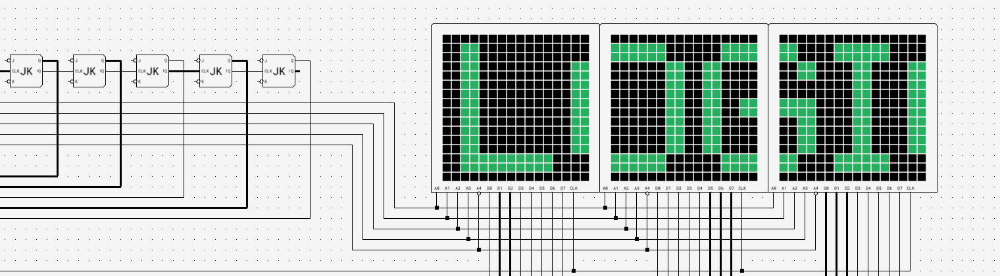

<p align="center">
  <a href="https://logigator.com">
    <picture>
      <source media="(prefers-color-scheme: dark)" srcset="logigator-web/src/assets/logo-on-dark.svg" />
      
    </picture>
  </a>
</p>

<p align="center">
  <strong>Build, simulate and share logic circuits, right in your browser.</strong><br />
  From your first AND gate to a CPU you designed yourself.
</p>

<p align="center">
  <a href="https://logigator.com"><strong>Open Logigator</strong></a> ·
  <a href="https://logigator.com/en/docs">Documentation</a> ·
  <a href="CHANGELOG.md">Changelog</a>
</p>

<p align="center">
  <a href="https://github.com/logigator/logigator/actions?query=workflow%3A%22CI+logigator-editor%22"></a>
  <a href="https://github.com/logigator/logigator/actions?query=workflow%3A%22CI+logigator-web%22"></a>
  <a href="https://github.com/logigator/logigator/actions?query=workflow%3A%22CI+logigator-api%22"></a>
  <a href="LICENSE"></a>
</p>

<p align="center">
  <picture>
    <source media="(prefers-color-scheme: dark)" srcset=".github/readme/hero-dark.webp" />
    
  </picture>
</p>

## What is Logigator?

Logigator is a digital logic editor and simulator that runs in the browser. Place gates on an
endless board, draw wires between them, press **Start simulation** and watch the signals flow.
Nothing to install, no account needed to start, and it works on a phone or tablet as well as on a
desktop.

It's made for students learning how a computer works from the gate up, for teachers who want
circuits their class can open with one link, and for anyone who enjoys building things out of
ones and zeros.

## Highlights

- **A fast, smooth editor.** Pan and zoom freely, select, rotate, copy and paste whole sections,
  undo anything. Large boards stay smooth because the canvas renders on the GPU.
- **Real simulation, at real speed.** The circuit is compiled and run by a WebAssembly engine in a
  background thread: step frame by frame, pick a speed of up to 10 MHz, or run as fast as your
  machine allows. Wires carrying conflicting signals light up orange the moment it happens.
- **Your own components.** Turn any circuit into a reusable component with its own ports, nest
  components inside components, and look inside a running one to see what it's doing.
- **Things to play with.** Switches, buttons, clocks and random numbers on the way in; LEDs, LED
  matrices, seven-segment displays and a terminal on the way out. Type on a keyboard component, or
  play your circuit with an on-screen controller or a real gamepad.
- **Memory you can see.** ROM and RAM with a hex editor, and a live view of RAM that follows the
  address being read.
- **Save, share, discover.** Keep projects in your browser, in a file or in the cloud. Share a link
  that opens straight into the circuit, or publish it to the community, where others can star it
  and save their own copy.
- **Help built in.** A hands-on tutorial, tips when you need them, a full reference for every
  component, and the whole interface in English, German, French and Spanish.

Try it at **[logigator.com](https://logigator.com)**, or start from one of the examples there:
adders, counters, flip-flops, a traffic light, a dice and more.

## Running it locally

The development stack runs entirely in Docker, so the only thing you need on your machine is
[Docker](https://docs.docker.com/engine/install/) with the Compose plugin.

**1. Clone the repository**

```sh
git clone https://github.com/logigator/logigator.git
cd logigator
```

**2. Point `logigator.test` at your machine**

Add this line to `/etc/hosts` (Linux and macOS) or `C:\Windows\System32\drivers\etc\hosts`
(Windows):

```
127.0.0.1 logigator.test
```

**3. Start the stack**

```sh
docker compose up
```

The first start installs the dependencies and takes a few minutes. Then open
**<https://logigator.test>**:

| Address                          | What you get                               |
| -------------------------------- | ------------------------------------------ |
| `https://logigator.test/`        | The website: community, docs, your account |
| `https://logigator.test/editor/` | The editor                                 |
| `https://logigator.test/api/`    | The API                                    |

The certificate comes from Caddy's local certificate authority, so your browser warns about it the
first time. Accept the warning, or trust the CA once to get rid of it for good:

```sh
docker compose cp edge:/data/caddy/pki/authorities/local/root.crt ./caddy-root.crt
# then import caddy-root.crt into your system or browser trust store
```

Every app reloads as you edit its source, and the API restarts on its own.

**Good to know**

- **Accounts work without a mail server.** In development, mails aren't sent; the API prints them
  to its log, confirmation link included (`docker compose logs -f api`).
- **Load the example circuits** into your local community:

  ```sh
  docker compose exec api yarn workspace logigator-api run db:seed-examples
  ```

- **Configuration is optional.** Every API setting has a default that suits the dev stack. To change
  one, copy `logigator-api/.env.example` to `logigator-api/.env` and edit it.
- **Your data lives in `data/`**: the Postgres database and uploaded files. Delete the folder for a
  fresh start.
- Postgres (`localhost:5432`, user, password and database `logigator`) and Redis
  (`localhost:6379`) are published on localhost, so you can connect your own tools.

## Working on the code

Logigator is one Yarn workspace. Run commands inside a container, from the repository root:

```sh
docker compose exec editor yarn <command>
```

| Command                                 | What it does                                          |
| --------------------------------------- | ----------------------------------------------------- |
| `yarn test`                             | Every package's tests                                 |
| `yarn test:editor` (or `:web`, `:api`…) | One package's tests                                   |
| `yarn lint` / `yarn lint:fix`           | ESLint over everything                                |
| `yarn typecheck`                        | TypeScript over the packages without an Angular build |
| `yarn format` / `yarn format:fix`       | Prettier over the whole repository                    |
| `yarn build`                            | Production builds of the editor, website and API      |

A bare command runs for every package; `<command>:<package>` runs for one.

### How it fits together

| Folder                | What it is                                                                 |
| --------------------- | -------------------------------------------------------------------------- |
| `logigator-editor/`   | The editor: Angular with a PixiJS canvas and a WebAssembly simulator       |
| `logigator-web/`      | The website, server-rendered with Angular SSR                              |
| `logigator-api/`      | The API: NestJS on Fastify, PostgreSQL through Drizzle, Redis for sessions |
| `logigator-ui/`       | `@logigator/ui`, the component library both apps are built from            |
| `logigator-core/`     | `@logigator/core`, the circuit model and file format, shared by every app  |
| `logigator-contract/` | `@logigator/contract`, the API's requests and responses as zod schemas     |
| `logigator-docs/`     | `@logigator/docs`, the user documentation in four languages                |

The four libraries are never built on their own: each app compiles their source directly, so a
change to shared code shows up everywhere at once. In development and production alike, one Caddy
server puts the website at the root, the editor under `/editor` and the API under `/api`.

To go deeper, [`CLAUDE.md`](CLAUDE.md) maps the repository and the rules that span it, and
[`logigator-editor/docs/`](logigator-editor/docs) explains each part of the editor.

## Contributing

Bug reports, ideas, translations and pull requests are welcome; [`CONTRIBUTING.md`](CONTRIBUTING.md)
explains how. Security issues go through [`SECURITY.md`](SECURITY.md), never a public issue.

## License

Logigator is free software under the
[GNU Affero General Public License v3.0](LICENSE).
