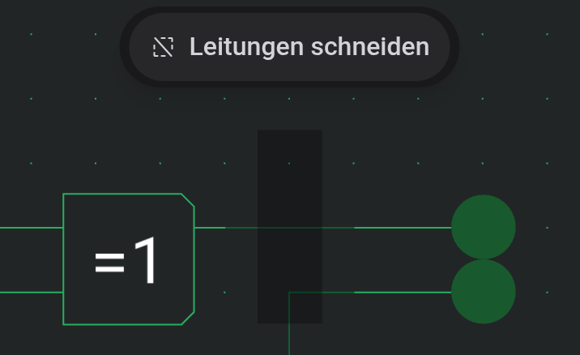

# Arbeitsfläche und Werkzeuge

Die Arbeitsfläche ist das Raster, auf dem du baust. Komponenten und Leitungen rasten darauf ein, und die Statusleiste unten zeigt die Rasterposition unter dem Cursor.

## Bewegen {#moving-around}

Das Mausrad und ein Wischen mit zwei Fingern auf dem Trackpad verschieben die Arbeitsfläche; mit gedrücktem `Shift` scrollt das Mausrad seitwärts. Zum Zoomen an der Zeigerposition hältst du beim Scrollen `Ctrl` (`⌘` auf dem Mac) gedrückt oder ziehst auf dem Trackpad zwei Finger auseinander. Die Zoom-Schaltflächen in der Werkzeugleiste und Ansicht → Einzoomen, Auszoomen und Zoom 100% zoomen in festen Stufen.

Die Ansicht verschiebst du auch, indem du mit der mittleren Maustaste ziehst, oder mit der linken, während du `Space` hältst. Das funktioniert in jedem Werkzeug. Ist das Werkzeug „Schwenken“ aktiv, verschiebt Ziehen mit der linken Taste auch ohne `Space`.

Die Minimap in der rechten unteren Ecke zeigt die ganze Schaltung mit einem Rahmen um den sichtbaren Ausschnitt. Klicke oder ziehe darin, um die Ansicht dorthin zu bewegen. „Minimap ausblenden“ klappt sie ein, und der Editor merkt sich das.

## Werkzeuge {#tools}

Es ist immer ein Werkzeug aktiv. Jedes hat ein Kürzel mit einer Taste und eine Schaltfläche in der Werkzeugleiste, wobei sich Auswählen und Schwenken eine teilen: Der Pfeil daneben wählt das andere. Der Editor startet mit Auswählen.

| Werkzeug         | Taste | Was Ziehen bewirkt                                                                     |
| ---------------- | ----- | -------------------------------------------------------------------------------------- |
| Auswählen        | `S`   | Zieht einen Auswahlrahmen auf, oder verschiebt die Auswahl, wenn du in ihr beginnst    |
| Schwenken        | `P`   | Verschiebt die Ansicht, und sonst nichts                                               |
| Leitungswerkzeug | `W`   | Zeichnet eine Leitung (siehe [Leitungen und Verbindungen](docs:wires-and-connections)) |
| Radiergummi      | `E`   | Löscht alles, worüber es fährt                                                         |
| Text             | `T`   | Setzt eine Textbeschriftung (ein Klick genügt)                                         |

Ein Klick ohne Ziehen wählt in Auswählen und im Leitungswerkzeug das Element unter dem Zeiger aus. Das Leitungswerkzeug prüft vorher, ob du einen Anschluss oder eine Leitungskreuzung getroffen hast, denn ein Tippen darauf negiert oder verbindet stattdessen.

## Komponenten platzieren {#placing-components}

Klicke eine Komponente in der Palette an, und sie folgt dem Cursor als Vorschau. Ein Klick auf die Arbeitsfläche setzt sie ab. Die Vorschau bleibt danach am Cursor, sodass du mehrere hintereinander setzen kannst. `R` und `Shift+R` drehen die Vorschau vor dem Absetzen, und die nächste Komponente behält diese Richtung.

Wo die Vorschau eine andere Komponente überlappt, wird nichts platziert. Mit `Escape` oder einem anderen Werkzeug hörst du auf zu platzieren.

## Auswählen und verschieben {#selecting-and-moving}

Ziehe mit „Auswählen“ einen Rahmen über die gewünschten Elemente. Jede Komponente und jede Leitung, die der Rahmen berührt, wird ausgewählt. Halte `Ctrl` (`⌘` auf dem Mac), um die Auswahl zu ändern statt sie zu ersetzen: Ein Klick fügt ein Element hinzu oder entfernt es, ein Rahmen fügt hinzu, was er abdeckt. Das funktioniert auch im Leitungswerkzeug.

Ziehe die Auswahl, um sie zu verschieben. `R` dreht sie im Uhrzeigersinn, `Shift+R` dagegen, und die Pfeiltasten verschieben sie um einen Rasterschritt. Landet die Auswahl auf etwas anderem, bleibt sie angehoben und folgt deinen nächsten Bewegungen, bis sie auf einem freien Platz liegt.

`Escape` wirkt in Stufen. Jeder Druck tut das Erste davon, was zutrifft:

1. Bricht ein laufendes Ziehen ab.
2. Hebt die Auswahl auf.
3. Wechselt zu Auswählen.

## Leitungen an der Auswahlkante schneiden {#cutting-wires-at-the-selection-edge}

Normalerweise erfasst ein Auswahlrahmen ganze Leitungen. Im Schneidemodus schneidet er jede Leitung, die seine Kante kreuzt, und wählt nur die Stücke innerhalb aus. So hebst du einen Abschnitt aus der Mitte eines Busses heraus.

Solange „Auswählen“ aktiv ist, schwebt oben auf der Arbeitsfläche die Schaltfläche „Leitungen schneiden“, die den Modus ein- und ausschaltet. Mit Tastatur kannst du auch `Alt` gedrückt halten, während du den Rahmen loslässt, um nur dieses eine Mal zu schneiden.

## Kopieren, Einfügen und Löschen {#copy-paste-and-delete}

Kopieren (`Ctrl+C`), Ausschneiden (`Ctrl+X`), Einfügen (`Ctrl+V`) und Löschen (`Delete`) findest du in der Werkzeugleiste und im Menü Bearbeiten. Eingefügte Elemente erscheinen als Vorschau unter dem Cursor, oder in der Mitte der Ansicht, wenn der Zeiger nicht über der Arbeitsfläche ist. Ziehe die Vorschau auf einen freien Platz und lass los, um sie abzusetzen. `Escape` oder ein Klick außerhalb der Vorschau bricht ab.

Rückgängig (`Ctrl+Z`) und Wiederholen (`Ctrl+Shift+Z`) gelten für jede Bearbeitung.

## Radieren {#erasing}

Klicke mit dem Radiergummi ein Element an, um es zu löschen, oder ziehe über mehrere. Drückst du `Escape`, bevor du loslässt, kommt alles zurück, was dieses Ziehen gelöscht hat.

## Siehe auch {#see-also}

- [Leitungen und Verbindungen](docs:wires-and-connections): Leitungen zeichnen und Kreuzungen verbinden
- [Komponenten und Optionen](docs:components-and-options): die Bauteile, die du platzierst
- [Smartphones und Tablets](docs:phones-and-tablets): dieselben Werkzeuge in der Touch-Ansicht
- [Tastaturbefehle](docs:shortcuts): die hier verwendeten Tasten ändern
