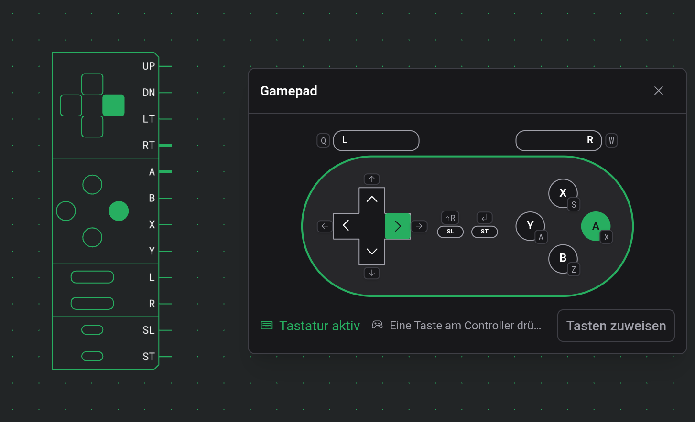
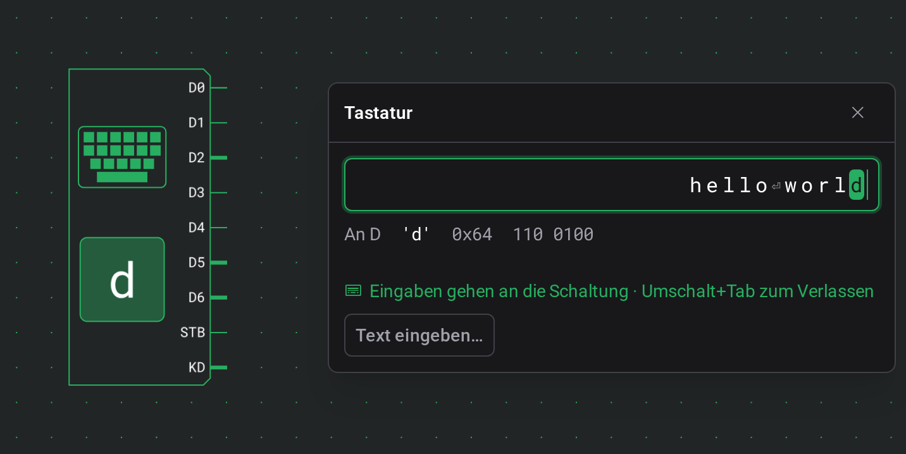

# Eingaben

Eingaben sind die Komponenten, die du während einer Simulation bedienst: Schalter, Taster, ein Gamepad und eine Tastatur. Jede steuert ihre Ausgänge nach dem, was du klickst, drückst oder tippst, und der Rest der Schaltung reagiert.

## Schalter

Ein Schalter wechselt während einer Simulation mit jedem Klick zwischen 0 und 1 und bleibt, wo du ihn lässt. „Stopp“ schaltet ihn wieder aus.

| Anschluss | Richtung | Bedeutung                      |
| --------- | -------- | ------------------------------ |
| Ausgang   | aus      | 1, solange der Schalter an ist |

Außer Richtung hat er keine Optionen.

## Taster

Ein Taster gibt 1 aus, solange du ihn gedrückt hältst.

| Anschluss | Richtung | Bedeutung                          |
| --------- | -------- | ---------------------------------- |
| Ausgang   | aus      | 1, solange der Taster gedrückt ist |

Außer Richtung hat er keine Optionen.

Ein Taster gibt weiter, was gerade gedrückt ist. Klickst du einer langsamen oder pausierten Simulation weit voraus, überspringt er ältere Klicks, dein letzter Klick kommt aber immer an.

## Impulstaster

Ein Impulstaster sendet pro Klick einen Impuls von einem Tick, egal wie lange du ihn hältst.

| Anschluss | Richtung | Bedeutung                  |
| --------- | -------- | -------------------------- |
| Ausgang   | aus      | 1 für einen Tick pro Klick |

Außer Richtung hat er keine Optionen.

Ein Impulstaster überspringt keinen Klick, egal wie weit du der Simulation voraus bist. Jeder Klick kommt als eigener Impuls an.

## Gamepad

Ein Gamepad hat einen Ausgang pro Taste, 1 solange die Taste gedrückt ist. Das Steuerkreuz ist immer da; die anderen Tasten schaltest du in Gruppen ein. Während einer Simulation öffnet ein Klick darauf ein Fenster mit einem Controller zum Spielen.

| Anschluss | Richtung | Bedeutung            |
| --------- | -------- | -------------------- |
| UP        | aus      | Steuerkreuz hoch     |
| DN        | aus      | Steuerkreuz runter   |
| LT        | aus      | Steuerkreuz links    |
| RT        | aus      | Steuerkreuz rechts   |
| A         | aus      | Aktionstaste A       |
| B         | aus      | Aktionstaste B       |
| X         | aus      | Aktionstaste X       |
| Y         | aus      | Aktionstaste Y       |
| L         | aus      | Linke Schultertaste  |
| R         | aus      | Rechte Schultertaste |
| SL        | aus      | Select               |
| ST        | aus      | Start                |

Die Anschlüsse kommen in dieser Reihenfolge, ohne die abgeschalteten Tasten.

| Option         | Werte                                   | Standard |
| -------------- | --------------------------------------- | -------- |
| Aktionstasten  | 0, A, A B, A B X Y                      | A B      |
| Schultertasten | 0, L R                                  | 0        |
| Menütasten     | 0, ST, SL ST                            | SL ST    |
| Tastennamen    | ein Name mit bis zu 8 Zeichen pro Taste | keine    |

Die Standardwerte ergeben acht Ausgänge, mit allen Gruppen sind es zwölf.

Eine Taste, die du im Fenster gedrückt hältst, setzt ihren Ausgang auf 1, bis du loslässt, und leuchtet auch auf der Arbeitsfläche. Gleichzeitig gedrückte Tasten kommen im selben Tick an. Wie ein Taster gibt das Gamepad weiter, was gerade gedrückt ist, und kann deshalb ältere Tastendrücke überspringen, wenn du einer langsamen oder pausierten Simulation weit voraus bist.

Schließt du das Fenster oder verlässt die Simulation, werden alle Tasten losgelassen.

### Tastatur, Maus und Touch

Das Fenster bekommt beim Öffnen die Tastatur, und die Zeile unten zeigt „Tastatur aktiv“. Klickst du auf die Arbeitsfläche oder ein anderes Fenster, steht dort „Hier klicken, um die Tastatur zu nutzen“, und Tastendrücke erreichen das Gamepad nicht mehr. Unter jeder Gamepad-Taste steht die Tastaturtaste dafür.

Solange das Fenster die Tastatur hat:

- gehen die Tasten des Gamepads den Tastaturbefehlen vor, `Enter` drückt also Start und verlässt die Simulation nicht,
- schließt `Escape` weiterhin das Fenster,
- funktionieren Tastaturbefehle mit `Ctrl` oder `Alt` weiter.

Die Standardtasten und wie du sie änderst, stehen unter [Tastaturbefehle](docs:shortcuts#tasten-des-gamepads).

Mit der Maus oder dem Finger bleibt eine Taste gedrückt, solange du sie hältst. Auf einem Touchscreen hält jeder Finger seine eigene Taste. Das Steuerkreuz hat acht Richtungen: Drückst du zwischen zwei Arme, sind beide gedrückt, und wenn du den Daumen weiterschiebst, wechselst du von einer Richtung zur nächsten, ohne abzusetzen. In der Mitte des Steuerkreuzes ist keine Richtung gedrückt.

### Gamecontroller

Auch ein Gamecontroller, der mit deinem Computer verbunden ist, kann ein Gamepad spielen. Der Browser meldet einen Controller erst, nachdem du bei geöffnetem Editor eine seiner Tasten gedrückt hast. Tust du das bei offenem Gamepad-Fenster, wird der Controller mit diesem Fenster verbunden und erscheint unten im Controller-Menü.

Ein Controller spielt sein Gamepad weiter, auch wenn ein anderes Fenster die Tastatur hat. Zwei Controller können zwei Gamepads gleichzeitig spielen, jeder in seinem eigenen Fenster ausgewählt.

Die Tasten werden nach ihrer Lage zugeordnet, egal wie sie beschriftet sind:

| Am Controller                 | Am Gamepad  |
| ----------------------------- | ----------- |
| Rechte Aktionstaste           | A           |
| Untere Aktionstaste           | B           |
| Obere Aktionstaste            | X           |
| Linke Aktionstaste            | Y           |
| Steuerkreuz oder linker Stick | Steuerkreuz |
| LB oder LT                    | L           |
| RB oder RT                    | R           |
| Back oder Share               | Select      |
| Start                         | Start       |

Controller, die der Browser nicht mit der Standardbelegung meldet, stehen in der Liste, lassen sich aber nicht auswählen.

### Tastennamen

Tastennamen in der Einstellungskarte öffnet ein Bild des Controllers mit einem Feld an jeder Taste. Ein Name mit bis zu 8 Zeichen ersetzt auf der Arbeitsfläche die Anschlussbeschriftung der Taste und steht im Controller-Fenster neben der Taste. Ein leeres Feld behält die Standardbeschriftung. Zeichen, die die Arbeitsfläche nicht darstellen kann, fehlen in der Anschlussbeschriftung, und der Dialog weist darauf hin.

Namen von Tasten, die du abschaltest, bleiben erhalten und sind wieder da, wenn du die Tasten wieder einschaltest.

### Gamepads in Beobachtungen und in der Touch-Ansicht

Ein Gamepad in einer benutzerdefinierten Komponente spielst du aus einer [Beobachtung](docs:inspection#beobachtungen) heraus. Der Titel seines Fensters zeigt den Pfad, etwa Outer › Inner › Gamepad.

In der Touch-Ansicht öffnet sich der Controller in der Leiste am unteren Bildschirmrand. Die Tastenbeschriftungen erscheinen dort, sobald du eine Taste auf einer Tastatur drückst, und das Controller-Menü, sobald ein Controller verbunden ist.

## Tastatur

Eine Tastatur legt den Code jeder Taste, die du drückst, an ihre Ausgänge. Während einer Simulation öffnet ein Klick darauf ein Fenster zum Tippen. Das Kästchen auf ihrem Gehäuse zeigt das Zeichen an D und leuchtet, solange KD 1 ist.

| Anschluss | Richtung | Bedeutung                                                                      |
| --------- | -------- | ------------------------------------------------------------------------------ |
| D0 bis D7 | aus      | Der 8-Bit-Latin-1-Code der zuletzt gedrückten Taste, D0 ist das niedrigste Bit |
| STB       | aus      | Ein Impuls von einem Tick bei jedem Tastendruck                                |
| KD        | aus      | 1, solange eine Taste gehalten wird                                            |

Außer Richtung hat sie keine Optionen.

### Das Fenster der Tastatur

Das Fenster hat oben ein Eingabefeld. Solange das Feld den Fokus hat, gehen die Tasten, die du drückst, an die Schaltung.

- Das Feld zeigt die letzten 64 gesendeten Zeichen, das neueste rechts, und hebt das Zeichen an D hervor, solange eine Taste gehalten wird.
- Darunter zeigt „An D“ den Code, den die Schaltung gerade bekommt: das Zeichen, sein Hex-Wert und seine 8 Bits.
- Die Zeile darunter lautet „Eingaben gehen an die Schaltung · Umschalt+Tab zum Verlassen“, solange das Feld den Fokus hat. Klickst du woanders hin, steht dort „Hier klicken, um zu tippen“, und Tasten erreichen die Tastatur erst wieder, wenn du ins Fenster klickst.

Welche Tasten an die Schaltung gehen statt an den Editor, steht unter [Tastaturbefehle](docs:shortcuts#tasten-im-fenster-einer-tastatur).

### Was ein Tastendruck bewirkt

Eine Taste, die du drückst, legt ihren Code an D0 bis D7 an, gibt an STB einen Impuls von einem Tick aus und setzt KD auf 1. Eine Taste, die du drückst und loslässt, braucht wie jedes Zeichen eines eingefügten Texts vier Ticks:

| Tick | D0 bis D7 | STB | KD  |
| ---- | --------- | --- | --- |
| 1    | der Code  | 0   | 1   |
| 2    | der Code  | 1   | 1   |
| 3    | der Code  | 0   | 1   |
| 4    | der Code  | 0   | 0   |

STB geht einen Tick nach dem Code auf 1 und einen Tick, bevor KD auf 0 geht, zurück auf 0. So liest eine Schaltung, die D bei steigendem STB speichert, jedes Zeichen richtig, auch wenn auf dem Weg von D ein Gatter mehr liegt als auf dem von STB oder umgekehrt.

Eine Taste, die du hältst, lässt KD nach Tick 3 auf 1, bis du loslässt. D behält den Code, nachdem KD auf 0 gegangen ist, bis die nächste Taste ihn ersetzt.

- Eine gehaltene Taste wiederholt sich nicht, STB gibt also pro Tastendruck einen Impuls aus.
- Drückst du eine zweite Taste, bevor du die erste loslässt, liegt der Code der zweiten an D an, mit einem neuen Impuls an STB. KD bleibt 1, bis du beide losgelassen hast.
- Soll eine Schaltung eine gehaltene Taste wiederholen, kann sie einen Taktgeber laufen lassen, solange KD 1 ist.
- Zählt eine Schaltung Tastendrücke, kann sie die Impulse an KD zählen.

Schließt du das Fenster, klickst daneben oder wechselst in einen anderen Tab, werden alle gehaltenen Tasten losgelassen. „Stopp“ leert die Zeichen im Feld.

### Zeichencodes

Der Code ist Latin-1: ASCII und dazu die Buchstaben mit Akzent und die Symbole westeuropäischer Sprachen. Druckbare Zeichen, vom Leerzeichen bis `~` und von `0xA0` bis ÿ, werden unverändert gesendet, ä kommt also als `0xE4` an. Das geschützte Leerzeichen (`0xA0`) und der weiche Trennstrich (`0xAD`) erscheinen als NBS und SHY, weil man sie nicht sieht.

Diese Tasten senden Steuerzeichen, die auf der Arbeitsfläche und bei „An D“ mit ihrem Namen erscheinen:

| Taste       | Code   | Angezeigt als |
| ----------- | ------ | ------------- |
| `Enter`     | `0x0A` | LF            |
| `Backspace` | `0x08` | BS            |
| `Tab`       | `0x09` | TAB           |
| `Escape`    | `0x1B` | ESC           |
| `Delete`    | `0x7F` | DEL           |
| `→`         | `0x1C` | RT            |
| `←`         | `0x1D` | LT            |
| `↑`         | `0x1E` | UP            |
| `↓`         | `0x1F` | DN            |
| `Home`      | `0x0B` | HOM           |

Ein [Terminal](docs:outputs#terminal) versteht jedes dieser Steuerzeichen außer ESC. An eine Tastatur angeschlossen, gibt es also aus, was du tippst.

Manche Tasten und Zeichen senden nichts oder etwas anderes:

| Taste oder Zeichen                                                    | Gesendet                                                              |
| --------------------------------------------------------------------- | --------------------------------------------------------------------- |
| Funktionstasten, `End`, `Page Up`, `Page Down`, `Insert`              | nichts                                                                |
| Pfeiltasten und `Home`, solange `Shift` gehalten wird                 | nichts                                                                |
| Typografische Anführungszeichen                                       | `'` und `"`                                                           |
| Lange Striche                                                         | `-`                                                                   |
| …                                                                     | drei Punkte                                                           |
| Andere Zeichen außerhalb von Latin-1, etwa € oder ein Emoji           | übersprungen; die Zeile unten weist ein paar Sekunden lang darauf hin |
| Mit `AltGr` getippte Zeichen, etwa das @ auf einer deutschen Tastatur | das Zeichen                                                           |
| Tastenkombinationen mit `Ctrl`, `Alt` oder `⌘`                        | nichts, sie bleiben dem Browser überlassen                            |

### Eingefügter Text

Eingefügter Text wird Zeichen für Zeichen gesendet. „Text eingeben…“ unten im Fenster öffnet einen Dialog, in dem du einen längeren Text schreiben oder einfügen kannst, etwa ein Programm. Er zeigt vor dem Senden, wie viele Zeichen übersprungen werden.

In einem eingefügten oder gesendeten Text:

- werden Zeilenumbrüche als LF gesendet und Tabulatoren als TAB,
- fallen andere Steuerzeichen weg,
- werden Zeichen außerhalb von Latin-1 übersprungen, wie beim Tippen.

Jedes Zeichen kommt an wie eine Taste, die gedrückt und losgelassen wird, in den vier Ticks unter [Was ein Tastendruck bewirkt](#was-ein-tastendruck-bewirkt), und das nächste folgt im fünften. Nach jedem Zeichen ist KD einen Tick 0, sodass auch ein doppelter Buchstabe als zwei Impulse an KD ankommt.

Solange Zeichen warten, zeigt das Fenster „Sende“ mit der Zahl der übrigen und ein ✕, das den Rest verwirft. Ein Zeichen, dessen Impuls an STB schon begonnen hat, kommt trotzdem noch an, und KD geht auf 0. „Sende“ erscheint auch, wenn du schneller tippst, als die Simulation läuft, etwa bei einer niedrigen festen Geschwindigkeit.

Die Grenzen:

- Ein Einfügen oder ein „Senden“ nimmt bis zu 10.000 Zeichen.
- Höchstens 21.845 Zeichen können gleichzeitig warten.
- Ein Einfügen oder „Senden“, das nicht mehr hinter die schon wartenden Zeichen passt, wird gar nicht gesendet, auch nicht teilweise. Das Fenster oder der Dialog bittet dich stattdessen, auf sie zu warten.

### Einzelschritte bei pausierter Simulation

Ist die Simulation pausiert, warten Tasten auf „Einzelschritt“. Jeder Schritt ist ein Tick der Tabelle unter [Was ein Tastendruck bewirkt](#was-ein-tastendruck-bewirkt):

| Nach Schritt | Was die Schaltung bekommt          |
| ------------ | ---------------------------------- |
| 1            | Das Zeichen an D, KD auf 1         |
| 2            | STB auf 1                          |
| 3            | STB auf 0                          |
| 4            | KD auf 0, das Zeichen bleibt an D  |
| 5            | Das nächste Zeichen an D, KD auf 1 |

Ein eingefügter Text braucht also vier Schritte pro Zeichen.

### Tastaturen in Beobachtungen und in der Touch-Ansicht

In eine Tastatur in einer benutzerdefinierten Komponente tippst du aus einer [Beobachtung](docs:inspection#beobachtungen) heraus. Der Titel ihres Fensters zeigt den Pfad, wie bei einem Gamepad.

Auf einem Smartphone oder Tablet öffnet sich das Fenster in der Leiste am unteren Bildschirmrand (siehe [Smartphones und Tablets](docs:phones-and-tablets#simulation-und-inspektion)).

## Siehe auch

- [Simulation](docs:simulation): eine Schaltung laufen lassen, pausieren und schrittweise durchgehen
- [Ausgaben](docs:outputs): LEDs, Anzeigen und das Terminal
- [Tastaturbefehle](docs:shortcuts): die Tasten des Gamepads und die Tasten im Fenster einer Tastatur
- [Inspektion und Beobachtungen](docs:inspection): Eingaben in einer benutzerdefinierten Komponente bedienen
