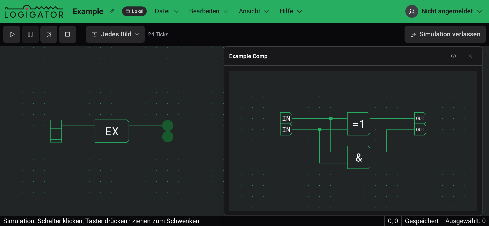
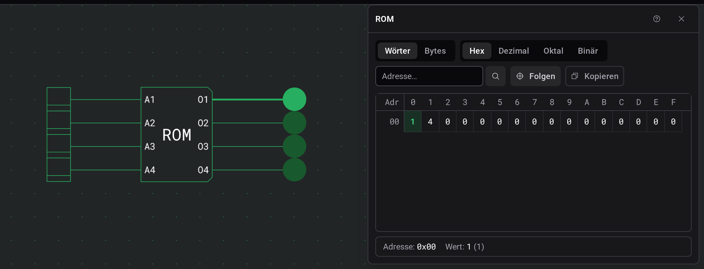
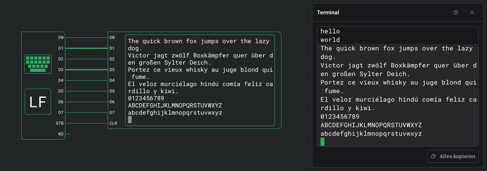

# Inspektion und Beobachtungen

Während einer [Simulation](docs:simulation), ob laufend oder pausiert, lassen sich vier Arten von Komponenten öffnen, um hineinzusehen. Ein Klick auf ein ROM zeigt seinen Inhalt, das gerade gelesene Wort hervorgehoben, ein Klick auf ein RAM zeigt, was es speichert, während die Schaltung hineinschreibt, und ein Klick auf ein Terminal zeigt alles, was es ausgegeben hat. Ein Klick auf eine benutzerdefinierte Komponente öffnet eine Beobachtung, eine Live-Ansicht ihrer inneren Schaltung.

Am Desktop öffnet sich jede Ansicht als Fenster, das du verschieben und in der Größe ändern kannst. Ein erneuter Klick auf die Komponente holt ihr Fenster nach vorn. In der [Touch-Ansicht](docs:phones-and-tablets#simulation-und-inspektion) teilen sich ROM-, RAM- und Terminal-Ansichten eine Leiste am unteren Bildschirmrand, und eine Beobachtung füllt den ganzen Bildschirm. Verlässt du die Simulation, schließen sich alle.

## ROM-Inhalt

Die Ansicht ist schreibgeschützt; den Inhalt änderst du beim Bearbeiten in den [Einstellungen des ROM](docs:memory#rom). Das Wort an der aktuellen Adresse ist hervorgehoben, und mit „Folgen“ (standardmäßig an) scrollt die Tabelle mit, wenn sich die Adresse ändert. Die Zeile unten zeigt Adresse und Wert der hervorgehobenen Zelle. Ein Klick auf eine andere Zelle zeigt stattdessen diese, bis sich die Adresse das nächste Mal ändert.

Die Schaltflächen über der Tabelle wählen Wörter oder Bytes und das Zahlensystem: Hex, Dezimal, Oktal oder Binär. Um zu einer Adresse zu springen, tippe sie hexadezimal in das Feld „Adresse…“. „Kopieren“ legt die ganze Tabelle als Text in die Zwischenablage, in der gewählten Ansicht und Basis.

## RAM-Inhalt

Die Ansicht eines RAM hat dieselbe Tabelle, dieselben Schaltflächen und „Folgen“ wie die eines ROM, das Wort an der Adresse an seinen Eingängen hervorgehoben. Sie zeigt, was die Schaltung gespeichert hat, und ändert sich, während die Schaltung schreibt, ob laufend oder schrittweise. Auch sie ist schreibgeschützt: In ein RAM schreibt nur die Schaltung. Beim Start der Simulation ist jedes Wort 0, und „Stopp“ setzt alle wieder auf 0.

Ein großes RAM wird nur rund um die sichtbaren Zeilen gelesen. Eine Zeile, die ins Bild scrollt, zeigt Punkte, bis sie gelesen ist, was einen Moment dauert, und die Zeile unten zeigt für eine solche Zelle „Nicht geladen“. „Kopieren“ legt die Tabelle so in die Zwischenablage, wie du sie siehst, Punkte eingeschlossen.

## Terminal-Ausgabe

Das Fenster eines Terminals zeigt den Verlauf, die älteste Zeile zuerst, und darunter den Bildschirm auf einem getönten Band mit dem Cursor. Text erscheint, sobald die Schaltung ihn ausgibt, ob laufend oder schrittweise. Was jeder Code bewirkt, steht unter [Terminal](docs:outputs#terminal).

Zeilen brechen an den Spalten des Terminals um, wie auf seinem Bildschirm, ein schmaleres oder breiteres Fenster bricht sie also nicht neu um. Wird das Fenster schmaler, wird der Text kleiner, bis zu einer Mindestgröße. Danach lässt sich das Fenster seitlich scrollen. „Alles kopieren“ legt den Verlauf und den Bildschirm als Text in die Zwischenablage.

Ein Terminal auf der Arbeitsfläche wird ab dem Start der Simulation gelesen, sein Fenster zeigt also den ganzen Text, auch wenn du es spät öffnest. „Stopp“ leert das Fenster ebenso wie den Bildschirm des Terminals.

Die Simulation hält für jedes Terminal die letzten 65.536 Zeichen, die es bekommen hat. Schickt eine Schaltung zwischen zwei Bildaufbauten mehr, etwa bei „So schnell wie möglich“:

- erreichen die ältesten davon das Terminal nie,
- sagt eine Zeile im Verlauf, wie viele Zeichen verloren gingen,
- macht der Bildschirm mit den Zeichen weiter, die danach kamen.

## Beobachtungen

Eine Beobachtung zeichnet die innere Schaltung der Komponente mit denselben leuchtenden Leitungen wie die Arbeitsfläche. Du kannst darin verschieben und zoomen und die Schalter und Taster darin bedienen. Sie steuern die echte Simulation, also reagiert auch der Rest der Schaltung.

Ein Klick auf eine Komponente innerhalb einer Beobachtung öffnet:

| Komponente                         | Was sich öffnet                                                                                                                            |
| ---------------------------------- | ------------------------------------------------------------------------------------------------------------------------------------------ |
| Eine benutzerdefinierte Komponente | Ihre Schaltung, im selben Fenster. Der Titel zeigt den Pfad, etwa Outer › Inner. Klicke auf einen früheren Namen, um wieder hinaufzugehen. |
| Ein ROM, ein RAM oder ein Terminal | Seine eigene Ansicht.                                                                                                                      |
| Ein Gamepad oder eine Tastatur     | Das Fenster, dessen Titel den Pfad zeigt, etwa Outer › Inner › Gamepad.                                                                    |

Ein Terminal in einer Beobachtung zeigt dort auch seinen Bildschirm: Öffnest du seine Ebene, spielt es die Zeichen ab, die die Simulation von ihm noch hält, und zeigt so, was ausgegeben wurde, bevor du hingesehen hast.

Das Fenster eines Gamepads oder einer Tastatur funktioniert wie auf der Arbeitsfläche (siehe [Gamepad](docs:inputs#gamepad) und [Tastatur](docs:inputs#tastatur)), und was du dort drückst, erreicht die Komponente in der Beobachtung. Gehst du über ihre Ebene hinaus nach oben oder schließt die Beobachtung, schließt sich auch dieses Fenster.

Meldet die Beobachtung, dass die innere Schaltung nicht zur kompilierten Simulation passt, wurde die Komponente nach dem Start der Simulation geändert. Verlasse die Simulation und starte sie neu.

## Siehe auch

- [Simulation](docs:simulation): eine Schaltung laufen lassen
- [Benutzerdefinierte Komponenten](docs:custom-components): die Komponenten bauen, die du beobachtest
- [Speicher](docs:memory): Optionen von ROM und RAM, den Inhalt eines ROM bearbeiten
- [Ausgaben](docs:outputs): die Optionen des Terminals und was es mit jedem Code macht
