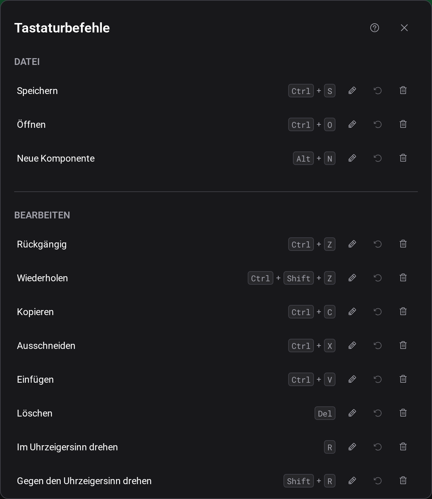

# Tastaturbefehle

Das sind die Standardbelegungen, in der Reihenfolge, in der Bearbeiten → Tastaturbefehle sie auflistet. Auf dem Mac funktioniert `⌘` überall, wo die Tabelle `Ctrl` nennt, und `Ctrl` funktioniert ebenfalls.

## Standardbelegung

| Aktion                                                 | Standard       |
| ------------------------------------------------------ | -------------- |
| Speichern                                              | `Ctrl+S`       |
| Öffnen                                                 | `Ctrl+O`       |
| Neue Komponente                                        | `Alt+N`        |
| Rückgängig                                             | `Ctrl+Z`       |
| Wiederholen                                            | `Ctrl+Shift+Z` |
| Kopieren                                               | `Ctrl+C`       |
| Ausschneiden                                           | `Ctrl+X`       |
| Einfügen                                               | `Ctrl+V`       |
| Löschen                                                | `Delete`       |
| Im Uhrzeigersinn drehen                                | `R`            |
| Gegen den Uhrzeigersinn drehen                         | `Shift+R`      |
| Auswahl nach oben / unten / links / rechts verschieben | Pfeiltasten    |
| Einzoomen                                              | `Ctrl++`       |
| Auszoomen                                              | `Ctrl+-`       |
| Zoom 100%                                              | `Ctrl+0`       |
| Schwenken                                              | `P`            |
| Leitungswerkzeug                                       | `W`            |
| Auswählen                                              | `S`            |
| Radieren                                               | `E`            |
| Text platzieren                                        | `T`            |
| Leitungen an der Auswahlkante schneiden (halten)       | `Alt`          |
| Zur Auswahl hinzufügen oder daraus entfernen (halten)  | `Ctrl`         |
| Simulation starten/stoppen                             | `Enter`        |
| Abbrechen                                              | `Escape`       |

Während du in ein Textfeld tippst, reagiert kein Kürzel außer `Escape`. In einer Simulation sind die Bearbeitungskürzel abgeschaltet, und `Escape` verlässt die Simulation.

## Gehaltene Tasten

Die beiden mit „halten“ markierten Aktionen wirken, solange die Taste gedrückt ist, statt einmal auszulösen. Halte `Alt`, während du einen Auswahlrahmen loslässt, um die Leitungen an seiner Kante zu schneiden (siehe [Arbeitsfläche und Werkzeuge](docs:board-and-tools#leitungen-an-der-auswahlkante-schneiden)). Halte `Ctrl` beim Klicken oder Aufziehen eines Rahmens, um zur Auswahl hinzuzufügen oder daraus zu entfernen. Das funktioniert mit Auswählen, Schwenken und dem Leitungswerkzeug.

## Eine Belegung ändern

Bearbeiten → Tastaturbefehle listet jede Aktion. Klicke auf den Stift daneben und drücke die neue Kombination. `Escape` bricht die Aufzeichnung ab und lässt sich deshalb nicht anders belegen. Eine einzelne Modifikatortaste wie `Alt` kann nur einer der beiden Halte-Aktionen zugewiesen werden.

Gehört die Kombination schon zu einer anderen Aktion, verliert diese sie, und eine Meldung nennt sie. „Zurücksetzen“ stellt die Standardbelegung einer Aktion wieder her, „Zuweisung aufheben“ lässt sie ohne Kürzel, und „Alle zurücksetzen“ stellt alle Standardbelegungen wieder her.

Deine Belegungen werden in diesem Browser gespeichert. Löschst du die Website-Daten, gelten wieder die Standardwerte.

## Tasten des Gamepads

Ein [Gamepad](docs:inputs#gamepad) hat eigene Tasten, getrennt von den Tastaturbefehlen oben. Sie wirken, solange sein Controller-Fenster die Tastatur hat, und gehen dort den Tastaturbefehlen vor: `Enter` drückt Start.

| Gamepad-Taste                  | Standard       |
| ------------------------------ | -------------- |
| Hoch / Runter / Links / Rechts | Pfeiltasten    |
| A                              | `X`            |
| B                              | `Y`            |
| X                              | `S`            |
| Y                              | `A`            |
| L                              | `Q`            |
| R                              | `W`            |
| Select                         | `Shift` rechts |
| Start                          | `Enter`        |

Es zählt die Lage einer Taste auf der Tastatur. Die Tabelle nennt sie, wie sie auf einer deutschen Tastatur beschriftet sind; auf einer US-Tastatur liegt B zum Beispiel auf Z. Chrome und Edge zeigen im Fenster die Beschriftung deiner Tastatur, andere Browser die einer US-Tastatur.

So änderst du die Tasten:

1. Klicke unten in einem Gamepad-Fenster auf „Tasten zuweisen“.
2. Klicke auf eine Gamepad-Taste und drücke dann die Tastaturtaste, die sie bekommen soll. Hatte eine andere Gamepad-Taste sie schon, tauschen die beiden, und die andere leuchtet kurz auf.
3. Klicke auf „Fertig“, um zum Spielen zurückzukehren.

Während du zuweist, bricht `Escape` ab, und `Backspace` oder `Delete` lässt die Gamepad-Taste ohne Tastaturtaste. `Escape` und `Tab` lassen sich nicht zuweisen. „Standard wiederherstellen“ stellt die Tabelle oben wieder her.

Die Tasten gelten für jedes Gamepad in jedem Projekt und werden wie die Tastaturbefehle in diesem Browser gespeichert. Eine Änderung erscheint sofort in jedem offenen Gamepad-Fenster, auch in anderen Tabs.

## Tasten im Fenster einer Tastatur

Solange das Eingabefeld im [Fenster einer Tastatur](docs:inputs#tastatur) den Fokus hat, gehen Tasten an die Schaltung, und die Tastaturbefehle oben tun nichts. Diese Tasten verhalten sich dort anders:

| Taste       | Im Eingabefeld                          |
| ----------- | --------------------------------------- |
| `Enter`     | Sendet LF. Die Simulation läuft weiter. |
| `Escape`    | Sendet ESC. Das Fenster bleibt offen.   |
| `Tab`       | Sendet TAB. Der Fokus bleibt im Feld.   |
| `Shift+Tab` | Bewegt den Fokus aus dem Feld.          |
| Pfeiltasten | Senden RT, LT, UP und DN.               |

Tastenkombinationen mit `Ctrl`, `Alt` oder `⌘` gehen an den Browser, sodass `Ctrl+V` Text in die Tastatur einfügt. `AltGr` gehört nicht dazu: Ein Zeichen, das du damit tippst, wird gesendet. Eine Taste sendet das Zeichen, das deine Tastaturbelegung ihr gibt, deshalb lassen sich diese Tasten nicht neu zuweisen wie die eines Gamepads.

## Siehe auch

- [Arbeitsfläche und Werkzeuge](docs:board-and-tools): die Werkzeuge und Aktionen hinter diesen Tasten
- [Simulation](docs:simulation): was Enter und Escape dort tun
