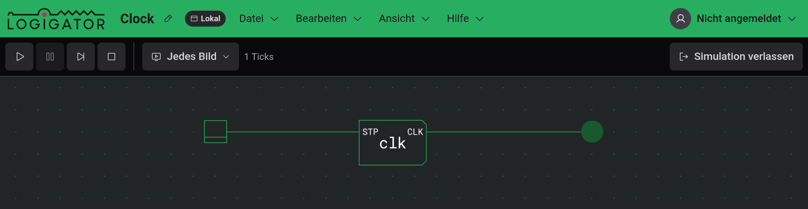
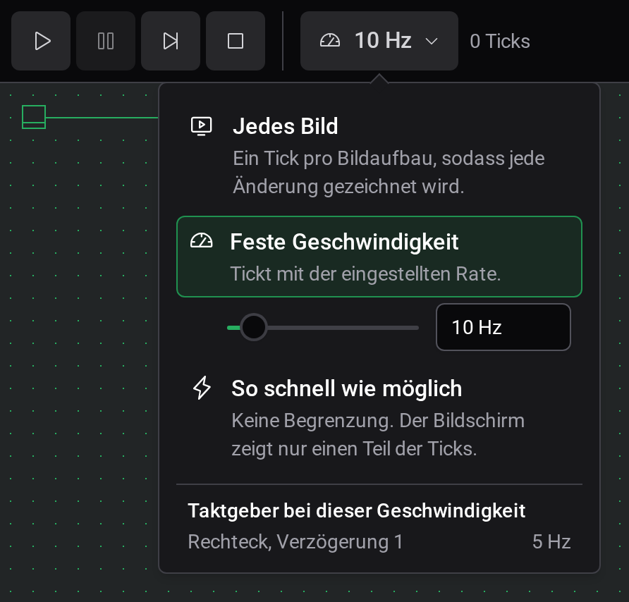

# Simulation

„Simulation starten“ am rechten Ende der Werkzeugleiste setzt die Schaltung unter Strom: Leitungen unter Strom leuchten, LEDs und Anzeigen zeigen ihren Zustand, und Schalter und Taster reagieren auf Klicks. `Enter` tut dasselbe.

## Starten und verlassen

Die Simulation läuft immer mit dem Hauptprojekt. Ist der Tab einer benutzerdefinierten Komponente offen, wechselt der Editor vorher zurück zum Hauptprojekt.

Während sie läuft, ist die Arbeitsfläche gesperrt. Du kannst die Ansicht verschieben und zoomen, Eingaben bedienen und ROMs, RAMs, Terminals und benutzerdefinierte Komponenten [inspizieren](docs:inspection), aber nichts platzieren, verschieben, verdrahten oder löschen. „Simulation verlassen“, `Enter` oder `Escape` führt mit dem Werkzeug Schwenken zurück zum Bearbeiten.

Ist „Simulation automatisch starten“ an (Standard), läuft die Schaltung los, sobald du die Simulation betrittst. Ist die Einstellung aus, wartet sie pausiert bei Tick 0, sodass du von Anfang an schrittweise vorgehen kannst.

## Steuerung

Während einer Simulation ersetzen vier Schaltflächen, die Geschwindigkeits-Schaltfläche und eine Anzeige die Werkzeugleiste.

| Schaltfläche  | Was sie tut                                                                                                   |
| ------------- | ------------------------------------------------------------------------------------------------------------- |
| Start         | Startet die Simulation oder setzt sie fort.                                                                   |
| Pause         | Hält beim aktuellen Tick an und behält den Zustand.                                                           |
| Einzelschritt | Geht einen Tick weiter. Nur im pausierten Zustand verfügbar.                                                  |
| Stopp         | Setzt die Schaltung auf Tick 0 zurück, schaltet alle Schalter aus und pausiert. Du bleibst in der Simulation. |

Die Anzeige zeigt die Ticks seit dem Start und, während die Simulation läuft, die tatsächlich erreichte Geschwindigkeit.

## Geschwindigkeit

Die Geschwindigkeits-Schaltfläche zeigt die aktuelle Einstellung. Ein Klick darauf öffnet ein Feld mit drei Modi, zwischen denen du auch während des Laufs wechseln kannst.

| Modus                  | Was er tut                                                                                                                          |
| ---------------------- | ----------------------------------------------------------------------------------------------------------------------------------- |
| Jedes Bild             | Der Standard. Geht pro Bildaufbau einen Tick weiter, die Geschwindigkeit folgt also der Bildwiederholrate deines Bildschirms.       |
| Feste Geschwindigkeit  | Tickt mit einer Rate, die du einstellst, anfangs 1 kHz. Kommt die Schaltung nicht mit, erscheint neben der Anzeige ein Warnzeichen. |
| So schnell wie möglich | Läuft ohne Begrenzung. Der Bildschirm zeigt dann nur einen Teil der Ticks.                                                          |

Bei fester Geschwindigkeit reicht der Regler von 1 Hz bis 10 MHz. Im Feld daneben kannst du jede Rate ab 0,1 Hz eintippen, etwa `20`, `2,5k` oder `1M`. Ein rotes Feld heißt, dass die Eingabe keine Rate ist, und die letzte gültige gilt weiter.

Unter den Modi listet „Taktgeber bei dieser Geschwindigkeit“ die Frequenz jeder Art von Taktgeber in der Schaltung, nach Signalform und Verzögerung, etwa „Rechteck, Verzögerung 5“. Wie viele Ticks ein Zyklus eines Taktgebers dauert, steht unter [Taktgeber](docs:clock-and-timing#taktgeber). Bei fester Geschwindigkeit steht die Liste sofort da. In den beiden anderen Modi muss die Rate erst gemessen werden, daher erscheint die Liste etwa eine Sekunde, nachdem die Schaltung losgelaufen ist.

## Eingaben bedienen

| Komponente   | Wie du sie bedienst                                                                          | Details                                  |
| ------------ | -------------------------------------------------------------------------------------------- | ---------------------------------------- |
| Schalter     | Klicke darauf. Er wechselt mit jedem Klick und bleibt, wo du ihn lässt.                      | [Schalter](docs:inputs#schalter)         |
| Taster       | Halte ihn gedrückt. Er ist an, solange du ihn hältst.                                        | [Taster](docs:inputs#taster)             |
| Impulstaster | Klicke darauf. Jeder Klick sendet einen Impuls von einem Tick, egal wie lange du ihn hältst. | [Impulstaster](docs:inputs#impulstaster) |
| Gamepad      | Klicke darauf, um seinen Controller zu öffnen, und drücke dort die Tasten.                   | [Gamepad](docs:inputs#gamepad)           |
| Tastatur     | Klicke darauf, um ein Fenster zu öffnen, und tippe hinein.                                   | [Tastatur](docs:inputs#tastatur)         |

Ziehen an jeder anderen Stelle der Arbeitsfläche verschiebt die Ansicht.

## Widersprüchliche Signale

Eine orange gezeichnete Leitung hat einen Konflikt. Das Orange ist ein Hinweis auf deine Schaltung und ändert nichts daran, wie die Simulation läuft.

### Ursachen

- Zwei oder mehr Ausgänge sind an dieselbe Leitung angeschlossen, und in diesem Moment gibt einer 1 aus und ein anderer 0. Ausgänge, die übereinstimmen, werden nicht markiert, das Orange kann also kommen und gehen, wenn sich die Werte ändern. In echter Hardware wäre das ein Kurzschluss.
- Ein SR-Flip-Flop wurde mit S und R gleichzeitig auf 1 getaktet. Q geht auf 1 und !Q auf 0, und beide bleiben orange, bis eine Taktflanke kommt, bei der nur S oder nur R auf 1 ist. In echter Hardware ist das eine Eingangsbelegung, die ein SR-Flip-Flop nicht erlaubt.

### Wirkung auf die Simulation

Die Simulation läuft unverändert weiter: Eine Leitung mit mehreren Ausgängen ist 1, sobald einer davon 1 ist.

Ein Konflikt in einer benutzerdefinierten Komponente erscheint nicht auf der Arbeitsfläche. Klicke auf die Komponente, um eine [Beobachtung](docs:inspection#beobachtungen) zu öffnen, in der ihre Leitungen ihn zeigen.

Schaltest du die Einstellung „Konflikte hervorheben“ ab, die standardmäßig an ist, verschwindet das Orange. Siehe [Einstellungen](docs:settings).

### Abhilfe

| Ursache                           | Abhilfe                                                                                                                                                                                                                                               |
| --------------------------------- | ----------------------------------------------------------------------------------------------------------------------------------------------------------------------------------------------------------------------------------------------------- |
| Mehrere Ausgänge an einer Leitung | Schließe an jede Leitung nur einen Ausgang an. Willst du mehrere Quellen zusammenführen, leite sie durch ein [ODER-Gatter](docs:logic-gates#oder-gatter). Um eine davon auszuwählen, nimm einen [Multiplexer](docs:adders-and-selectors#multiplexer). |
| S und R beide auf 1               | Setze S und R nicht gleichzeitig auf 1, oder nimm stattdessen ein [D- oder JK-Flip-Flop](docs:memory#d-flip-flop).                                                                                                                                    |

## Wenn die Simulation nicht startet

Der Editor startet nicht und zeigt eine Meldung mit der betroffenen Komponente, wenn

- eine benutzerdefinierte Komponente sich selbst enthält, direkt oder über eine andere,
- eine benutzerdefinierte Komponente keine Schaltung enthält,
- die Anschlüsse einer benutzerdefinierten Komponente nicht mehr zu den Eingangs- und Ausgangssteckern in ihrer Schaltung passen.

Behebe das bei der genannten Komponente und starte erneut. Sagt die Meldung, dass die Simulations-Engine nicht starten konnte, unterstützt dein Browser kein WebAssembly.

## Siehe auch

- [Inspektion und Beobachtungen](docs:inspection): ROM- und RAM-Inhalte, Terminal-Ausgabe und Beobachtungen
- [Eingaben](docs:inputs): Schalter, Taster, das Gamepad und die Tastatur
- [Ausgaben](docs:outputs): LEDs, Anzeigen und das Terminal
- [Einstellungen](docs:settings): „Simulation automatisch starten“ und „Konflikte hervorheben“
- [Smartphones und Tablets](docs:phones-and-tablets): die Steuerung in der Touch-Ansicht
