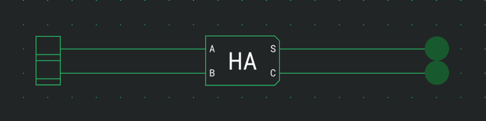
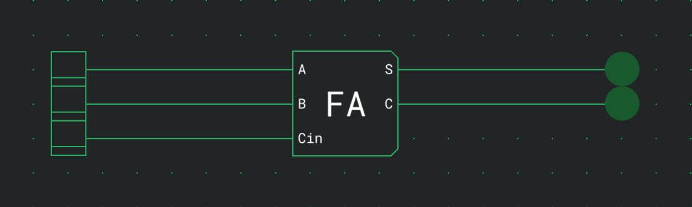
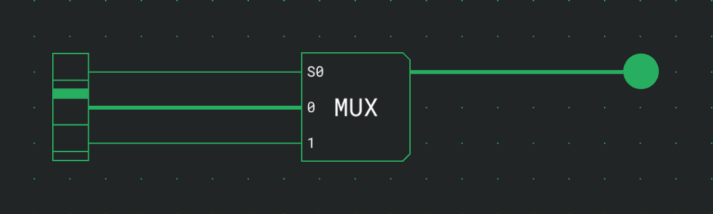
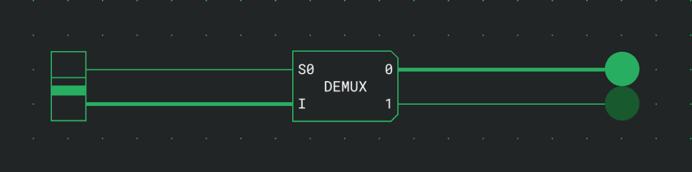
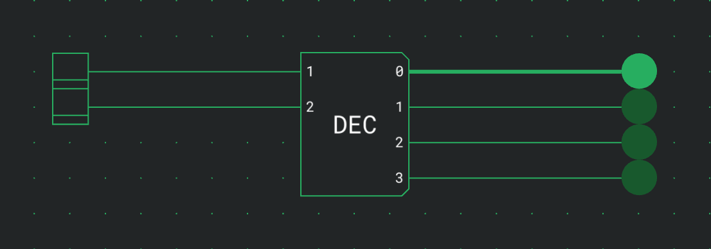
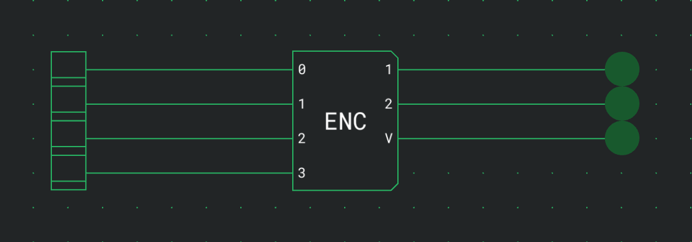

# Adders and selectors

Adders add single bits and produce a sum bit and a carry. Selectors route signals by a binary number: a multiplexer picks one of several inputs, a demultiplexer sends one input to one of several outputs, a decoder turns a number into a single output at 1, and an encoder turns the highest input at 1 back into a number. All six are in the Adders and selectors category of the palette.

## Half Adder {#half-adder}

The half adder adds two bits.

| Port | Direction | Meaning         |
| ---- | --------- | --------------- |
| A    | in        | The first bit.  |
| B    | in        | The second bit. |
| S    | out       | The sum bit.    |
| C    | out       | The carry bit.  |

It has no options besides Direction.

| A   | B   | S   | C   |
| --- | --- | --- | --- |
| 0   | 0   | 0   | 0   |
| 0   | 1   | 1   | 0   |
| 1   | 0   | 1   | 0   |
| 1   | 1   | 0   | 1   |

## Full Adder {#full-adder}

The full adder adds two bits and a carry-in.

| Port | Direction | Meaning                                 |
| ---- | --------- | --------------------------------------- |
| A    | in        | The first bit.                          |
| B    | in        | The second bit.                         |
| Cin  | in        | The carry-in, from the next lower bit.  |
| S    | out       | The sum bit.                            |
| C    | out       | The carry bit, for the next higher bit. |

It has no options besides Direction.

| A   | B   | Cin | S   | C   |
| --- | --- | --- | --- | --- |
| 0   | 0   | 0   | 0   | 0   |
| 0   | 0   | 1   | 1   | 0   |
| 0   | 1   | 0   | 1   | 0   |
| 0   | 1   | 1   | 0   | 1   |
| 1   | 0   | 0   | 1   | 0   |
| 1   | 0   | 1   | 0   | 1   |
| 1   | 1   | 0   | 0   | 1   |
| 1   | 1   | 1   | 1   | 1   |

To add numbers of several bits, use one adder per bit and connect each adder's C to the Cin of the adder for the next higher bit. The lowest bit can use a half adder, since it has no carry-in.

## Multiplexer {#multiplexer}

The multiplexer passes the data input chosen by the select lines to its output. There are 2ⁿ data inputs for n select lines.

| Port       | Direction | Meaning                                    |
| ---------- | --------- | ------------------------------------------ |
| S0, S1, …  | in        | The select lines, S0 being the lowest bit. |
| 0, 1, 2, … | in        | The data inputs.                           |
| Output     | out       | The value of the chosen data input.        |

The output has no label.

| Option       | Values | Default |
| ------------ | ------ | ------- |
| Select lines | 1 to 6 | 1       |

With 2 select lines:

| S1  | S0  | Output  |
| --- | --- | ------- |
| 0   | 0   | Input 0 |
| 0   | 1   | Input 1 |
| 1   | 0   | Input 2 |
| 1   | 1   | Input 3 |

## Demultiplexer {#demultiplexer}

The demultiplexer passes input I to the output chosen by the select lines. Every other output is 0. There are 2ⁿ outputs for n select lines.

| Port       | Direction | Meaning                                    |
| ---------- | --------- | ------------------------------------------ |
| S0, S1, …  | in        | The select lines, S0 being the lowest bit. |
| I          | in        | The data input.                            |
| 0, 1, 2, … | out       | The outputs.                               |

| Option       | Values | Default |
| ------------ | ------ | ------- |
| Select lines | 1 to 6 | 1       |

With 2 select lines:

| S1  | S0  | Output carrying I |
| --- | --- | ----------------- |
| 0   | 0   | 0                 |
| 0   | 1   | 1                 |
| 1   | 0   | 2                 |
| 1   | 1   | 3                 |

The select lines come first, as on the Multiplexer. A demultiplexer from an older circuit keeps I first, before the select lines, and works the same way otherwise. The labels on the component show the order.

## Decoder {#decoder}

The decoder sets the one output whose number is the binary value on its inputs to 1. Every other output is 0. There are 2ⁿ outputs for n inputs.

| Port       | Direction | Meaning                                               |
| ---------- | --------- | ----------------------------------------------------- |
| 1, 2, 4, … | in        | The bits of the number, each labelled with its value. |
| 0, 1, 2, … | out       | One output per number.                                |

| Option | Values | Default |
| ------ | ------ | ------- |
| Inputs | 1 to 6 | 2       |

With 2 inputs:

| 2   | 1   | Output at 1 |
| --- | --- | ----------- |
| 0   | 0   | 0           |
| 0   | 1   | 1           |
| 1   | 0   | 2           |
| 1   | 1   | 3           |

## Encoder {#encoder}

The encoder outputs the number of the highest input that is 1. V is 1 while any input is, so input 0 can be told apart from no input. There are 2ⁿ inputs for n outputs, not counting V.

| Port       | Direction | Meaning                                               |
| ---------- | --------- | ----------------------------------------------------- |
| 0, 1, 2, … | in        | One input per number.                                 |
| 1, 2, 4, … | out       | The bits of the number, each labelled with its value. |
| V          | out       | 1 while any input is 1.                               |

| Option  | Values | Default |
| ------- | ------ | ------- |
| Outputs | 1 to 6 | 1       |

With 2 outputs, where x means the input can be 0 or 1:

| 3   | 2   | 1   | 0   | Output 2 | Output 1 | V   |
| --- | --- | --- | --- | -------- | -------- | --- |
| 0   | 0   | 0   | 0   | 0        | 0        | 0   |
| 0   | 0   | 0   | 1   | 0        | 0        | 1   |
| 0   | 0   | 1   | x   | 0        | 1        | 1   |
| 0   | 1   | x   | x   | 1        | 0        | 1   |
| 1   | x   | x   | x   | 1        | 1        | 1   |

An encoder from an older circuit has no V.

## See also {#see-also}

- [Components and options](docs:components-and-options): the palette and the settings card
- [Logic gates](docs:logic-gates): NOT, AND, OR and XOR
- [Memory](docs:memory): reading words at an address
- [Outputs](docs:outputs): showing a binary number on a segment display
