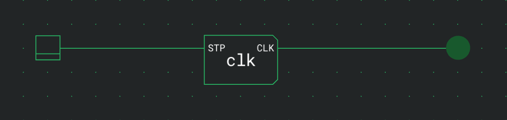
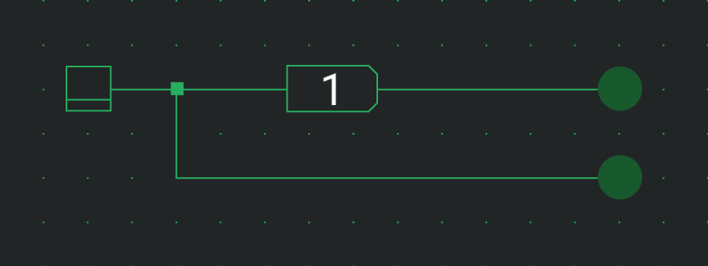
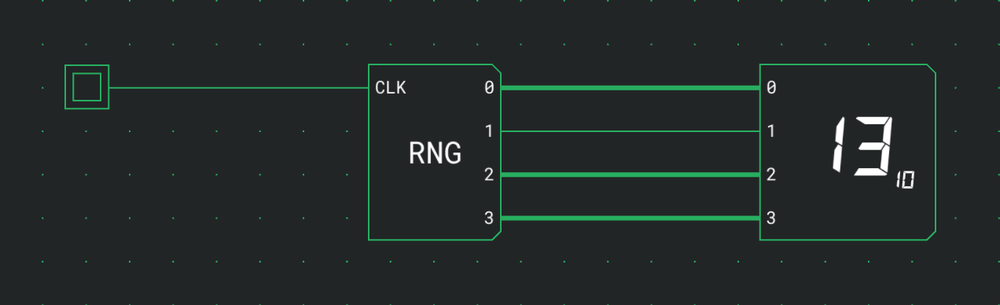

# Timing

These components work with time, counted in simulation ticks. A Clock switches its output on and off by itself, a Delay passes a signal on one tick later, and a Random Number Generator puts new random bits on its outputs when it is clocked.

## Clock

A Clock switches its output between 0 and 1 over and over, at a rate set by its Delay option. Use it to drive counters and anything else that moves in steps.

| Port | Direction | Meaning                                  |
| ---- | --------- | ---------------------------------------- |
| STP  | in        | Stop: holds the clock at 0 while it is 1 |
| CLK  | out       | The clock signal                         |

| Option   | Values             | Default |
| -------- | ------------------ | ------- |
| Waveform | Square, Pulse      | Square  |
| Delay    | 1 to 4,294,967,295 | 1       |

Every cycle starts with the output at 0 for Delay ticks. What follows depends on the waveform:

| Waveform | Output 0 for | Then output 1 for | One cycle takes |
| -------- | ------------ | ----------------- | --------------- |
| Square   | Delay ticks  | Delay ticks       | 2 × Delay ticks |
| Pulse    | Delay ticks  | 1 tick            | Delay + 1 ticks |

Once STP goes back to 0, the clock starts a new cycle from the beginning.

How fast the clock runs in seconds depends on the simulation speed: divide the ticks per second by the ticks per cycle. At a fixed speed of 10 Hz:

| Waveform | Delay | One cycle takes | Frequency |
| -------- | ----- | --------------- | --------- |
| Square   | 1     | 2 ticks         | 5 Hz      |
| Square   | 5     | 10 ticks        | 1 Hz      |
| Pulse    | 4     | 5 ticks         | 2 Hz      |

The speed panel lists these frequencies for every clock in the circuit under Clocks at this speed. See [Speed](docs:simulation#speed).

## Delay

A Delay passes its input through unchanged, one tick later. Like any other component it takes one tick to pass a change on, and that tick is all it adds. A chain of them holds a signal back by one tick each, for example to make two paths through a circuit equally long.

| Port   | Direction | Meaning                       |
| ------ | --------- | ----------------------------- |
| Input  | in        | The signal to pass on         |
| Output | out       | The same signal, a tick later |

It has no options besides Direction.

## Random Number Generator

A Random Number Generator puts a new random value on its outputs on every rising edge of CLK. Between edges, the outputs keep their value.

| Port       | Direction | Meaning                            |
| ---------- | --------- | ---------------------------------- |
| CLK        | in        | Each rising edge makes a new value |
| 0, 1, 2, … | out       | The random bits, one per output    |

| Option  | Values  | Default |
| ------- | ------- | ------- |
| Outputs | 1 to 64 | 1       |

With a [negation bubble](docs:components-and-options#negating-a-port) on CLK, it makes a new value on the falling edge instead.

## See also

- [Simulation](docs:simulation): ticks, run controls and the simulation speed
- [Inputs](docs:inputs): switches and buttons to drive STP or CLK by hand
- [Outputs](docs:outputs): LEDs and displays to show a signal
- [Components and options](docs:components-and-options): the palette and the settings card
