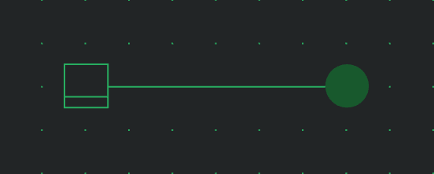
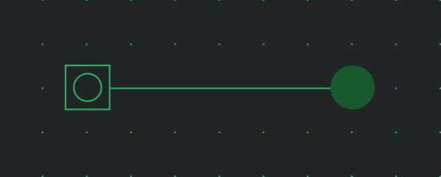
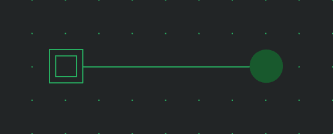
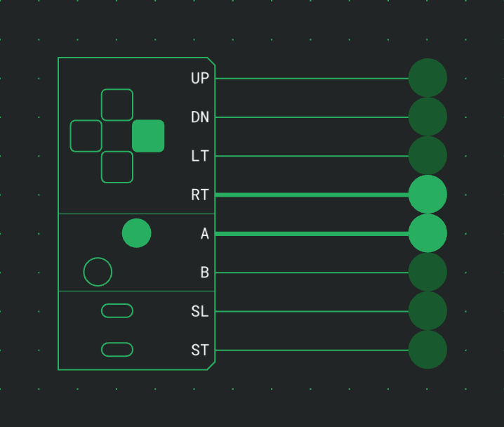
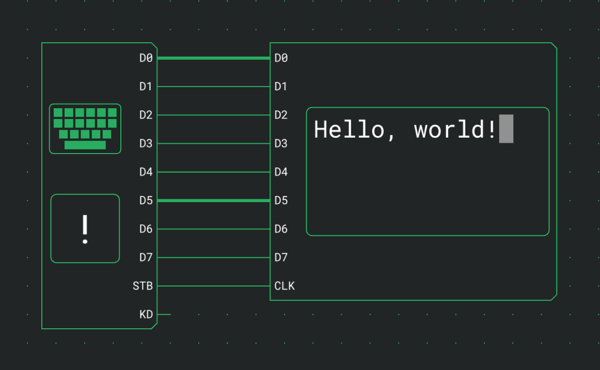

# Inputs

Inputs are the components you operate during a simulation: switches, buttons, a gamepad and a keyboard. Each one drives its outputs from what you click, press or type, and the rest of the circuit reacts.

## Switch

A Switch toggles between 0 and 1 with each click during a simulation and stays where you left it. Stop turns it off again.

| Port   | Direction | Meaning                  |
| ------ | --------- | ------------------------ |
| Output | out       | 1 while the switch is on |

It has no options besides Direction.

## Button

A Button outputs 1 for as long as you hold it down.

| Port   | Direction | Meaning                    |
| ------ | --------- | -------------------------- |
| Output | out       | 1 while the button is held |

It has no options besides Direction.

A Button passes on what is held now. When you click far ahead of a slow or paused simulation, it skips older presses, but your last click always arrives.

## Pulse button

A Pulse button sends a pulse of one tick per click, however long you hold it.

| Port   | Direction | Meaning                  |
| ------ | --------- | ------------------------ |
| Output | out       | 1 for one tick per click |

It has no options besides Direction.

A Pulse button never skips a click, however far ahead of the simulation you are. Each click arrives as its own pulse.

## Gamepad

A Gamepad has one output per button, 1 while the button is held. The D-pad is always there; the other buttons are switched on in groups. During a simulation, clicking it opens a window with a controller to play.

| Port | Direction | Meaning        |
| ---- | --------- | -------------- |
| UP   | out       | D-pad up       |
| DN   | out       | D-pad down     |
| LT   | out       | D-pad left     |
| RT   | out       | D-pad right    |
| A    | out       | Face button A  |
| B    | out       | Face button B  |
| X    | out       | Face button X  |
| Y    | out       | Face button Y  |
| L    | out       | Left shoulder  |
| R    | out       | Right shoulder |
| SL   | out       | Select         |
| ST   | out       | Start          |

The ports come in this order, leaving out the buttons that are switched off.

| Option           | Values                                  | Default |
| ---------------- | --------------------------------------- | ------- |
| Face buttons     | 0, A, A B, A B X Y                      | A B     |
| Shoulder buttons | 0, L R                                  | 0       |
| Menu buttons     | 0, ST, SL ST                            | SL ST   |
| Button names     | a name of up to 8 characters per button | none    |

The defaults give eight outputs; with every group switched on there are twelve.

A button held in the window sets its output to 1 until you let go, and lights up on the board too. Buttons pressed together arrive on the same tick. Like a Button, the gamepad passes on what is held now, so it can skip older presses when you are far ahead of a slow or paused simulation.

Closing the window or leaving the simulation lets go of every button.

### Keyboard, mouse and touch

The window takes the keyboard when it opens, and the line at the bottom reads Keyboard active. After you click the board or another window it reads Click here to use the keyboard, and keys no longer reach the gamepad. The key for each button is shown under it.

While the window has the keyboard:

- a gamepad key comes before a shortcut, so `Enter` presses Start and does not leave the simulation,
- `Escape` still closes the window,
- shortcuts with `Ctrl` or `Alt` still work.

The default keys and how to change them are in [Keyboard shortcuts](docs:shortcuts#gamepad-keys).

With the mouse or a finger, a button stays pressed for as long as you hold it. On a touchscreen, each finger holds its own button. The D-pad has eight directions: pressing between two arms holds both, and sliding your thumb moves from one direction to the next without lifting it. Pressing the centre of the D-pad holds no direction.

### Game controllers

A game controller connected to your computer can play a gamepad as well. The browser reports a controller only after you press one of its buttons while the editor is open. Do that with a gamepad window open, and the controller is connected to that window and appears in the Controller menu at the bottom.

A controller keeps playing its gamepad when another window has the keyboard. Two controllers can play two gamepads at once, each chosen in its own window.

Buttons are matched by position, whatever they are labelled:

| On the controller   | On the gamepad |
| ------------------- | -------------- |
| Right face button   | A              |
| Bottom face button  | B              |
| Top face button     | X              |
| Left face button    | Y              |
| D-pad or left stick | D-pad          |
| LB or LT            | L              |
| RB or RT            | R              |
| Back or Share       | Select         |
| Start               | Start          |

Controllers that the browser doesn't report with the standard layout are listed but can't be chosen.

### Button names

Button names, in the settings card, opens a picture of the controller with a field at each button. A name of up to 8 characters replaces the button's port label on the board and is shown beside the button in the controller window. An empty field keeps the default label. Characters the board can't draw are left out of the port label, and the dialog says so.

Names of buttons you switch off are kept and come back when you switch them on again.

### Gamepads in watches and the touch layout

A gamepad inside a custom component is played from a [watch](docs:inspection#watches). Its window is titled with the path, such as Outer › Inner › Gamepad.

In the touch layout, the controller opens in the sheet at the bottom of the screen. The key labels appear there once you press a key on a keyboard, and the Controller menu once a controller is connected.

## Keyboard

A Keyboard puts the code of each key you press on its outputs. During a simulation, clicking it opens a window to type into. The box on its body shows the character on D and lights up while KD is 1.

| Port     | Direction | Meaning                                                           |
| -------- | --------- | ----------------------------------------------------------------- |
| D0 to D7 | out       | The 8-bit Latin-1 code of the last key pressed, D0 the lowest bit |
| STB      | out       | A one-tick pulse on each key press                                |
| KD       | out       | 1 while a key is held                                             |

It has no options besides Direction.

### The keyboard window

The window has a typing field at the top. While the field has the focus, the keys you press go to the circuit.

- The field shows the last 64 characters sent, newest on the right, with the one on D highlighted while a key is held.
- On D, below it, shows the code the circuit gets right now: the character, its hex value and its 8 bits.
- The line under that reads Typing into the circuit · Shift+Tab to leave while the field has the focus. After you click somewhere else it reads Click here to type, and keys no longer reach the keyboard until you click back into the window.

Which keys go to the circuit instead of the editor is listed in [Keyboard shortcuts](docs:shortcuts#keys-in-a-keyboard-window).

### What a key press does

A key going down puts its code on D0 to D7, sends a one-tick pulse on STB and sets KD to 1. A key you press and let go, like each character of a pasted text, takes four ticks:

| Tick | D0 to D7 | STB | KD  |
| ---- | -------- | --- | --- |
| 1    | the code | 0   | 1   |
| 2    | the code | 1   | 1   |
| 3    | the code | 0   | 1   |
| 4    | the code | 0   | 0   |

STB rises one tick after the code arrives and falls one tick before KD goes to 0. A circuit that stores D when STB rises therefore reads every character, even with one gate more on the way of D than of STB, or the other way round.

A key you hold keeps KD at 1 after tick 3 until you let go. D keeps the code after KD goes to 0, until the next key replaces it.

- A held key does not repeat, so STB pulses once per press.
- Pressing a second key before letting go of the first puts the second key's code on D with a new pulse on STB. KD stays 1 until you have let go of both.
- A circuit that should repeat a held key can run a clock while KD is 1.
- A circuit that counts key presses can count the pulses on KD.

Closing the window, clicking outside it and switching to another tab let go of every held key. Stop clears the characters in the field.

### Character codes

The code is Latin-1: ASCII plus the accented letters and symbols of Western European languages. Printable characters, from space to `~` and from `0xA0` to ÿ, are sent as themselves, so ä arrives as `0xE4`. No-break space (`0xA0`) and the soft hyphen (`0xAD`) are shown as NBS and SHY, since they have no visible mark.

These keys send control codes, shown on the board and next to On D by their names:

| Key         | Code   | Shown as |
| ----------- | ------ | -------- |
| `Enter`     | `0x0A` | LF       |
| `Backspace` | `0x08` | BS       |
| `Tab`       | `0x09` | TAB      |
| `Escape`    | `0x1B` | ESC      |
| `Delete`    | `0x7F` | DEL      |
| `→`         | `0x1C` | RT       |
| `←`         | `0x1D` | LT       |
| `↑`         | `0x1E` | UP       |
| `↓`         | `0x1F` | DN       |
| `Home`      | `0x0B` | HOM      |

A [Terminal](docs:outputs#terminal) acts on each of these codes except ESC, so a terminal wired to a keyboard echoes what you type.

Some keys and characters send nothing or something else:

| Key or character                                              | Sent                                                      |
| ------------------------------------------------------------- | --------------------------------------------------------- |
| Function keys, `End`, `Page Up`, `Page Down`, `Insert`        | nothing                                                   |
| Arrow keys and `Home` while `Shift` is held                   | nothing                                                   |
| Curly quotes                                                  | `'` and `"`                                               |
| Long dashes                                                   | `-`                                                       |
| …                                                             | three dots                                                |
| Other characters outside Latin-1, such as € or an emoji       | skipped; the line at the bottom says so for a few seconds |
| Characters typed with `AltGr`, such as @ on a German keyboard | the character                                             |
| Combinations with `Ctrl`, `Alt` or `⌘`                        | nothing, they are left to the browser                     |

### Pasting text

A paste sends the pasted text one character at a time. Type text…, at the bottom of the window, opens a dialog where you can write or paste a longer text, a program for example. It says how many of its characters will be skipped before you send it.

In a pasted or sent text:

- line breaks are sent as LF and tabs as TAB,
- other control characters are left out,
- characters outside Latin-1 are skipped, as when typed.

Each character arrives as a key pressed and let go of, in the four ticks shown in [What a key press does](#what-a-key-press-does), and the next one follows on the fifth. KD is 0 for a tick after each character, so a double letter still arrives as two pulses on KD.

While characters are waiting, the window shows Sending with the number left and a ✕ that drops the rest. A character whose pulse on STB has already started still arrives, and KD goes to 0. Sending also appears when you type faster than the simulation runs, at a low fixed speed for example.

The limits:

- One paste or one Send takes up to 10,000 characters.
- At most 21,845 characters can wait at once.
- A paste or a Send that does not fit behind the characters already waiting is not sent at all, not even in part. The window or the dialog asks you to wait for them instead.

### Stepping while paused

While the simulation is paused, keys wait for Step. Each step is one tick of the table in [What a key press does](#what-a-key-press-does):

| After step | What the circuit gets               |
| ---------- | ----------------------------------- |
| 1          | The character on D, KD at 1         |
| 2          | STB at 1                            |
| 3          | STB at 0                            |
| 4          | KD at 0, the character staying on D |
| 5          | The next character on D, KD at 1    |

A pasted text therefore takes four steps per character.

### Keyboards in watches and the touch layout

A keyboard inside a custom component is typed into from a [watch](docs:inspection#watches). Its window is titled with the path, as a gamepad's is.

On a phone or tablet, the window opens in the sheet at the bottom of the screen (see [Phones and tablets](docs:phones-and-tablets#simulation-and-inspection)).

## See also

- [Simulation](docs:simulation): running, pausing and stepping a circuit
- [Outputs](docs:outputs): LEDs, displays and the terminal
- [Keyboard shortcuts](docs:shortcuts): gamepad keys and the keys in a keyboard window
- [Inspection and watches](docs:inspection): operating inputs inside a custom component
