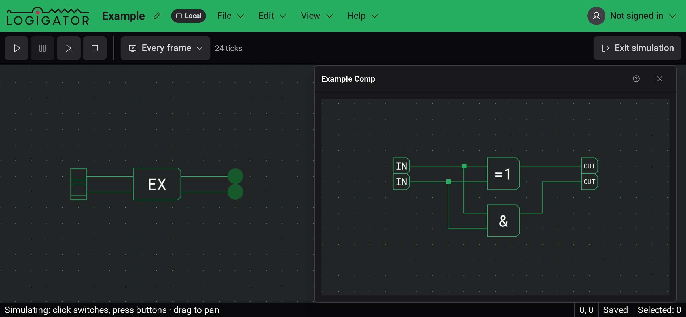
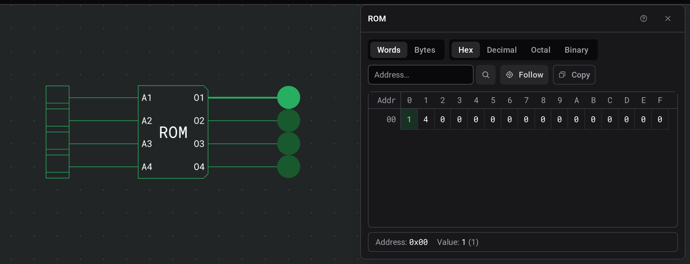
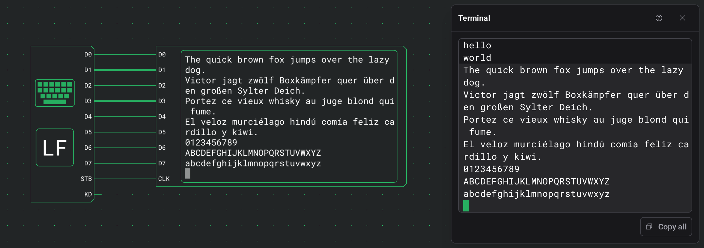
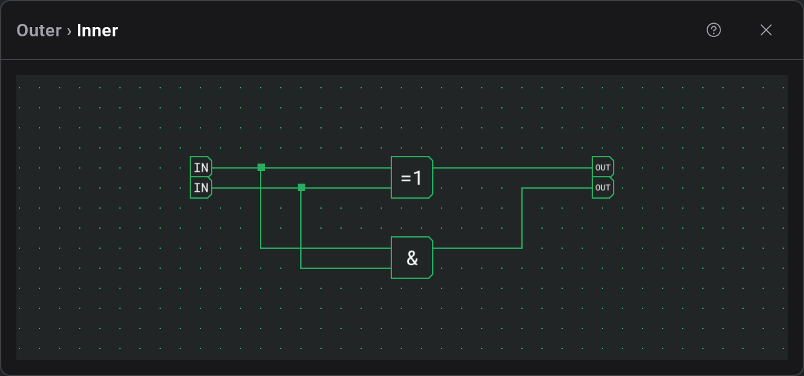

# Inspection and watches

During a [simulation](docs:simulation), running or paused, four kinds of component can be opened to see inside them. Clicking a ROM shows its contents with the word it is currently reading highlighted, clicking a RAM shows what it holds as the circuit writes it, and clicking a Terminal shows everything it has printed. Clicking a custom component opens a watch, a live view of its inner circuit.

On a desktop, each view opens as a window that you can move and resize. Clicking the component again brings its window to the front. In the [touch layout](docs:phones-and-tablets#simulation-and-inspection), ROM, RAM and terminal views share a sheet at the bottom of the screen and a watch fills the whole screen. Leaving the simulation closes all of them.

## ROM contents {#rom-contents}

The viewer is read-only; you change the contents in the [ROM's settings](docs:memory#rom) while editing. The word at the current address is highlighted, and with Follow on (the default) the table scrolls along as the address changes. The line at the bottom shows the address and value of the highlighted cell. Clicking another cell shows that one instead until the address next changes.

The buttons above the table choose Words or Bytes and the number base: Hex, Decimal, Octal or Binary. To jump to an address, type it in hex into the Address… field. Copy puts the whole table on the clipboard as text, in the view and base you picked.

## RAM contents {#ram-contents}

A RAM's viewer has the same table, buttons and Follow as a ROM's, with the word at the address on its inputs highlighted. It shows what the circuit has stored and changes as the circuit writes, running or stepped. It is read-only too: only the circuit writes a RAM. Every word is 0 when the simulation starts, and Stop sets them all back to 0.

A large RAM is read only around the rows on screen. A row scrolled into view shows dots until it has been read, which takes a moment, and the line at the bottom reads Not loaded for a cell shown that way. Copy puts the table on the clipboard as you see it, dots included.

## Terminal output {#terminal-output}

A terminal's window shows the scrollback, oldest line first, and below it the screen on a tinted band with the cursor. Text appears as the circuit prints it, running or stepped. What each code does is described under [Terminal](docs:outputs#terminal).

Lines break at the terminal's own columns, as on its screen, so a narrower or wider window doesn't rewrap them. The text gets smaller as the window narrows, down to a minimum size, and after that the window scrolls sideways. Copy all puts the scrollback and the screen on the clipboard as text.

A terminal on the board is read from the start of the simulation, so its window shows the whole text even when you open it late. Stop clears the window as well as the terminal's screen.

The simulation holds the last 65,536 characters sent to each terminal. When a circuit sends more than that between two screen refreshes, at As fast as possible for example:

- the oldest of them never reach the terminal,
- a line in the scrollback says how many characters were lost,
- the screen carries on with the characters that came after.

## Watches {#watches}

A watch draws the component's inner circuit with the same lit wires as the board. You can pan and zoom inside it, and operate the switches and buttons it contains. They drive the real simulation, so the rest of the circuit reacts.

Clicking a component inside a watch opens:

| Component                  | What opens                                                                                                             |
| -------------------------- | ---------------------------------------------------------------------------------------------------------------------- |
| A custom component         | Its circuit, in the same window. The title shows the path, such as Outer › Inner. Click an earlier name to go back up. |
| A ROM, a RAM or a terminal | Its own viewer.                                                                                                        |
| A gamepad or a keyboard    | Its window, titled with the path, such as Outer › Inner › Gamepad.                                                     |

A terminal inside a watch shows its screen there too: when you open its level, it replays the characters the simulation still holds for it, so it shows what was printed before you looked.

A gamepad's or keyboard's window works like one on the board (see [Gamepad](docs:inputs#gamepad) and [Keyboard](docs:inputs#keyboard)), and what you press there reaches the component inside the watch. Going back up past its level or closing the watch closes that window too.

If the watch reports that the inner circuit does not match the compiled simulation, the component was changed after the simulation started. Leave the simulation and start it again.

## See also {#see-also}

- [Simulation](docs:simulation): running a circuit
- [Custom components](docs:custom-components): building the components you watch
- [Memory](docs:memory): ROM and RAM options, editing ROM contents
- [Outputs](docs:outputs): the terminal's options and what it does with each code
