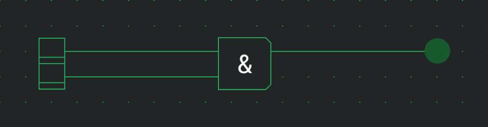
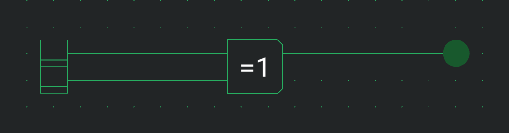

# Logic gates

Logic gates work on single bits. The NOT gate inverts its one input, and the AND, OR and XOR gates combine 2 to 64 inputs into one output. All four are in the Logic gates category of the palette. Their ports have no labels; the symbol on the box tells them apart. The category also holds the Tunnel, which is described under [Tunnels](docs:wires-and-connections#tunnels).

## NOT Gate

The NOT gate inverts its input. Its box is marked `!`.

| Port   | Direction | Meaning                   |
| ------ | --------- | ------------------------- |
| Input  | in        | The bit to invert.        |
| Output | out       | The inverse of the input. |

It has no options besides Direction.

| Input | Output |
| ----- | ------ |
| 0     | 1      |
| 1     | 0      |

A negation bubble inverts a port's signal with no extra delay, so you often don't need a NOT gate in front of another component. See [Negating a port](docs:components-and-options#negating-a-port).

## AND Gate

The AND gate outputs 1 when every input is 1. Its box is marked `&`.

| Port   | Direction | Meaning                  |
| ------ | --------- | ------------------------ |
| Inputs | in        | The bits to combine.     |
| Output | out       | 1 when every input is 1. |

| Option | Values  | Default |
| ------ | ------- | ------- |
| Inputs | 2 to 64 | 2       |

| Input 1 | Input 2 | Output |
| ------- | ------- | ------ |
| 0       | 0       | 0      |
| 0       | 1       | 0      |
| 1       | 0       | 0      |
| 1       | 1       | 1      |

With more inputs, the output is 1 only while all of them are 1. A single 0 makes it 0.

Negating the output turns the AND gate into a NAND gate.

## OR Gate

The OR gate outputs 1 when at least one input is 1. Its box is marked `≥1`.

| Port   | Direction | Meaning                         |
| ------ | --------- | ------------------------------- |
| Inputs | in        | The bits to combine.            |
| Output | out       | 1 when at least one input is 1. |

| Option | Values  | Default |
| ------ | ------- | ------- |
| Inputs | 2 to 64 | 2       |

| Input 1 | Input 2 | Output |
| ------- | ------- | ------ |
| 0       | 0       | 0      |
| 0       | 1       | 1      |
| 1       | 0       | 1      |
| 1       | 1       | 1      |

With more inputs, the output is 0 only while all of them are 0. A single 1 makes it 1.

Negating the output turns the OR gate into a NOR gate. To combine several outputs on one wire, feed them into an OR gate instead of connecting them directly (see [Conflicting signals](docs:simulation#conflicting-signals)).

## XOR Gate

The XOR gate outputs 1 when an odd number of inputs are 1. Its box is marked `=1`.

| Port   | Direction | Meaning                               |
| ------ | --------- | ------------------------------------- |
| Inputs | in        | The bits to combine.                  |
| Output | out       | 1 when an odd number of inputs are 1. |

| Option | Values  | Default |
| ------ | ------- | ------- |
| Inputs | 2 to 64 | 2       |

| Input 1 | Input 2 | Output |
| ------- | ------- | ------ |
| 0       | 0       | 0      |
| 0       | 1       | 1      |
| 1       | 0       | 1      |
| 1       | 1       | 0      |

With more inputs, the gate counts the 1s: one or three inputs at 1 give 1, two or four give 0. It is not 1 for exactly one input only.

Negating the output turns the XOR gate into an XNOR gate.

## See also

- [Components and options](docs:components-and-options): the palette, the settings card and negating a port
- [Memory](docs:memory): flip-flops, ROM and RAM
- [Adders and selectors](docs:adders-and-selectors): half and full adders built into one component
- [Simulation](docs:simulation): running a circuit
