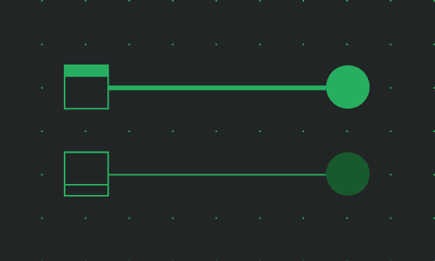
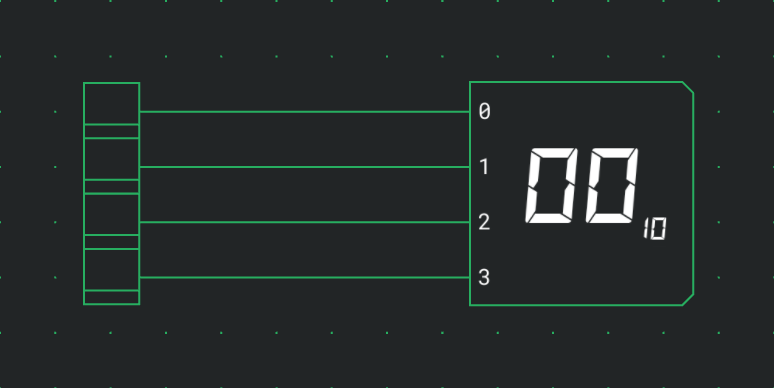
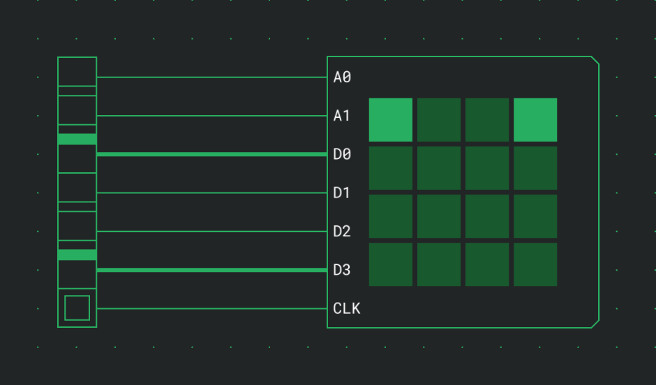
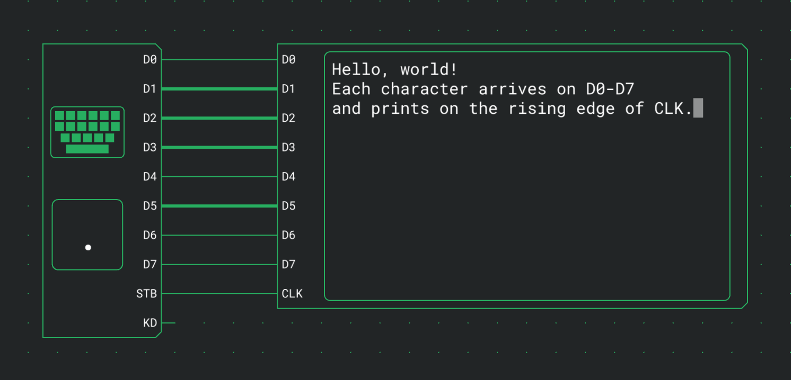

# Outputs

Outputs show what a circuit is doing: an LED for a single signal, a Segment Display for a number, an LED Matrix for a picture and a Terminal for text. They have inputs only and change as the simulation runs.

## LED

An LED lights up while its input is 1.

| Port  | Direction | Meaning          |
| ----- | --------- | ---------------- |
| Input | in        | 1 lights the LED |

It has no options besides Direction.

## Segment Display

A Segment Display shows the binary number on its inputs as a number in decimal, hex or octal.

| Port       | Direction | Meaning                                    |
| ---------- | --------- | ------------------------------------------ |
| 0, 1, 2, … | in        | The bits of the number, input 0 the lowest |

| Option | Values        | Default |
| ------ | ------------- | ------- |
| Inputs | 1 to 16       | 2       |
| Base   | DEC, HEX, OCT | DEC     |

The number is padded with zeros to as many digits as the largest value on the inputs needs. A small 10, 16 or 8 next to it shows the base.

| Inputs | DEC        | HEX      | OCT        |
| ------ | ---------- | -------- | ---------- |
| 4      | 00 to 15   | 0 to f   | 00 to 17   |
| 8      | 000 to 255 | 00 to ff | 000 to 377 |

## LED Matrix

An LED Matrix is a square grid of LEDs. On the rising edge of CLK, the data inputs are written into the row the address inputs select. Each row keeps what was written into it until the next write.

| Port      | Direction | Meaning                             |
| --------- | --------- | ----------------------------------- |
| A0, A1, … | in        | The address of the row to write     |
| D0, D1, … | in        | The LEDs to light in that row       |
| CLK       | in        | A rising edge writes D into the row |

| Option       | Values   | Default |
| ------------ | -------- | ------- |
| Width/Height | 4, 8, 16 | 4       |

The size sets how many address and data inputs there are:

| Width/Height | Address inputs | Data inputs | One address covers |
| ------------ | -------------- | ----------- | ------------------ |
| 4            | A0 to A1       | D0 to D3    | one row            |
| 8            | A0 to A2       | D0 to D7    | one row            |
| 16           | A0 to A4       | D0 to D7    | half a row         |

At 16 × 16, address 0 is the left half of row 0, address 1 its right half, address 2 the left half of row 1, and so on. D0 is the leftmost LED of the row or half row. Row 0 is at the top, and when you turn the matrix, the grid stays upright and only the ports move.

With a [negation bubble](docs:components-and-options#negating-a-port) on CLK, the matrix writes on the falling edge instead.

## Terminal

A Terminal is a text screen. It prints one character each time its CLK input rises: the one whose code is on D0 to D7 on that tick. Line feed, backspace and the other control codes move the cursor instead.

| Port     | Direction | Meaning                                            |
| -------- | --------- | -------------------------------------------------- |
| D0 to D7 | in        | The 8-bit Latin-1 code to print, D0 the lowest bit |
| CLK      | in        | A rising edge prints the code on D0 to D7          |

| Option    | Values       | Default |
| --------- | ------------ | ------- |
| Columns   | 8 to 80      | 40      |
| Rows      | 1 to 24      | 12      |
| Text size | Small, Large | Small   |

The screen is Columns characters wide and Rows lines high, and the component grows to fit it. Large draws each character one and a half times as large as Small. When you turn a terminal, its screen stays upright and only the ports move.

The next character goes where the block cursor is, which the screen shows only during a simulation. With a [negation bubble](docs:components-and-options#negating-a-port) on CLK, the terminal prints on the falling edge instead.

To see what you type, connect a [Keyboard](docs:inputs#keyboard)'s D0 to D7 to the terminal's D0 to D7 and its STB to CLK. `Enter` then starts a new line, `Backspace` erases the character before the cursor, and the arrow keys and `Home` move the cursor.

During a simulation, clicking a terminal opens a window with everything it has printed. The window is described in [Inspection and watches](docs:inspection#terminal-output).

### Printed characters

The codes are Latin-1, as on the keyboard. Codes from space to `~` and from `0xA0` to ÿ print as their character, so `0x41` prints A and `0xE4` prints ä. No-break space prints as a space and the soft hyphen as a hyphen.

### Control codes

These codes move the cursor or erase:

| Code   | Name | What it does                                                                                        |
| ------ | ---- | --------------------------------------------------------------------------------------------------- |
| `0x08` | BS   | Moves one column left and erases the character there. Does nothing in the first column.             |
| `0x09` | TAB  | Moves right to the next tab stop, one every 8 columns, or to the last column.                       |
| `0x0A` | LF   | Moves to the start of the next line. On the bottom row, the screen scrolls up one line instead.     |
| `0x0B` | HOM  | Moves to the top left corner.                                                                       |
| `0x0C` | FF   | Clears the screen and moves to the top left corner. The cleared lines don't go into the scrollback. |
| `0x0D` | CR   | Moves to the start of the line.                                                                     |
| `0x1C` | RT   | Moves one column right.                                                                             |
| `0x1D` | LT   | Moves one column left.                                                                              |
| `0x1E` | UP   | Moves one line up.                                                                                  |
| `0x1F` | DN   | Moves one line down.                                                                                |
| `0x7F` | DEL  | Erases the character under the cursor. The cursor stays where it is.                                |

RT, LT, UP and DN stop at the edges of the screen; only LF scrolls. Every other code, ESC and `0x80` to `0x9F` among them, is ignored.

### Line wrapping

- A character printed in the last column leaves the cursor there.
- The next character goes to the start of the next line, scrolling the screen if the cursor was on the bottom row.
- A full line followed by LF therefore leaves no empty line.
- A code that moves the cursor cancels that wrap, so a BS right after the last column erases the character printed there.

### Scrollback

A line that scrolls off the top goes into the scrollback as it was, and the cursor codes can no longer change it. The scrollback keeps the last 10,000 lines and is shown in the terminal's [window](docs:inspection#terminal-output).

| Action                 | Screen  | Scrollback |
| ---------------------- | ------- | ---------- |
| Pause                  | kept    | kept       |
| Stop                   | cleared | cleared    |
| Leaving the simulation | cleared | cleared    |

## See also

- [Inputs](docs:inputs): switches, buttons and the keyboard that drive these outputs
- [Inspection and watches](docs:inspection): the terminal window and watches
- [Simulation](docs:simulation): running, pausing and stopping a circuit
- [Components and options](docs:components-and-options): the palette and the settings card
