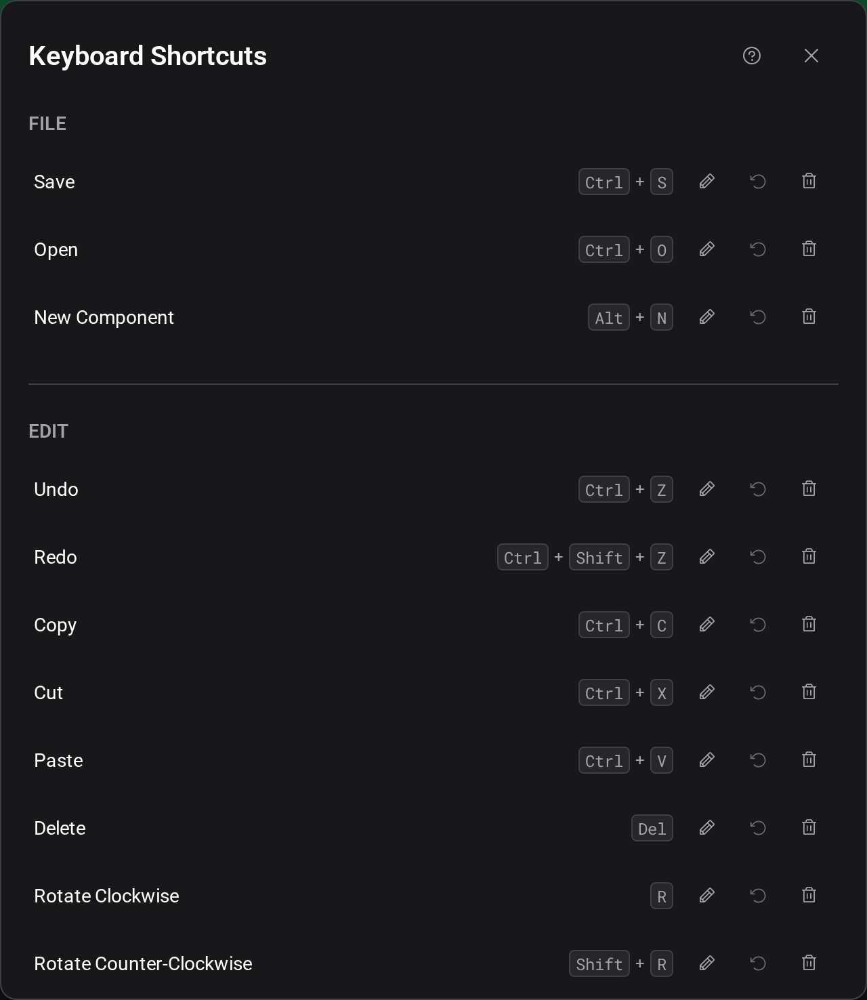

# Keyboard shortcuts

These are the default bindings, in the order Edit → Keyboard Shortcuts lists them. On a Mac, `⌘` works wherever the table says `Ctrl`, and `Ctrl` works as well.

## Default bindings {#default-bindings}

| Action                                  | Default        |
| --------------------------------------- | -------------- |
| Save                                    | `Ctrl+S`       |
| Open                                    | `Ctrl+O`       |
| New Component                           | `Alt+N`        |
| Undo                                    | `Ctrl+Z`       |
| Redo                                    | `Ctrl+Shift+Z` |
| Copy                                    | `Ctrl+C`       |
| Cut                                     | `Ctrl+X`       |
| Paste                                   | `Ctrl+V`       |
| Delete                                  | `Delete`       |
| Rotate Clockwise                        | `R`            |
| Rotate Counter-Clockwise                | `Shift+R`      |
| Move Selection Up / Down / Left / Right | arrow keys     |
| Zoom In                                 | `Ctrl++`       |
| Zoom Out                                | `Ctrl+-`       |
| Zoom 100%                               | `Ctrl+0`       |
| Pan                                     | `P`            |
| Wire Tool                               | `W`            |
| Select                                  | `S`            |
| Erase                                   | `E`            |
| Place Text                              | `T`            |
| Cut Wires at Selection Edge (hold)      | `Alt`          |
| Add to or Remove from Selection (hold)  | `Ctrl`         |
| Start/Stop Simulation                   | `Enter`        |
| Cancel                                  | `Escape`       |

Shortcuts do nothing while you type in a text field, except `Escape`. During a simulation, the editing shortcuts are switched off and `Escape` leaves the simulation.

## Held keys {#held-keys}

The two actions marked "hold" act while the key is down instead of firing once. Hold `Alt` while releasing a selection box to cut the wires at its edge (see [Board and tools](docs:board-and-tools#cutting-wires-at-the-selection-edge)). Hold `Ctrl` while clicking or drawing a box to add to the selection or remove from it. That works with Select, Pan and the Wire tool.

## Changing a binding {#changing-a-binding}

Edit → Keyboard Shortcuts lists every action. Click the pencil next to one and press the new combination. `Escape` cancels the recording, which is why it can't be bound to anything else. A single modifier key such as `Alt` can only be bound to the two held actions.

If the combination already belongs to another action, that action loses it and a message says which one. Reset puts one action back to its default, Unassign leaves it without a shortcut, and Reset All restores every default.

Your bindings are stored in this browser. Clearing the site data resets them.

## Gamepad keys {#gamepad-keys}

A [gamepad](docs:inputs#gamepad) has its own keys, separate from the shortcuts above. They work while its controller window has the keyboard, and there they come before the shortcuts, so `Enter` presses Start.

| Button                   | Default key   |
| ------------------------ | ------------- |
| Up / Down / Left / Right | arrow keys    |
| A                        | `X`           |
| B                        | `Z`           |
| X                        | `S`           |
| Y                        | `A`           |
| L                        | `Q`           |
| R                        | `W`           |
| Select                   | right `Shift` |
| Start                    | `Enter`       |

A key counts by its position on the keyboard, and the table names it as on a US keyboard. On a German keyboard, for example, B is the key labelled Y. In Chrome and Edge, the window shows each key as your keyboard labels it.

To change the keys:

1. Click Assign keys at the bottom of a gamepad window.
2. Click a button, then press the key it should have. If another button had that key, the two swap keys and the other button lights up briefly.
3. Click Done to go back to playing.

While you assign, `Escape` cancels, and `Backspace` or `Delete` leaves the button without a key. `Escape` and `Tab` can't be assigned. Reset to defaults restores the table above.

The keys are shared by every gamepad in every project and stored in this browser, like the shortcuts. A change shows at once in every open gamepad window, in other tabs as well.

## Keys in a keyboard window {#keys-in-a-keyboard-window}

While the typing field of a [keyboard's window](docs:inputs#keyboard) has the focus, keys go to the circuit and the shortcuts above do nothing. These keys act differently there:

| Key         | In the typing field                      |
| ----------- | ---------------------------------------- |
| `Enter`     | Sends LF. The simulation keeps running.  |
| `Escape`    | Sends ESC. The window stays open.        |
| `Tab`       | Sends TAB. The focus stays in the field. |
| `Shift+Tab` | Moves the focus out of the field.        |
| arrow keys  | Send RT, LT, UP and DN.                  |

Combinations with `Ctrl`, `Alt` or `⌘` go to the browser, so `Ctrl+V` pastes text into the keyboard. `AltGr` is not one of them: a character typed with it is sent. A key sends the character your keyboard layout gives it, so these keys can't be reassigned the way a gamepad's can.

## See also {#see-also}

- [Board and tools](docs:board-and-tools): the tools and actions these keys trigger
- [Simulation](docs:simulation): what Enter and Escape do there
