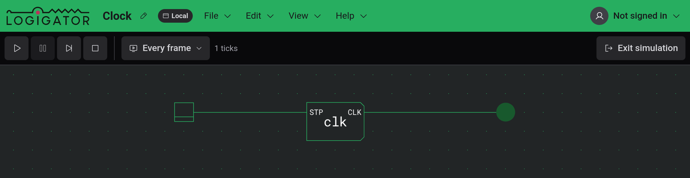
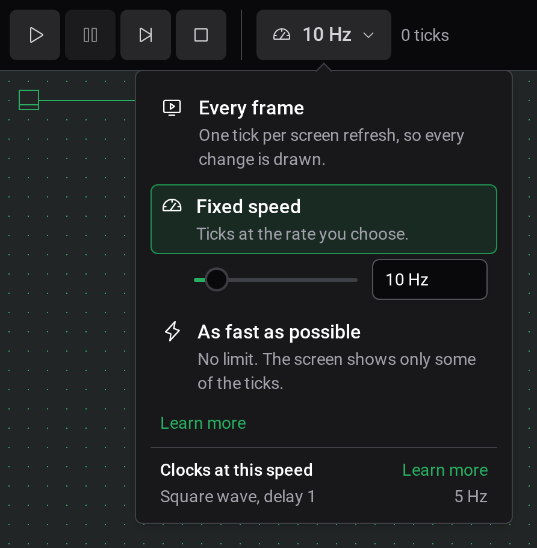

# Simulation

Start simulation, at the right end of the toolbar, powers the circuit: powered wires light up, LEDs and displays show their state, and switches and buttons respond to clicks. `Enter` does the same.

## Entering and leaving

The simulation always runs the main project. If a custom component's tab is open, the editor switches back to Main project first.

While it runs, the board is locked. You can pan and zoom, operate inputs and [inspect](docs:inspection) ROMs, RAMs, terminals and custom components, but not place, move, wire or delete anything. Exit simulation, `Enter` or `Escape` returns to editing with the Pan tool.

With the Auto-start simulation setting on (the default), the circuit starts running as soon as you enter. With it off, the simulation waits paused at tick 0 so you can step from the start.

## Run controls

While a simulation is active, the toolbar is replaced by four buttons, the speed button and a readout.

| Button | What it does                                                                                 |
| ------ | -------------------------------------------------------------------------------------------- |
| Run    | Starts or resumes the simulation.                                                            |
| Pause  | Stops at the current tick and keeps the state.                                               |
| Step   | Advances one tick. Only available while paused.                                              |
| Stop   | Resets the circuit to tick 0, turns every switch off and pauses. You stay in the simulation. |

The readout shows the ticks since the start and, while running, the speed actually reached.

## Speed

The speed button shows the current setting. Clicking it opens a panel with three modes, which you can switch while the circuit runs.

| Mode                | What it does                                                                                                                      |
| ------------------- | --------------------------------------------------------------------------------------------------------------------------------- |
| Every frame         | The default. Advances one tick per screen refresh, so the speed follows your display's refresh rate.                              |
| Fixed speed         | Ticks at a rate you set, 1 kHz to begin with. If the circuit is too large to keep up, a warning sign appears next to the readout. |
| As fast as possible | Runs without a limit. The screen then shows only some of the ticks.                                                               |

For Fixed speed, the slider goes from 1 Hz to 10 MHz. In the box next to it you can type any rate from 0.1 Hz up, such as `20`, `2.5k` or `1M`. A red box means the input is not a rate, and the last valid one stays in effect.

Under the modes, Clocks at this speed lists the frequency of each kind of clock in the circuit, by waveform and delay, such as Square wave, delay 5. How many ticks one cycle of a clock takes is described under [Clock](docs:clock-and-timing#clock). With Fixed speed the list is there right away. In the other two modes the rate has to be measured first, so the list appears about a second after the circuit starts running.

## Operating inputs

| Component    | How you operate it                                                        | Details                                  |
| ------------ | ------------------------------------------------------------------------- | ---------------------------------------- |
| Switch       | Click it. It toggles with each click and stays where you left it.         | [Switch](docs:inputs#switch)             |
| Button       | Hold it down. It is on for as long as you hold it.                        | [Button](docs:inputs#button)             |
| Pulse button | Click it. Each click sends a pulse of one tick, however long you hold it. | [Pulse button](docs:inputs#pulse-button) |
| Gamepad      | Click it to open its controller, then press the buttons there.            | [Gamepad](docs:inputs#gamepad)           |
| Keyboard     | Click it to open a window, then type into it.                             | [Keyboard](docs:inputs#keyboard)         |

Dragging from anywhere else on the board pans it.

## Conflicting signals

A wire drawn in orange carries a conflict. The orange is a hint about your circuit and doesn't change how the simulation runs.

### Causes

- Two or more outputs drive the same wire, and at that moment one is 1 and another is 0. Outputs that agree are not marked, so the orange can come and go as the values change. On real hardware, this would be a short circuit.
- An SR flip-flop was clocked with S and R both at 1. Q goes to 1 and !Q to 0, and both stay orange until a clock edge with only S or only R at 1. On real hardware, this is an input an SR flip-flop does not allow.

### Effect on the simulation

The simulation keeps running as before: a wire with several outputs on it is 1 as soon as one of them is 1.

A conflict inside a custom component is not shown on the board. Click the component to open a [watch](docs:inspection#watches), where its wires show it.

Switching off the Highlight conflicts setting, which is on by default, turns the orange off. See [Settings](docs:settings#editor-settings).

### Fixes

| Cause                       | Fix                                                                                                                                                                                                         |
| --------------------------- | ----------------------------------------------------------------------------------------------------------------------------------------------------------------------------------------------------------- |
| Several outputs on one wire | Connect only one output to each wire. To combine several sources, feed them into an [OR gate](docs:logic-gates#or-gate). To choose one of them, use a [multiplexer](docs:adders-and-selectors#multiplexer). |
| S and R both at 1           | Don't set S and R to 1 at the same time, or use a [D or JK flip-flop](docs:memory#d-flip-flop) instead.                                                                                                     |

## When the simulation won't start

The editor refuses to start and shows a message naming the component when:

- a custom component contains itself, directly or through another one,
- a custom component has no circuit inside it,
- a custom component's ports no longer match the Input and Output plugs in its circuit.

Fix the named component and start again. If the message says the simulation engine could not start, your browser does not support WebAssembly.

## See also

- [Inspection and watches](docs:inspection): ROM and RAM contents, terminal output, and watches
- [Inputs](docs:inputs): switches, buttons, the gamepad and the keyboard
- [Outputs](docs:outputs): LEDs, displays and the terminal
- [Settings](docs:settings): Auto-start simulation and Highlight conflicts
- [Phones and tablets](docs:phones-and-tablets): the run controls in the touch layout
