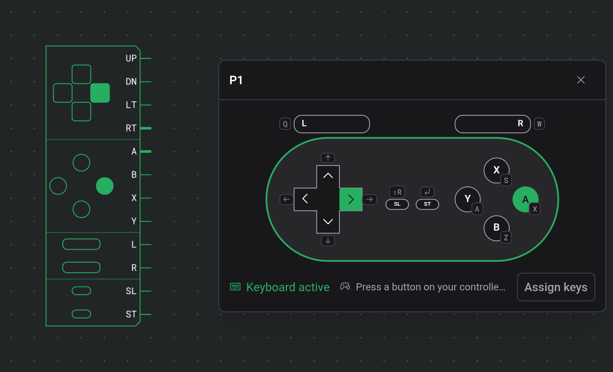
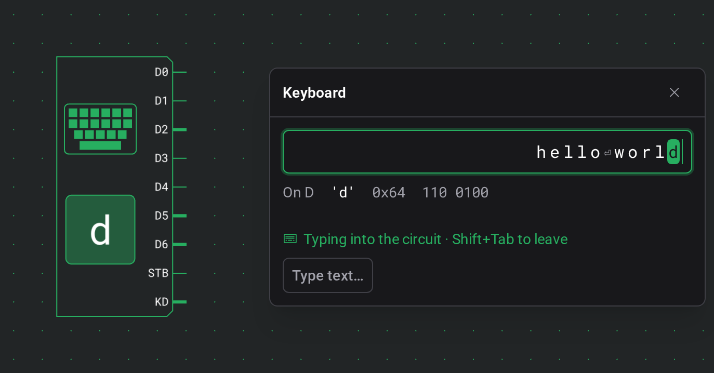

# Simulation

Start simulation, at the right end of the toolbar, powers the circuit: powered wires light up, LEDs and displays show their state, and switches and buttons respond to clicks. `Enter` does the same.

## Entering and leaving

The simulation always runs the main project. If a custom component's tab is open, the editor switches back to Main project first.

While it runs, the board is locked. You can pan and zoom, operate inputs and [inspect](docs:inspection) ROMs, RAMs, terminals and custom components, but not place, move, wire or delete anything. Exit simulation, `Enter` or `Escape` returns to editing with the Pan tool.

With the Auto-start simulation setting on (the default), the circuit starts running as soon as you enter. With it off, the simulation waits paused at tick 0 so you can step from the start.

## Run controls

While a simulation is active, the toolbar is replaced by four buttons, the speed button and a readout.

| Button | What it does                                                                                 |
| ------ | -------------------------------------------------------------------------------------------- |
| Run    | Starts or resumes the simulation.                                                            |
| Pause  | Stops at the current tick and keeps the state.                                               |
| Step   | Advances one tick. Only available while paused.                                              |
| Stop   | Resets the circuit to tick 0, turns every switch off and pauses. You stay in the simulation. |

The readout shows the ticks since the start and, while running, the speed actually reached.

## Speed

The speed button shows the current setting. Clicking it opens a panel with three modes, which you can switch while the circuit runs:

- Every frame, the default, advances one tick per screen refresh, so the speed follows your display's refresh rate.
- Fixed speed ticks at a rate you set, 1 kHz to begin with. The slider goes from 1 Hz to 10 MHz. In the box next to it you can type any rate from 0.1 Hz up, such as `20`, `2.5k` or `1M`. A red box means the input is not a rate, and the last valid one stays in effect. If the circuit is too large to keep up, a warning sign appears next to the readout.
- As fast as possible runs without a limit. The screen then shows only some of the ticks.

Under the modes, Clocks at this speed lists the frequency of each kind of clock in the circuit. A square wave is off for Delay ticks and then on for as many, so one cycle takes 2 × Delay ticks. A pulse is on for one tick after Delay ticks off, so one cycle takes Delay + 1 ticks. At 10 Hz, a square wave with delay 1 runs at 5 Hz and one with delay 5 at 1 Hz, and a pulse with delay 4 runs at 2 Hz. With Fixed speed the list is there right away. In the other two modes the rate has to be measured first, so the list appears about a second after the circuit starts running.

## Operating inputs

- A Switch toggles with each click and stays where you left it.
- A Button is on for as long as you hold it down. It passes on what is held now, so when you click far ahead of a slow or paused simulation it skips older presses, but your last click always arrives.
- A Pulse button sends a pulse of one tick per click, however long you hold it. It is the one that never skips a click, however far ahead of the simulation you are.
- A Gamepad opens its controller, described in the next section.
- A Keyboard opens a window to type into, described after the gamepad.

Dragging from anywhere else on the board pans it.

## Playing a gamepad

Clicking a Gamepad opens a window with a controller drawn in it. A button held there sets its output to 1 until you let go, and lights up on the board too. Like a Button, the gamepad passes on what is held now and can skip older presses when you are far ahead of a slow or paused simulation, while buttons pressed together arrive on the same tick.

The window takes the keyboard when it opens, and the line at the bottom reads Keyboard active. After you click the board or another window it reads Click here to use the keyboard, and keys no longer reach the gamepad. The key for each button is shown under it. While the window has the keyboard, a gamepad key comes before a shortcut, so `Enter` presses Start and does not leave the simulation. `Escape` still closes the window, and shortcuts with `Ctrl` or `Alt` still work. The default keys and how to change them are in [Keyboard shortcuts](docs:shortcuts#gamepad-keys).

With the mouse or a finger, a button stays pressed for as long as you hold it, and on a touchscreen each finger holds its own button. The D-pad has eight directions: pressing between two arms holds both, and sliding your thumb moves from one direction to the next without lifting it. Pressing the centre of the D-pad holds no direction.

A game controller connected to your computer can play a gamepad as well. The browser reports a controller only after you press one of its buttons while the editor is open. Do that with a gamepad window open, and the controller is connected to that window and appears in the Controller menu at the bottom. A controller keeps playing its gamepad when another window has the keyboard, so two controllers can play two gamepads at once, each chosen in its own window. Buttons are matched by position, whatever they are labelled: the right face button is A, the bottom one B, the top one X and the left one Y. The D-pad and the left stick both work the D-pad, LB and LT are L, RB and RT are R, Back or Share is Select, and Start is Start. Controllers that the browser doesn't report with the standard layout are listed but can't be chosen.

Closing the window or leaving the simulation lets go of every button. A gamepad inside a custom component is played from a [watch](docs:inspection#watches). In the touch layout, the controller opens in the sheet at the bottom of the screen; the key labels appear there once you press a key on a keyboard, and the Controller menu once a controller is connected.

## Typing on a keyboard

Clicking a Keyboard opens a window with a typing field at the top. While the field has the focus, the keys you press go to the circuit. A key going down puts its code on D0 to D7, sends a one-tick pulse on STB and turns KD on. KD stays on while you hold the key and goes off when you let go, and D keeps the character until the next key replaces it. The box on the keyboard's body shows the character on D and lights up while KD is on.

The field shows the last 64 characters sent, newest on the right, with the one on D highlighted while a key is held. On D, below it, is the code the circuit gets right now: the character, its hex value and its 8 bits. The line under that reads Typing into the circuit · Shift+Tab to leave while the field has the focus. After you click somewhere else it reads Click here to type, and keys no longer reach the keyboard until you click back into the window.

A held key does not repeat, so STB pulses once per press. KD tells a circuit whether a key is held: one that should repeat a held key can run a clock while KD is on, and one that counts key presses can count the pulses on KD. Pressing a second key before letting go of the first puts the second key's code on D with a new pulse on STB, and KD stays on until you have let go of both.

The code is Latin-1: ASCII plus the accented letters and symbols of Western European languages. Printable characters, from space to `~` and from `0xA0` to ÿ, are sent as themselves, so ä arrives as `0xE4`. No-break space (`0xA0`) and the soft hyphen (`0xAD`) are shown as NBS and SHY, since they have no visible mark. These keys send control codes, shown on the board and next to On D by their names:

| Key         | Code   | Shown as |
| ----------- | ------ | -------- |
| `Enter`     | `0x0A` | LF       |
| `Backspace` | `0x08` | BS       |
| `Tab`       | `0x09` | TAB      |
| `Escape`    | `0x1B` | ESC      |
| `Delete`    | `0x7F` | DEL      |
| `→`         | `0x1C` | RT       |
| `←`         | `0x1D` | LT       |
| `↑`         | `0x1E` | UP       |
| `↓`         | `0x1F` | DN       |
| `Home`      | `0x0B` | HOM      |

A [Terminal](#printing-to-a-terminal) acts on each of these codes except ESC, so a terminal wired to a keyboard echoes what you type.

The function keys, `End`, `Page Up`, `Page Down` and `Insert` send nothing, and so do the arrow keys and `Home` while you hold `Shift`. Curly quotes and long dashes are sent as `'`, `"` and `-`, and … as three dots. Any other character outside Latin-1, such as € or an emoji, is skipped, and the line at the bottom says so for a few seconds. Characters typed with `AltGr`, such as @ on a German keyboard, are sent. Combinations with `Ctrl`, `Alt` or `⌘` are left to the browser. Which keys go to the circuit instead of the editor is listed in [Keyboard shortcuts](docs:shortcuts#keys-in-a-keyboard-window).

A paste sends the pasted text one character at a time. Type text…, at the bottom of the window, opens a dialog where you can write or paste a longer text, a program for example, and says how many of its characters will be skipped before you send it. Line breaks are sent as LF and tabs as TAB, other control characters are left out, and one paste or one Send takes up to 10,000 characters. Each character arrives as a key pressed and let go of: KD is on for three ticks, and STB rises one tick after the code arrives and falls one tick before KD goes off, so a circuit that stores D when STB rises still reads every character, even with one gate more on the way of D than of STB, or the other way round. KD is off for a tick after each character, so a double letter still arrives as two pulses on KD. While characters are waiting, the window shows Sending with the number left and a ✕ that drops the rest. A character whose pulse on STB has already started still arrives, and KD goes off. You also see it when you type faster than the simulation runs, at a low fixed speed for example. At most 21,845 characters can wait at once, and a paste or a Send that does not fit behind them is not sent at all, not even in part: the window or the dialog asks you to wait for them instead.

While the simulation is paused, keys wait for Step. A key you press and let go is on D with KD on after the next step, STB is 1 after the second and 0 again after the third, and KD is off after the fourth, the character staying on D. The next character follows after the fifth, so a pasted text takes four steps per character.

Closing the window, clicking outside it and switching to another tab let go of every held key. Stop clears the characters in the field. A keyboard inside a custom component is typed into from a [watch](docs:inspection#watches). On a phone or tablet, the window opens in the sheet at the bottom of the screen (see [Phones and tablets](docs:phones-and-tablets#simulation-and-inspection)).

## Printing to a terminal

A Terminal prints one character each time its CLK input rises: the one whose code is on D0 to D7 on that tick. With a negation bubble on CLK, it prints on the falling edge instead. The next character goes where the block cursor is, which the screen shows only during a simulation.

To see what you type, connect a Keyboard's D0 to D7 to the terminal's D0 to D7 and its STB to CLK. `Enter` then starts a new line, `Backspace` erases the character before the cursor, and the arrow keys and `Home` move the cursor.

The codes are Latin-1, as on the keyboard. Codes from space to `~` and from `0xA0` to ÿ print as their character, so `0x41` prints A and `0xE4` prints ä. No-break space prints as a space and the soft hyphen as a hyphen. These control codes move the cursor or erase:

| Code   | Name | What it does                                                                                        |
| ------ | ---- | --------------------------------------------------------------------------------------------------- |
| `0x08` | BS   | Moves one column left and erases the character there. Does nothing in the first column.             |
| `0x09` | TAB  | Moves right to the next tab stop, one every 8 columns, or to the last column.                       |
| `0x0A` | LF   | Moves to the start of the next line. On the bottom row, the screen scrolls up one line instead.     |
| `0x0B` | HOM  | Moves to the top left corner.                                                                       |
| `0x0C` | FF   | Clears the screen and moves to the top left corner. The cleared lines don't go into the scrollback. |
| `0x0D` | CR   | Moves to the start of the line.                                                                     |
| `0x1C` | RT   | Moves one column right.                                                                             |
| `0x1D` | LT   | Moves one column left.                                                                              |
| `0x1E` | UP   | Moves one line up.                                                                                  |
| `0x1F` | DN   | Moves one line down.                                                                                |
| `0x7F` | DEL  | Erases the character under the cursor. The cursor stays where it is.                                |

RT, LT, UP and DN stop at the edges of the screen; only LF scrolls. Every other code, ESC and `0x80` to `0x9F` among them, is ignored.

A character printed in the last column leaves the cursor there, and the next character goes to the start of the next line, scrolling the screen if the cursor was on the bottom row. A full line followed by LF therefore leaves no empty line. A code that moves the cursor cancels that wrap, so a BS right after the last column erases the character printed there.

A line that scrolls off the top goes into the scrollback as it was, and the cursor codes can no longer change it. The scrollback keeps the last 10,000 lines and is shown in the terminal's [window](docs:inspection#terminal-output). Pause keeps the text on the screen and in the scrollback. Stop clears both, and so does leaving the simulation.

## Conflicting signals

A wire drawn in orange carries a conflict. There are two causes:

- Two or more outputs drive the same wire, and at that moment one is 1 and another is 0. Outputs that agree are not marked, so the orange can come and go as the values change.
- An SR flip-flop was clocked with S and R both at 1. Q goes to 1 and !Q to 0, and both stay orange until a clock edge with only S or only R at 1.

The simulation keeps running as before: a wire with several outputs on it is 1 as soon as one of them is 1. The orange is a hint about your circuit. On real hardware, the first case would be a short circuit, and the second is an input an SR flip-flop does not allow.

To fix the first case, connect only one output to each wire. To combine several sources, feed them into an OR gate, and to choose one of them, use a multiplexer. For an SR flip-flop, don't set S and R to 1 at the same time, or use a D or JK flip-flop instead.

A conflict inside a custom component is not shown on the board. Click the component to open a [watch](docs:inspection#watches), where its wires show it.

The Highlight conflicts setting, on by default, turns the orange off. See [Settings](docs:settings).

## When the simulation won't start

The editor refuses to start and shows a message naming the component when:

- a custom component contains itself, directly or through another one,
- a custom component has no circuit inside it,
- a custom component's ports no longer match the Input and Output plugs in its circuit.

Fix the named component and start again. If the message says the simulation engine could not start, your browser does not support WebAssembly.

## See also

- [Inspection and watches](docs:inspection): ROM and RAM contents, terminal output, and watches
- [Components and options](docs:components-and-options): what each input and display does
- [Settings](docs:settings): Auto-start simulation and Highlight conflicts
- [Phones and tablets](docs:phones-and-tablets): the run controls in the touch layout
