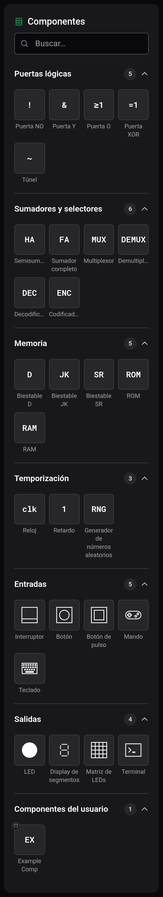
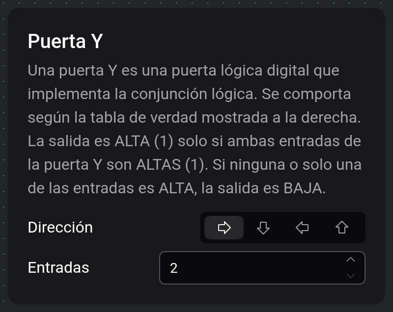

# Componentes y opciones

Los componentes son las piezas de las que se compone un circuito: puertas, memorias, entradas y pantallas. Los eliges en la paleta de la izquierda y ajustas sus opciones en la tarjeta de ajustes. Esta página lista todos los componentes integrados y enlaza a su descripción.

## La paleta {#the-palette}

El campo de búsqueda de arriba filtra la paleta por nombre. Las categorías son Puertas lógicas, Sumadores y selectores, Memoria, Temporización, Entradas y Salidas, además de Componentes del usuario en cuanto hayas construido un [componente personalizado](docs:custom-components). Un clic en el encabezado de una categoría la pliega. La colocación se describe en [Tablero y herramientas](docs:board-and-tools#placing-components).

Cada componente tarda un tick en pasar un cambio a su salida. Las tablas siguen el orden de la paleta.

### Puertas lógicas {#logic-gates}

| Componente                                  | Qué hace                                                               |
| ------------------------------------------- | ---------------------------------------------------------------------- |
| [Puerta NO](docs:logic-gates#not-gate)      | Invierte su entrada.                                                   |
| [Puerta Y](docs:logic-gates#and-gate)       | Da 1 cuando todas las entradas son 1.                                  |
| [Puerta O](docs:logic-gates#or-gate)        | Da 1 cuando al menos una entrada es 1.                                 |
| [Puerta XOR](docs:logic-gates#xor-gate)     | Da 1 cuando un número impar de entradas es 1.                          |
| [Túnel](docs:wires-and-connections#tunnels) | Se conecta sin cable con todos los demás túneles de la misma etiqueta. |

### Sumadores y selectores {#adders-and-selectors}

| Componente                                               | Qué hace                                                                 |
| -------------------------------------------------------- | ------------------------------------------------------------------------ |
| [Semisumador](docs:adders-and-selectors#half-adder)      | Suma dos bits.                                                           |
| [Sumador completo](docs:adders-and-selectors#full-adder) | Suma dos bits y un acarreo de entrada.                                   |
| [Multiplexor](docs:adders-and-selectors#multiplexer)     | Pasa a su salida la entrada de datos que eligen las líneas de selección. |
| [Demultiplexor](docs:adders-and-selectors#demultiplexer) | Pasa su entrada a la salida que eligen las líneas de selección.          |
| [Decodificador](docs:adders-and-selectors#decoder)       | Activa la única salida cuyo número está en las entradas.                 |
| [Codificador](docs:adders-and-selectors#encoder)         | Da el número de la entrada más alta que es 1.                            |

### Memoria {#memory}

| Componente                               | Qué hace                                                              |
| ---------------------------------------- | --------------------------------------------------------------------- |
| [Biestable D](docs:memory#d-flip-flop)   | Guarda D en el flanco de subida de CLK.                               |
| [Biestable JK](docs:memory#jk-flip-flop) | Pone a 1, pone a 0 o invierte un bit en el flanco de subida de CLK.   |
| [Biestable SR](docs:memory#sr-flip-flop) | Pone a 1 o a 0 un bit en el flanco de subida de CLK.                  |
| [ROM](docs:memory#rom)                   | Da la palabra guardada en la dirección presente en sus entradas.      |
| [RAM](docs:memory#ram)                   | Guarda las palabras que escribe el circuito y da la de una dirección. |

### Temporización {#timing}

| Componente                                                                       | Qué hace                                                                      |
| -------------------------------------------------------------------------------- | ----------------------------------------------------------------------------- |
| [Reloj](docs:clock-and-timing#clock)                                             | Cambia por sí solo entre 0 y 1, como onda cuadrada o como pulso.              |
| [Retardo](docs:clock-and-timing#delay)                                           | Deja pasar su entrada sin cambios, un tick después.                           |
| [Generador de números aleatorios](docs:clock-and-timing#random-number-generator) | Pone un valor aleatorio nuevo en sus salidas en cada flanco de subida de CLK. |

### Entradas {#inputs}

| Componente                                 | Qué hace                                                                   |
| ------------------------------------------ | -------------------------------------------------------------------------- |
| [Interruptor](docs:inputs#switch)          | Cambia entre 0 y 1 con cada clic durante una simulación.                   |
| [Botón](docs:inputs#button)                | Da 1 mientras lo mantienes pulsado.                                        |
| [Botón de pulso](docs:inputs#pulse-button) | Da un pulso de un tick por clic.                                           |
| [Mando](docs:inputs#gamepad)               | Una salida por botón de un mando con el que juegas durante una simulación. |
| [Teclado](docs:inputs#keyboard)            | Pone en sus salidas el código de cada tecla que escribes.                  |

### Salidas {#outputs}

| Componente                                           | Qué hace                                                                       |
| ---------------------------------------------------- | ------------------------------------------------------------------------------ |
| [LED](docs:outputs#led)                              | Se enciende mientras su entrada es 1.                                          |
| [Display de segmentos](docs:outputs#segment-display) | Muestra el número binario de sus entradas en decimal, hexadecimal u octal.     |
| [Matriz de LEDs](docs:outputs#led-matrix)            | Una cuadrícula cuadrada de LEDs que se escribe fila a fila.                    |
| [Terminal](docs:outputs#terminal)                    | Una pantalla de texto que muestra un carácter en cada flanco de subida de CLK. |

## La tarjeta de ajustes {#the-settings-card}

Al seleccionar un solo componente, o al elegir uno para colocar, aparece su tarjeta de ajustes junto al tablero: el nombre, una descripción y las opciones. Durante una simulación, la tarjeta está oculta.

- Dirección, que tienen todos los componentes, tiene cuatro botones con flechas que giran el componente. La dirección elegida al colocar se mantiene para el siguiente componente del mismo tipo.
- Cambiar Entradas, Salidas o una opción de tamaño cambia al instante el número de puertos.
- Las demás opciones se describen con cada componente, como el contenido de una [ROM](docs:memory#rom), los nombres de botones de un [mando](docs:inputs#gamepad) y el tamaño de pantalla de un [terminal](docs:outputs#terminal).

## Negar un puerto {#negating-a-port}

Con la herramienta de cable, toca un puerto de entrada o salida para añadirle una burbuja de negación. La señal que pasa por ese puerto queda invertida, sin retardo adicional. Toca la burbuja otra vez para quitarla. Al pasar el puntero sobre un puerto, la herramienta de cable muestra lo que haría un toque. Una burbuja en la entrada CLK de un [biestable](docs:memory) hace que reaccione al flanco de bajada.

Los túneles, los conectores Entrada y Salida y los puertos de un componente personalizado colocado no se pueden negar.

## Etiquetas de texto {#text-labels}

El texto no está en la paleta. Con la herramienta Texto (`T`), haz clic en el tablero para colocar una etiqueta «[insert text]». «Editar texto» en su tarjeta de ajustes abre un diálogo para el texto, que puede ocupar varias líneas, y Tamaño de fuente va de 2 a 128. Los cables atraviesan las etiquetas sin conectarse a ellas. Un clic en un cable que pasa bajo una etiqueta selecciona el cable.

## Ver también {#see-also}

- [Puertas lógicas](docs:logic-gates): la primera de las páginas de componentes
- [Entradas](docs:inputs): interruptores, botones, el mando y el teclado
- [Cables y conexiones](docs:wires-and-connections): conectar puertos
- [Componentes personalizados](docs:custom-components): construir tus propias piezas
- [Tablero y herramientas](docs:board-and-tools): colocar, mover y girar
