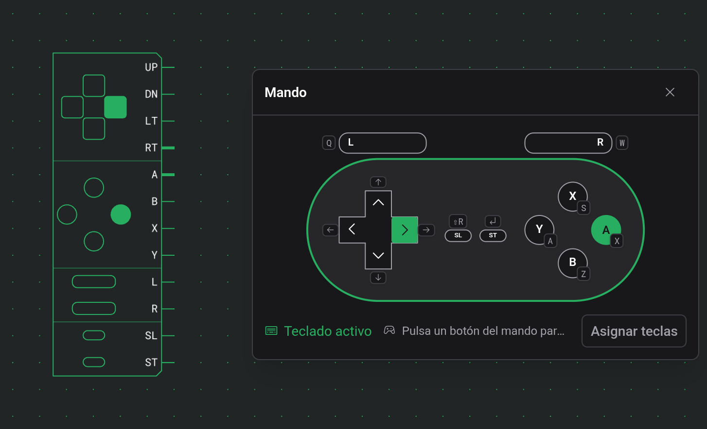
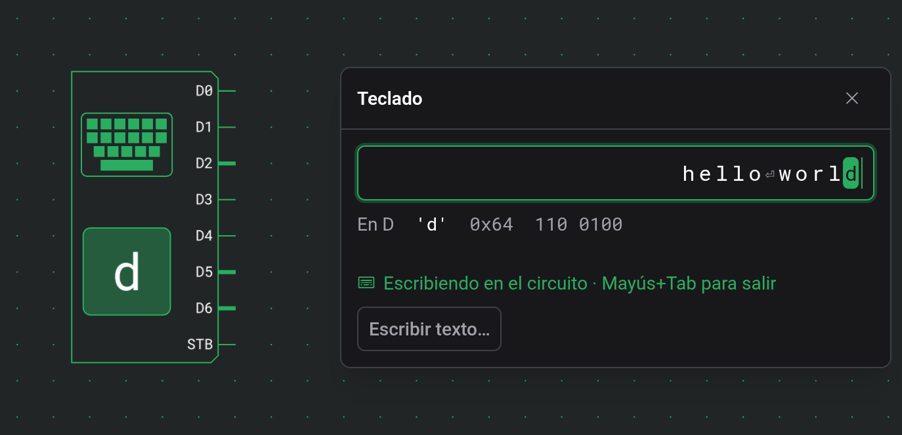

# Entradas

Las entradas son los componentes que manejas durante una simulación: interruptores, botones, un mando y un teclado. Cada una controla sus salidas según lo que pulsas, haces clic o escribes, y el resto del circuito reacciona.

## Interruptor {#switch}

Un interruptor cambia entre 0 y 1 con cada clic durante una simulación y se queda donde lo dejas. «Detener» lo vuelve a apagar.

| Puerto | Sentido | Significado                              |
| ------ | ------- | ---------------------------------------- |
| Salida | salida  | 1 mientras el interruptor está encendido |

No tiene más opciones que Dirección.

## Botón {#button}

Un botón da 1 mientras lo mantienes pulsado.

| Puerto | Sentido | Significado                      |
| ------ | ------- | -------------------------------- |
| Salida | salida  | 1 mientras el botón está pulsado |

No tiene más opciones que Dirección.

Un botón transmite lo que está pulsado ahora. Si haces clic muy por delante de una simulación lenta o en pausa, se salta las pulsaciones más antiguas, pero tu último clic siempre llega.

## Botón de pulso {#pulse-button}

Un botón de pulso envía un pulso de un tick por clic, lo mantengas pulsado el tiempo que sea.

| Puerto | Sentido | Significado                |
| ------ | ------- | -------------------------- |
| Salida | salida  | 1 durante un tick por clic |

No tiene más opciones que Dirección.

Un botón de pulso nunca se salta ningún clic, por mucha ventaja que le lleves a la simulación. Cada clic llega como su propio pulso.

## Mando {#gamepad}

Un mando tiene una salida por botón, a 1 mientras el botón está pulsado. La cruceta siempre está; los demás botones se activan por grupos. Durante una simulación, un clic abre una ventana con un mando para jugar.

| Puerto | Sentido | Significado       |
| ------ | ------- | ----------------- |
| UP     | salida  | Cruceta arriba    |
| DN     | salida  | Cruceta abajo     |
| LT     | salida  | Cruceta izquierda |
| RT     | salida  | Cruceta derecha   |
| A      | salida  | Botón de acción A |
| B      | salida  | Botón de acción B |
| X      | salida  | Botón de acción X |
| Y      | salida  | Botón de acción Y |
| L      | salida  | Lateral izquierdo |
| R      | salida  | Lateral derecho   |
| SL     | salida  | Select            |
| ST     | salida  | Start             |

Los puertos van en este orden, sin los botones desactivados.

| Opción             | Valores                                   | Predeterminado |
| ------------------ | ----------------------------------------- | -------------- |
| Botones de acción  | 0, A, A B, A B X Y                        | A B            |
| Botones laterales  | 0, L R                                    | 0              |
| Botones de menú    | 0, ST, SL ST                              | SL ST          |
| Nombres de botones | un nombre de hasta 8 caracteres por botón | ninguno        |

Los valores predeterminados dan ocho salidas; con todos los grupos activados hay doce.

Un botón que mantienes pulsado en la ventana pone su salida a 1 hasta que lo sueltas, y se ilumina también en el tablero. Los botones pulsados a la vez llegan en el mismo tick. Como un botón, el mando transmite lo que está pulsado ahora, así que puede saltarse pulsaciones antiguas cuando le llevas mucha ventaja a una simulación lenta o en pausa.

Al cerrar la ventana o salir de la simulación se sueltan todos los botones.

### Teclado, ratón y pantalla táctil {#keyboard-mouse-and-touch}

La ventana toma el teclado al abrirse, y la línea de abajo dice «Teclado activo». Después de un clic en el tablero o en otra ventana dice «Haz clic aquí para usar el teclado», y las teclas ya no llegan al mando. Bajo cada botón aparece su tecla.

Mientras la ventana tiene el teclado:

- las teclas del mando van antes que los atajos, así que `Enter` pulsa Start en lugar de salir de la simulación,
- `Escape` sigue cerrando la ventana,
- los atajos con `Ctrl` o `Alt` siguen funcionando.

Las teclas predeterminadas y cómo cambiarlas están en [Atajos de teclado](docs:shortcuts#gamepad-keys).

Con el ratón o con el dedo, un botón sigue pulsado mientras lo mantienes. En una pantalla táctil, cada dedo sostiene su propio botón. La cruceta tiene ocho direcciones: al pulsar entre dos brazos se pulsan los dos, y al deslizar el pulgar pasas de una dirección a la siguiente sin levantarlo. El centro de la cruceta no pulsa ninguna dirección.

### Mandos físicos {#game-controllers}

Un mando físico conectado al ordenador también puede jugar. El navegador solo informa de un mando después de que pulses uno de sus botones con el editor abierto. Si lo haces con una ventana de mando abierta, el mando físico se conecta a esa ventana y aparece en el menú Mando de abajo.

Un mando físico sigue jugando cuando otra ventana tiene el teclado. Dos mandos físicos pueden manejar dos mandos a la vez, cada uno elegido en su propia ventana.

Los botones se asignan por posición, digan lo que digan sus etiquetas:

| En el mando físico              | En el mando |
| ------------------------------- | ----------- |
| Botón de acción de la derecha   | A           |
| Botón de acción de abajo        | B           |
| Botón de acción de arriba       | X           |
| Botón de acción de la izquierda | Y           |
| Cruceta o stick izquierdo       | Cruceta     |
| LB o LT                         | L           |
| RB o RT                         | R           |
| Back o Share                    | Select      |
| Start                           | Start       |

Los mandos de los que el navegador no informa con la disposición estándar aparecen en la lista, pero no se pueden elegir.

### Nombres de botones {#button-names}

«Nombres de botones», en la tarjeta de ajustes, abre una imagen del mando con un campo en cada botón. Un nombre de hasta 8 caracteres sustituye la etiqueta del puerto de ese botón en el tablero y aparece junto al botón en la ventana del mando. Un campo vacío mantiene la etiqueta predeterminada. Los caracteres que el tablero no puede dibujar se omiten en la etiqueta del puerto, y el diálogo lo indica.

Los nombres de los botones que desactivas se conservan y vuelven cuando los activas de nuevo.

### Mandos en monitores y en la vista táctil {#gamepads-in-watches-and-the-touch-layout}

Un mando dentro de un componente personalizado se juega desde un [monitor](docs:inspection#watches). Su ventana lleva la ruta en el título, por ejemplo Outer › Inner › Mando.

En la vista táctil, el mando se abre en el panel de la parte inferior de la pantalla. Las teclas aparecen ahí en cuanto pulsas una tecla de un teclado, y el menú Mando en cuanto hay un mando físico conectado.

## Teclado {#keyboard}

Un teclado pone en sus salidas el código de cada tecla que pulsas. Durante una simulación, un clic abre una ventana para escribir. El recuadro de su cuerpo muestra el carácter que hay en D y se ilumina mientras KD es 1.

| Puerto  | Sentido | Significado                                                                              |
| ------- | ------- | ---------------------------------------------------------------------------------------- |
| D0 a D7 | salida  | El código Latin-1 de 8 bits de la última tecla pulsada; D0 es el bit menos significativo |
| STB     | salida  | Un pulso de un tick en cada pulsación                                                    |
| KD      | salida  | 1 mientras hay una tecla pulsada                                                         |

No tiene más opciones que Dirección.

### La ventana del teclado {#the-keyboard-window}

La ventana tiene un campo de escritura arriba. Mientras el campo tiene el foco, las teclas que pulsas van al circuito.

- El campo muestra los últimos 64 caracteres enviados, el más reciente a la derecha, y resalta el que hay en D mientras hay una tecla pulsada.
- Debajo, «En D» indica el código que recibe el circuito en ese momento: el carácter, su valor hexadecimal y sus 8 bits.
- La línea siguiente dice «Escribiendo en el circuito · Mayús+Tab para salir» mientras el campo tiene el foco. Después de un clic en otro sitio dice «Haz clic aquí para escribir», y las teclas no llegan al teclado hasta que vuelves a hacer clic en la ventana.

Qué teclas van al circuito en lugar de al editor está en [Atajos de teclado](docs:shortcuts#keys-in-a-keyboard-window).

### Qué hace una pulsación {#what-a-key-press-does}

Al pulsar una tecla, su código pasa a D0 a D7, STB envía un pulso de un tick y KD pasa a 1. Una tecla que pulsas y sueltas, como cada carácter de un texto pegado, ocupa cuatro ticks:

| Tick | D0 a D7   | STB | KD  |
| ---- | --------- | --- | --- |
| 1    | el código | 0   | 1   |
| 2    | el código | 1   | 1   |
| 3    | el código | 0   | 1   |
| 4    | el código | 0   | 0   |

STB sube un tick después de que llegue el código y baja un tick antes de que KD pase a 0. Por eso un circuito que guarda D cuando sube STB lee cada carácter, aunque haya una puerta más en el camino de D que en el de STB, o al revés.

Una tecla que sostienes mantiene KD a 1 después del tick 3 hasta que la sueltas. D conserva el código después de que KD pase a 0, hasta que la siguiente tecla lo sustituye.

- Una tecla sostenida no se repite, así que STB envía un pulso por pulsación.
- Si pulsas una segunda tecla antes de soltar la primera, el código de la segunda pasa a D, con un nuevo pulso en STB. KD sigue a 1 hasta que sueltas las dos.
- Un circuito que deba repetir una tecla sostenida puede hacer funcionar un reloj mientras KD es 1.
- Un circuito que cuente pulsaciones puede contar los pulsos de KD.

Al cerrar la ventana, hacer clic fuera de ella o cambiar a otra pestaña se sueltan todas las teclas pulsadas. «Detener» borra los caracteres del campo.

### Códigos de caracteres {#character-codes}

El código es Latin-1: ASCII más las letras con acento y los símbolos de las lenguas de Europa occidental. Los caracteres imprimibles, del espacio a `~` y de `0xA0` a ÿ, se envían tal cual, así que ñ llega como `0xF1`. El espacio de no separación (`0xA0`) y el guion blando (`0xAD`) se muestran como NBS y SHY, porque no se ven.

Estas teclas envían códigos de control, que el tablero y «En D» muestran por su nombre:

| Tecla       | Código | Se muestra como |
| ----------- | ------ | --------------- |
| `Enter`     | `0x0A` | LF              |
| `Backspace` | `0x08` | BS              |
| `Tab`       | `0x09` | TAB             |
| `Escape`    | `0x1B` | ESC             |
| `Delete`    | `0x7F` | DEL             |
| `→`         | `0x1C` | RT              |
| `←`         | `0x1D` | LT              |
| `↑`         | `0x1E` | UP              |
| `↓`         | `0x1F` | DN              |
| `Home`      | `0x0B` | HOM             |

Un [terminal](docs:outputs#terminal) entiende todos estos códigos salvo ESC, así que, conectado a un teclado, muestra lo que escribes.

Algunas teclas y caracteres no envían nada o envían otra cosa:

| Tecla o carácter                                                  | Se envía                                                     |
| ----------------------------------------------------------------- | ------------------------------------------------------------ |
| Teclas de función, `End`, `Page Up`, `Page Down`, `Insert`        | nada                                                         |
| Flechas y `Home` mientras mantienes `Shift`                       | nada                                                         |
| Comillas tipográficas                                             | `'` y `"`                                                    |
| Rayas                                                             | `-`                                                          |
| …                                                                 | tres puntos                                                  |
| Otros caracteres fuera de Latin-1, como € o un emoji              | se omiten; la línea de abajo lo indica durante unos segundos |
| Caracteres que escribes con `AltGr`, como @ en un teclado español | el carácter                                                  |
| Combinaciones con `Ctrl`, `Alt` o `⌘`                             | nada, quedan para el navegador                               |

### Pegar texto {#pasting-text}

Pegar envía el texto pegado carácter a carácter. «Escribir texto…», en la parte inferior de la ventana, abre un diálogo donde puedes escribir o pegar un texto más largo, un programa por ejemplo. Antes de enviarlo, el diálogo indica cuántos caracteres se omitirán.

En un texto pegado o enviado:

- los saltos de línea se envían como LF y los tabuladores como TAB,
- los demás caracteres de control se descartan,
- los caracteres fuera de Latin-1 se omiten, igual que al escribirlos.

Cada carácter llega como una tecla pulsada y soltada, en los cuatro ticks que muestra [Qué hace una pulsación](#what-a-key-press-does), y el siguiente llega en el quinto. Después de cada carácter KD está a 0 un tick, así que una letra doble llega como dos pulsos en KD.

Mientras hay caracteres esperando, la ventana muestra «Enviando» con el número que queda y una ✕ que descarta el resto. Un carácter cuyo pulso en STB ya ha empezado llega igualmente, y KD pasa a 0. «Enviando» también aparece cuando escribes más rápido de lo que avanza la simulación, por ejemplo a una velocidad fija baja.

Los límites:

- Cada pegado o cada «Enviar» admite hasta 10 000 caracteres.
- Como mucho pueden esperar 21 845 caracteres a la vez.
- Un pegado o un envío que no quepa detrás de los caracteres que ya esperan no se envía en absoluto, ni siquiera en parte. La ventana o el diálogo te pide que esperes a que salgan.

### Avanzar paso a paso en pausa {#stepping-while-paused}

Con la simulación en pausa, las teclas esperan a «Paso». Cada paso es un tick de la tabla de [Qué hace una pulsación](#what-a-key-press-does):

| Después del paso | Lo que recibe el circuito               |
| ---------------- | --------------------------------------- |
| 1                | El carácter en D, KD a 1                |
| 2                | STB a 1                                 |
| 3                | STB a 0                                 |
| 4                | KD a 0, mientras el carácter sigue en D |
| 5                | El siguiente carácter en D, KD a 1      |

Por eso un texto pegado necesita cuatro pasos por carácter.

### Teclados en monitores y en la vista táctil {#keyboards-in-watches-and-the-touch-layout}

En un teclado dentro de un componente personalizado se escribe desde un [monitor](docs:inspection#watches). Su ventana lleva la ruta en el título, igual que la de un mando.

En un móvil o una tableta, la ventana se abre en el panel de la parte inferior de la pantalla (consulta [Móviles y tabletas](docs:phones-and-tablets#simulation-and-inspection)).

## Ver también {#see-also}

- [Simulación](docs:simulation): ejecutar, pausar y avanzar paso a paso un circuito
- [Salidas](docs:outputs): LEDs, pantallas y el terminal
- [Atajos de teclado](docs:shortcuts): las teclas del mando y las teclas en la ventana de un teclado
- [Inspección y monitores](docs:inspection): usar entradas dentro de un componente personalizado
