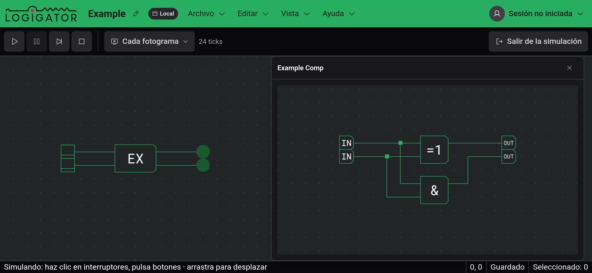
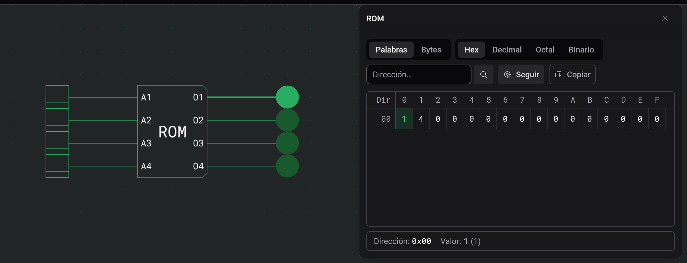

# Inspección y monitores

Durante una [simulación](docs:simulation), en marcha o en pausa, cuatro tipos de componente se pueden abrir para ver su interior. Un clic en una ROM muestra su contenido, con la palabra que está leyendo resaltada, un clic en una RAM muestra lo que guarda a medida que el circuito escribe en ella, y un clic en un terminal muestra todo el texto que ha recibido. Un clic en un componente personalizado abre un monitor, una vista en directo de su circuito interno.

En el escritorio, cada vista se abre en una ventana que puedes mover y cambiar de tamaño. Otro clic en el componente trae su ventana al frente. En la [vista táctil](docs:phones-and-tablets#simulation-and-inspection), las vistas de ROM, de RAM y de terminal comparten un panel en la parte inferior de la pantalla, y un monitor ocupa toda la pantalla. Al salir de la simulación se cierran todas.

## Contenido de una ROM {#rom-contents}

La vista es de solo lectura; el contenido se cambia al editar, en los [ajustes de la ROM](docs:memory#rom). La palabra de la dirección actual está resaltada, y con «Seguir» (activado por defecto) la tabla se desplaza a medida que cambia la dirección. La línea de abajo muestra la dirección y el valor de la celda resaltada. Un clic en otra celda muestra esa hasta el siguiente cambio de dirección.

Los botones sobre la tabla eligen Palabras o Bytes y la base: Hex, Decimal, Octal o Binario. Para ir a una dirección, escríbela en hexadecimal en el campo «Dirección…». «Copiar» pone toda la tabla en el portapapeles como texto, en la vista y la base elegidas.

## Contenido de una RAM {#ram-contents}

La vista de una RAM tiene la misma tabla, los mismos botones y el mismo «Seguir» que la de una ROM, con la palabra de la dirección presente en sus entradas resaltada. Muestra lo que el circuito ha guardado y cambia a medida que escribe, en marcha o paso a paso. También es de solo lectura: solo el circuito escribe en una RAM. Cada palabra vale 0 al empezar la simulación, y «Detener» las vuelve a poner todas a 0.

Una RAM grande solo se lee alrededor de las filas en pantalla. Una fila que entra en pantalla muestra puntos hasta que se ha leído, lo que tarda un momento, y la línea de abajo indica «Sin cargar» para una celda mostrada así. «Copiar» pone la tabla en el portapapeles tal como la ves, puntos incluidos.

## Salida de un terminal {#terminal-output}

La ventana de un terminal muestra el historial, la línea más antigua primero, y debajo la pantalla, sobre una franja tintada, con el cursor. El texto aparece a medida que el circuito lo envía, en marcha o paso a paso. Qué hace cada código se describe en [Terminal](docs:outputs#terminal).

Las líneas se cortan en las columnas del propio terminal, como en su pantalla, así que una ventana más estrecha o más ancha no las vuelve a cortar. El texto se hace más pequeño al estrechar la ventana, hasta un tamaño mínimo, y a partir de ahí la ventana se desplaza en horizontal. «Copiar todo» pone el historial y la pantalla en el portapapeles como texto.

Un terminal del tablero se lee desde el inicio de la simulación, así que su ventana muestra todo el texto aunque la abras tarde. «Detener» vacía la ventana igual que la pantalla del terminal.

La simulación guarda los últimos 65 536 caracteres enviados a cada terminal. Si un circuito envía más entre dos refrescos de pantalla, por ejemplo con Lo más rápido posible:

- los más antiguos nunca llegan al terminal,
- una línea del historial indica cuántos caracteres se han perdido,
- la pantalla sigue con los caracteres que llegaron después.

## Monitores {#watches}

Un monitor dibuja el circuito interno del componente con los mismos cables iluminados que el tablero. Dentro puedes desplazar la vista, hacer zoom y usar los interruptores y botones que contiene. Controlan la simulación real, así que el resto del circuito reacciona.

Un clic en un componente dentro de un monitor abre:

| Componente                     | Qué se abre                                                                                                                                 |
| ------------------------------ | ------------------------------------------------------------------------------------------------------------------------------------------- |
| Un componente personalizado    | Su circuito, en la misma ventana. El título muestra la ruta, por ejemplo Outer › Inner. Haz clic en un nombre anterior para volver a subir. |
| Una ROM, una RAM o un terminal | Su propia vista.                                                                                                                            |
| Un mando o un teclado          | Su ventana, con la ruta en el título, por ejemplo Outer › Inner › Mando.                                                                    |

Un terminal dentro de un monitor también muestra ahí su pantalla: al abrir su nivel, reproduce los caracteres que la simulación aún guarda de él, así que muestra lo que se escribió antes de que miraras.

La ventana de un mando o de un teclado funciona como en el tablero (consulta [Mando](docs:inputs#gamepad) y [Teclado](docs:inputs#keyboard)), y lo que pulsas ahí llega al componente dentro del monitor. Al subir por encima de su nivel o cerrar el monitor, también se cierra esa ventana.

Si el monitor avisa de que el circuito interno no coincide con la simulación compilada, el componente se cambió después de iniciar la simulación. Sal de la simulación y vuelve a iniciarla.

## Ver también {#see-also}

- [Simulación](docs:simulation): hacer funcionar un circuito
- [Componentes personalizados](docs:custom-components): construir los componentes que observas
- [Memoria](docs:memory): opciones de ROM y RAM, editar el contenido de una ROM
- [Salidas](docs:outputs): las opciones del terminal y qué hace con cada código
