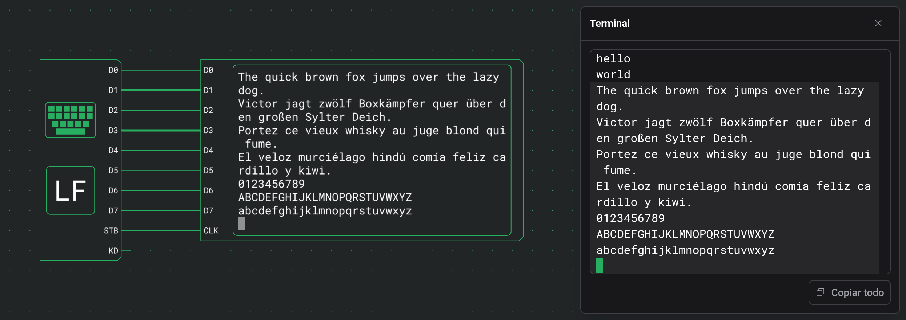

# Salidas

Las salidas muestran lo que hace un circuito: un LED para una sola señal, un display de segmentos para un número, una matriz de LEDs para una imagen y un terminal para texto. Solo tienen entradas y cambian a medida que avanza la simulación.

## LED

Un LED se enciende mientras su entrada es 1.

| Puerto  | Sentido | Significado       |
| ------- | ------- | ----------------- |
| Entrada | entrada | 1 enciende el LED |

No tiene más opciones que Dirección.

## Display de segmentos

Un display de segmentos muestra el número binario de sus entradas como un número en decimal, hexadecimal u octal.

| Puerto     | Sentido | Significado                                                     |
| ---------- | ------- | --------------------------------------------------------------- |
| 0, 1, 2, … | entrada | Los bits del número; la entrada 0 es el bit menos significativo |

| Opción   | Valores       | Predeterminado |
| -------- | ------------- | -------------- |
| Entradas | 1 a 16        | 2              |
| Base     | DEC, HEX, OCT | DEC            |

El número se rellena con ceros hasta tantas cifras como necesite el mayor valor posible de las entradas. Un 10, 16 u 8 pequeño a su lado indica la base.

| Entradas | DEC       | HEX     | OCT       |
| -------- | --------- | ------- | --------- |
| 4        | 00 a 15   | 0 a f   | 00 a 17   |
| 8        | 000 a 255 | 00 a ff | 000 a 377 |

## Matriz de LEDs

Una matriz de LEDs es una cuadrícula cuadrada de LEDs. En el flanco de subida de CLK, las entradas de datos se escriben en la fila que eligen las entradas de dirección. Cada fila conserva lo que se escribió en ella hasta la siguiente escritura.

| Puerto    | Sentido | Significado                              |
| --------- | ------- | ---------------------------------------- |
| A0, A1, … | entrada | La dirección de la fila que se escribe   |
| D0, D1, … | entrada | Los LEDs que se encienden en esa fila    |
| CLK       | entrada | Un flanco de subida escribe D en la fila |

| Opción     | Valores  | Predeterminado |
| ---------- | -------- | -------------- |
| Ancho/Alto | 4, 8, 16 | 4              |

El tamaño fija cuántas entradas de dirección y de datos hay:

| Ancho/Alto | Entradas de dirección | Entradas de datos | Una dirección abarca |
| ---------- | --------------------- | ----------------- | -------------------- |
| 4          | A0 a A1               | D0 a D3           | una fila             |
| 8          | A0 a A2               | D0 a D7           | una fila             |
| 16         | A0 a A4               | D0 a D7           | media fila           |

En 16 × 16, la dirección 0 es la mitad izquierda de la fila 0, la dirección 1 su mitad derecha, la dirección 2 la mitad izquierda de la fila 1, y así sucesivamente. D0 es el LED de más a la izquierda de la fila o media fila. La fila 0 está arriba, y al girar la matriz, la cuadrícula sigue derecha y solo se mueven los puertos.

Con una [burbuja de negación](docs:components-and-options#negar-un-puerto) en CLK, la matriz escribe en el flanco de bajada.

## Terminal

Un terminal es una pantalla de texto. Muestra un carácter cada vez que sube su entrada CLK: el que tiene su código en D0 a D7 en ese tick. El salto de línea, el retroceso y los demás códigos de control mueven el cursor en su lugar.

| Puerto  | Sentido | Significado                                                                  |
| ------- | ------- | ---------------------------------------------------------------------------- |
| D0 a D7 | entrada | El código Latin-1 de 8 bits que se muestra; D0 es el bit menos significativo |
| CLK     | entrada | Un flanco de subida muestra el código de D0 a D7                             |

| Opción          | Valores         | Predeterminado |
| --------------- | --------------- | -------------- |
| Columnas        | 8 a 80          | 40             |
| Filas           | 1 a 24          | 12             |
| Tamaño de texto | Pequeño, Grande | Pequeño        |

La pantalla tiene Columnas caracteres de ancho y Filas líneas de alto, y el componente crece para que quepa. Grande dibuja cada carácter una vez y media más grande que Pequeño. Al girar un terminal, su pantalla sigue derecha y solo se mueven los puertos.

El siguiente carácter va donde está el cursor de bloque, que la pantalla solo muestra durante una simulación. Con una [burbuja de negación](docs:components-and-options#negar-un-puerto) en CLK, el terminal muestra los caracteres en el flanco de bajada.

Para ver lo que escribes, conecta D0 a D7 de un [teclado](docs:inputs#teclado) a D0 a D7 del terminal, y su salida STB a CLK. `Enter` empieza entonces una línea nueva, `Backspace` borra el carácter anterior al cursor, y las flechas y `Home` mueven el cursor.

Durante una simulación, un clic en un terminal abre una ventana con todo lo que ha mostrado. La ventana se describe en [Inspección y monitores](docs:inspection#salida-de-un-terminal).

### Caracteres mostrados

Los códigos son Latin-1, como en el teclado. Los códigos del espacio a `~` y de `0xA0` a ÿ se muestran como su carácter, así que `0x41` muestra A y `0xF1` muestra ñ. El espacio de no separación se muestra como un espacio y el guion blando como un guion.

### Códigos de control

Estos códigos mueven el cursor o borran:

| Código | Nombre | Qué hace                                                                                           |
| ------ | ------ | -------------------------------------------------------------------------------------------------- |
| `0x08` | BS     | Retrocede una columna y borra el carácter que hay ahí. En la primera columna no hace nada.         |
| `0x09` | TAB    | Avanza hasta la siguiente tabulación, una cada 8 columnas, o hasta la última columna.              |
| `0x0A` | LF     | Pasa al principio de la fila siguiente. En la última fila, la pantalla sube una fila en su lugar.  |
| `0x0B` | HOM    | Va a la esquina superior izquierda.                                                                |
| `0x0C` | FF     | Borra la pantalla y va a la esquina superior izquierda. Las líneas borradas no pasan al historial. |
| `0x0D` | CR     | Vuelve al principio de la fila.                                                                    |
| `0x1C` | RT     | Avanza una columna a la derecha.                                                                   |
| `0x1D` | LT     | Retrocede una columna a la izquierda.                                                              |
| `0x1E` | UP     | Sube una fila.                                                                                     |
| `0x1F` | DN     | Baja una fila.                                                                                     |
| `0x7F` | DEL    | Borra el carácter bajo el cursor. El cursor no se mueve.                                           |

RT, LT, UP y DN se detienen en los bordes de la pantalla; solo LF la desplaza. Cualquier otro código, ESC y de `0x80` a `0x9F` incluidos, se ignora.

### Salto de línea automático

- Un carácter mostrado en la última columna deja ahí el cursor.
- El siguiente carácter va al principio de la fila siguiente, desplazando la pantalla si el cursor estaba en la última fila.
- Por eso una línea llena seguida de LF no deja una línea vacía.
- Un código que mueve el cursor anula ese salto, así que un BS justo después de la última columna borra el carácter que hay en ella.

### Historial

Una línea que sale de la pantalla por arriba pasa al historial tal como estaba, y los códigos del cursor ya no pueden cambiarla. El historial guarda las últimas 10 000 líneas y se muestra en la [ventana](docs:inspection#salida-de-un-terminal) del terminal.

| Acción                 | Pantalla    | Historial   |
| ---------------------- | ----------- | ----------- |
| Pausar                 | se conserva | se conserva |
| Detener                | se borra    | se borra    |
| Salir de la simulación | se borra    | se borra    |

## Ver también

- [Entradas](docs:inputs): interruptores, botones y el teclado que controlan estas salidas
- [Inspección y monitores](docs:inspection): la ventana del terminal y los monitores
- [Simulación](docs:simulation): ejecutar, pausar y detener un circuito
- [Componentes y opciones](docs:components-and-options): la paleta y la tarjeta de ajustes
