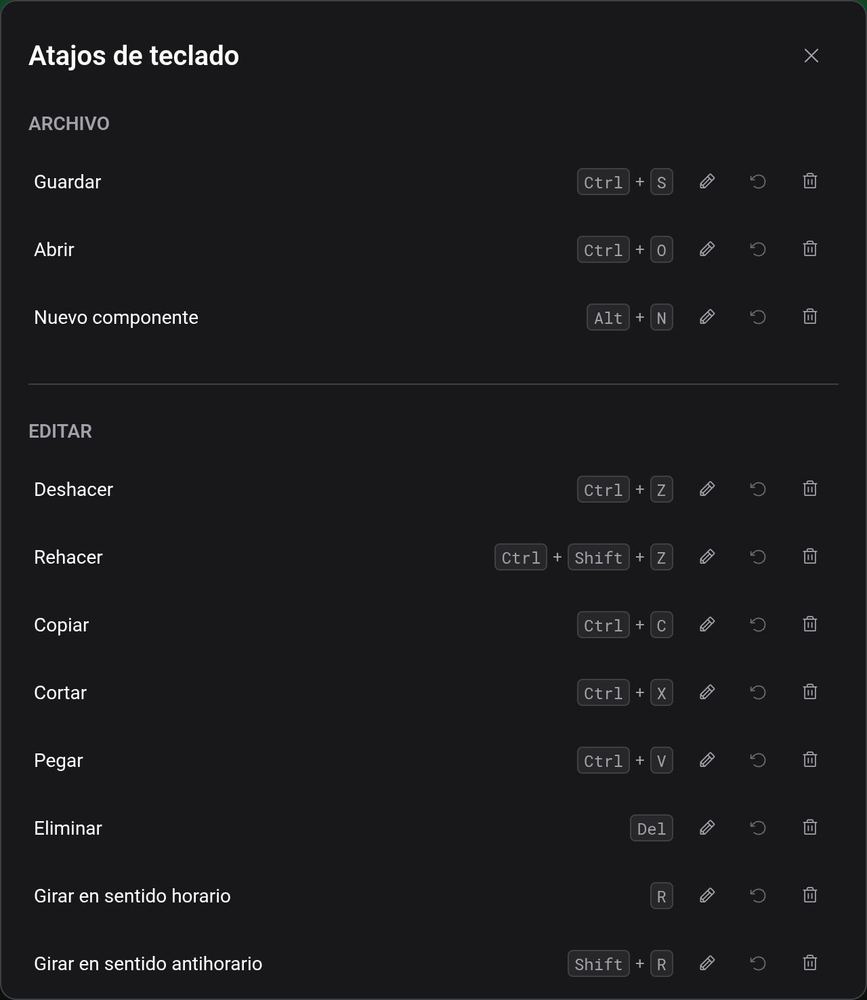

# Atajos de teclado

Estos son los atajos predeterminados, en el orden en que los lista Editar → Atajos de teclado. En Mac, `⌘` funciona en todos los sitios donde la tabla dice `Ctrl`, y `Ctrl` también funciona.

## Atajos predeterminados

| Acción                                                        | Predeterminado |
| ------------------------------------------------------------- | -------------- |
| Guardar                                                       | `Ctrl+S`       |
| Abrir                                                         | `Ctrl+O`       |
| Nuevo componente                                              | `Alt+N`        |
| Deshacer                                                      | `Ctrl+Z`       |
| Rehacer                                                       | `Ctrl+Shift+Z` |
| Copiar                                                        | `Ctrl+C`       |
| Cortar                                                        | `Ctrl+X`       |
| Pegar                                                         | `Ctrl+V`       |
| Eliminar                                                      | `Delete`       |
| Girar en sentido horario                                      | `R`            |
| Girar en sentido antihorario                                  | `Shift+R`      |
| Mover la selección hacia arriba / abajo / izquierda / derecha | flechas        |
| Acercar                                                       | `Ctrl++`       |
| Alejar                                                        | `Ctrl+-`       |
| Zoom 100%                                                     | `Ctrl+0`       |
| Desplazar                                                     | `P`            |
| Herramienta de cable                                          | `W`            |
| Seleccionar                                                   | `S`            |
| Borrar                                                        | `E`            |
| Colocar texto                                                 | `T`            |
| Cortar cables en el borde de la selección (mantener)          | `Alt`          |
| Añadir a la selección o quitarlo de ella (mantener)           | `Ctrl`         |
| Iniciar/detener simulación                                    | `Enter`        |
| Cancelar                                                      | `Escape`       |

Mientras escribes en un campo de texto, ningún atajo responde salvo `Escape`. Durante una simulación, los atajos de edición están desactivados y `Escape` sale de la simulación.

## Teclas mantenidas

Las dos acciones marcadas con «mantener» actúan mientras la tecla está pulsada, en lugar de dispararse una vez. Mantén `Alt` al soltar un marco de selección para cortar los cables en su borde (consulta [Tablero y herramientas](docs:board-and-tools#cortar-cables-en-el-borde-de-la-selección)). Mantén `Ctrl` al hacer clic o trazar un marco para añadir a la selección o quitar de ella. Funciona con Seleccionar, Desplazar y la herramienta de cable.

## Cambiar un atajo

Editar → Atajos de teclado lista cada acción. Haz clic en el lápiz junto a una y pulsa la nueva combinación. `Escape` cancela la grabación, por eso no se puede asignar a otra cosa. Una tecla modificadora sola, como `Alt`, solo puede asignarse a las dos acciones mantenidas.

Si la combinación ya pertenece a otra acción, esa acción la pierde y un mensaje dice cuál. «Restablecer» devuelve el atajo predeterminado de una acción, «Desasignar» la deja sin atajo y «Restablecer todo» restaura todos los predeterminados.

Tus atajos se guardan en este navegador. Borrar los datos del sitio los restablece.

## Teclas del mando

Un [mando](docs:inputs#mando) tiene sus propias teclas, aparte de los atajos de arriba. Funcionan mientras su ventana tiene el teclado, y ahí van antes que los atajos: `Enter` pulsa Start.

| Botón                                | Tecla predeterminada |
| ------------------------------------ | -------------------- |
| Arriba / Abajo / Izquierda / Derecha | flechas              |
| A                                    | `X`                  |
| B                                    | `Z`                  |
| X                                    | `S`                  |
| Y                                    | `A`                  |
| L                                    | `Q`                  |
| R                                    | `W`                  |
| Select                               | `Shift` derecha      |
| Start                                | `Enter`              |

Una tecla cuenta por su posición en el teclado; en un teclado español están donde indica la tabla. En un teclado francés AZERTY, por ejemplo, B queda en la W. Chrome y Edge muestran en la ventana cada tecla como la rotula tu teclado.

Para cambiar las teclas:

1. Haz clic en «Asignar teclas» en la parte inferior de una ventana de mando.
2. Haz clic en un botón y pulsa la tecla que debe tener. Si otro botón ya tenía esa tecla, los dos intercambian sus teclas y el otro botón se ilumina un momento.
3. Haz clic en «Listo» para volver al juego.

Mientras asignas, `Escape` cancela, y `Backspace` o `Delete` deja el botón sin tecla. `Escape` y `Tab` no se pueden asignar. «Restablecer valores predeterminados» vuelve a la tabla de arriba.

Las teclas son las mismas para todos los mandos de todos los proyectos y se guardan en este navegador, como los atajos. Un cambio aparece al momento en cada ventana de mando abierta, también en otras pestañas.

## Teclas en la ventana de un teclado

Mientras el campo de escritura de la [ventana de un teclado](docs:inputs#teclado) tiene el foco, las teclas van al circuito y los atajos de arriba no hacen nada. Estas teclas se comportan ahí de otra manera:

| Tecla       | En el campo de escritura                 |
| ----------- | ---------------------------------------- |
| `Enter`     | Envía LF. La simulación sigue.           |
| `Escape`    | Envía ESC. La ventana sigue abierta.     |
| `Tab`       | Envía TAB. El foco se queda en el campo. |
| `Shift+Tab` | Saca el foco del campo.                  |
| flechas     | Envían RT, LT, UP y DN.                  |

Las combinaciones con `Ctrl`, `Alt` o `⌘` van al navegador, así que `Ctrl+V` pega texto en el teclado. `AltGr` no es una de ellas: un carácter escrito con ella se envía. Una tecla envía el carácter que le da la distribución de tu teclado, por eso estas teclas no se reasignan como las de un mando.

## Ver también

- [Tablero y herramientas](docs:board-and-tools): las herramientas y acciones detrás de estas teclas
- [Simulación](docs:simulation): qué hacen Enter y Escape allí
