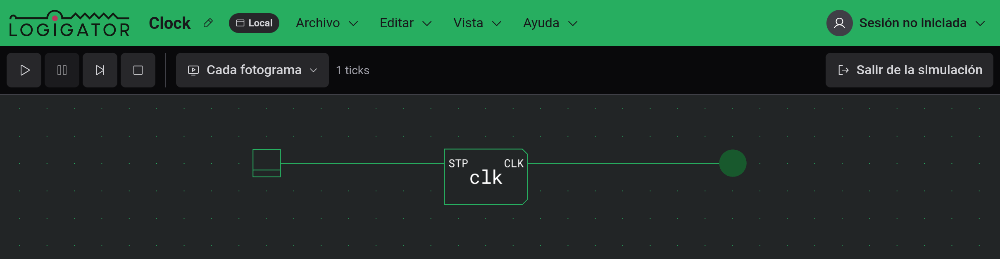
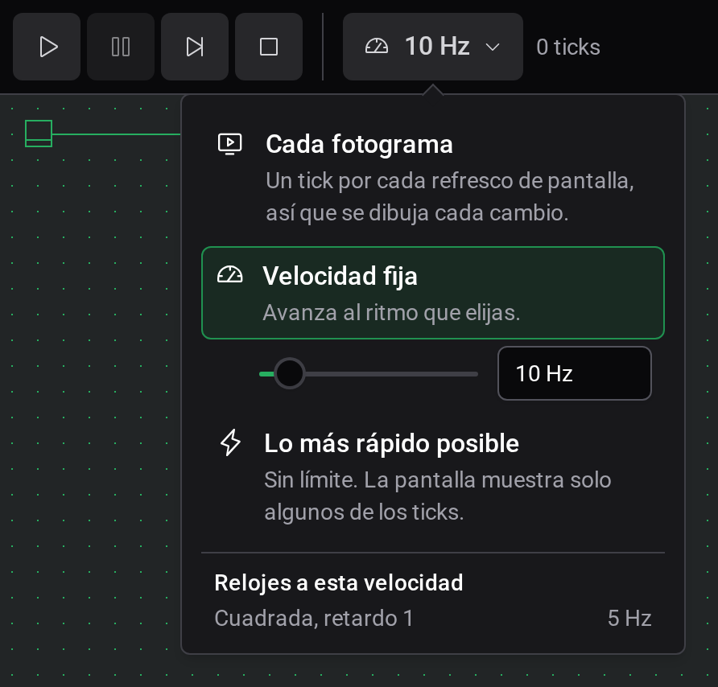

# Simulación

«Iniciar simulación», en el extremo derecho de la barra de herramientas, pone el circuito en marcha: los cables con corriente se iluminan, los LEDs y las pantallas muestran su estado, y los interruptores y botones responden a los clics. `Enter` hace lo mismo.

## Entrar y salir {#entering-and-leaving}

La simulación siempre ejecuta el proyecto principal. Si la pestaña de un componente personalizado está abierta, el editor vuelve antes al proyecto principal.

Mientras se ejecuta, el tablero está bloqueado. Puedes desplazar la vista y hacer zoom, usar las entradas e [inspeccionar](docs:inspection) ROMs, RAMs, terminales y componentes personalizados, pero no colocar, mover, cablear ni eliminar nada. «Salir de la simulación», `Enter` o `Escape` vuelve a la edición con la herramienta Desplazar.

Con «Iniciar la simulación automáticamente» activado (lo predeterminado), el circuito arranca en cuanto entras. Desactivado, la simulación espera en pausa en el tick 0 para que avances paso a paso desde el principio.

## Controles {#run-controls}

Durante una simulación, la barra de herramientas se sustituye por cuatro botones, el botón de velocidad y un contador.

| Botón    | Qué hace                                                                                        |
| -------- | ----------------------------------------------------------------------------------------------- |
| Ejecutar | Inicia o reanuda la simulación.                                                                 |
| Pausar   | Se detiene en el tick actual y conserva el estado.                                              |
| Paso     | Avanza un tick. Solo disponible en pausa.                                                       |
| Detener  | Devuelve el circuito al tick 0, apaga todos los interruptores y pausa. Sigues en la simulación. |

El contador muestra los ticks desde el inicio y, mientras se ejecuta, la velocidad alcanzada realmente.

## Velocidad {#speed}

El botón de velocidad muestra el ajuste actual. Un clic abre un panel con tres modos, entre los que puedes cambiar mientras el circuito se ejecuta.

| Modo                  | Qué hace                                                                                                                                    |
| --------------------- | ------------------------------------------------------------------------------------------------------------------------------------------- |
| Cada fotograma        | Lo predeterminado. Avanza un tick por cada refresco de pantalla, así que la velocidad sigue la frecuencia de tu pantalla.                   |
| Velocidad fija        | Avanza al ritmo que elijas, 1 kHz al principio. Si el circuito no puede seguir el ritmo, aparece un signo de advertencia junto al contador. |
| Lo más rápido posible | Funciona sin límite. La pantalla muestra entonces solo una parte de los ticks.                                                              |

Con Velocidad fija, el control deslizante va de 1 Hz a 10 MHz. En el campo de al lado puedes escribir cualquier ritmo desde 0,1 Hz, como `20`, `2,5k` o `1M`. Un campo rojo significa que lo escrito no es un ritmo, y sigue valiendo el último válido.

Bajo los modos, «Relojes a esta velocidad» lista la frecuencia de cada tipo de reloj del circuito, por forma de onda y retardo, por ejemplo «Cuadrada, retardo 5». Cuántos ticks dura un ciclo de un reloj se describe en [Reloj](docs:clock-and-timing#clock). Con velocidad fija, la lista aparece enseguida. En los otros dos modos hay que medir antes el ritmo, así que la lista aparece alrededor de un segundo después de que el circuito arranque.

## Usar las entradas {#operating-inputs}

| Componente     | Cómo se maneja                                                                               | Detalles                                   |
| -------------- | -------------------------------------------------------------------------------------------- | ------------------------------------------ |
| Interruptor    | Haz clic en él. Cambia con cada clic y se queda donde lo dejas.                              | [Interruptor](docs:inputs#switch)          |
| Botón          | Mantenlo pulsado. Está activo mientras lo mantienes.                                         | [Botón](docs:inputs#button)                |
| Botón de pulso | Haz clic en él. Cada clic envía un pulso de un tick, lo mantengas pulsado el tiempo que sea. | [Botón de pulso](docs:inputs#pulse-button) |
| Mando          | Haz clic en él para abrir su mando y pulsa ahí los botones.                                  | [Mando](docs:inputs#gamepad)               |
| Teclado        | Haz clic en él para abrir una ventana y escribe en ella.                                     | [Teclado](docs:inputs#keyboard)            |

Arrastrar en cualquier otro punto del tablero desplaza la vista.

## Señales en conflicto {#conflicting-signals}

Un cable dibujado en naranja tiene un conflicto. El naranja es un aviso sobre tu circuito y no cambia cómo funciona la simulación: un cable con conflicto sigue contando como 1 mientras al menos una salida le dé 1.

### Causas {#causes}

- Dos o más salidas controlan el mismo cable y, en ese momento, una está a 1 y otra a 0. Las salidas que coinciden no se marcan, así que el naranja puede aparecer y desaparecer según cambian los valores. En hardware real, esto sería un cortocircuito.
- Un biestable SR recibió un flanco de reloj con S y R a 1 a la vez. Q pasa a 1 y !Q a 0, y ambas siguen en naranja hasta un flanco de reloj con solo S o solo R a 1. En hardware real, es una combinación de entradas que un biestable SR no admite.

### Efecto en la simulación {#effect-on-the-simulation}

La simulación sigue igual: un cable con varias salidas está a 1 en cuanto una de ellas está a 1.

Un conflicto dentro de un componente personalizado no se muestra en el tablero. Haz clic en el componente para abrir un [monitor](docs:inspection#watches), donde sus cables lo muestran.

Desactivar el ajuste «Resaltar conflictos», activado de forma predeterminada, quita el naranja. Consulta [Ajustes](docs:settings#editor-settings).

### Soluciones {#fixes}

| Causa                      | Solución                                                                                                                                                                                                         |
| -------------------------- | ---------------------------------------------------------------------------------------------------------------------------------------------------------------------------------------------------------------- |
| Varias salidas en un cable | Conecta una sola salida a cada cable. Para combinar varias fuentes, pásalas por una [puerta O](docs:logic-gates#or-gate). Para elegir una de ellas, usa un [multiplexor](docs:adders-and-selectors#multiplexer). |
| S y R a 1 a la vez         | No pongas S y R a 1 a la vez, o usa en su lugar un [biestable D o JK](docs:memory#d-flip-flop).                                                                                                                  |

## Cuando la simulación no arranca {#when-the-simulation-won-t-start}

El editor no arranca y muestra un mensaje con el componente afectado cuando:

- un componente personalizado se contiene a sí mismo, directamente o a través de otro,
- un componente personalizado no tiene ningún circuito dentro,
- los puertos de un componente personalizado ya no coinciden con los conectores Entrada y Salida de su circuito.

Corrige el componente indicado y vuelve a empezar. Si el mensaje dice que el motor de simulación no pudo arrancar, tu navegador no admite WebAssembly.

## Ver también {#see-also}

- [Inspección y monitores](docs:inspection): contenido de ROMs y RAMs, salida de terminales, y monitores
- [Entradas](docs:inputs): interruptores, botones, el mando y el teclado
- [Salidas](docs:outputs): LEDs, pantallas y el terminal
- [Ajustes](docs:settings): el inicio automático de la simulación y el resaltado de conflictos
- [Móviles y tabletas](docs:phones-and-tablets): los controles en la vista táctil
