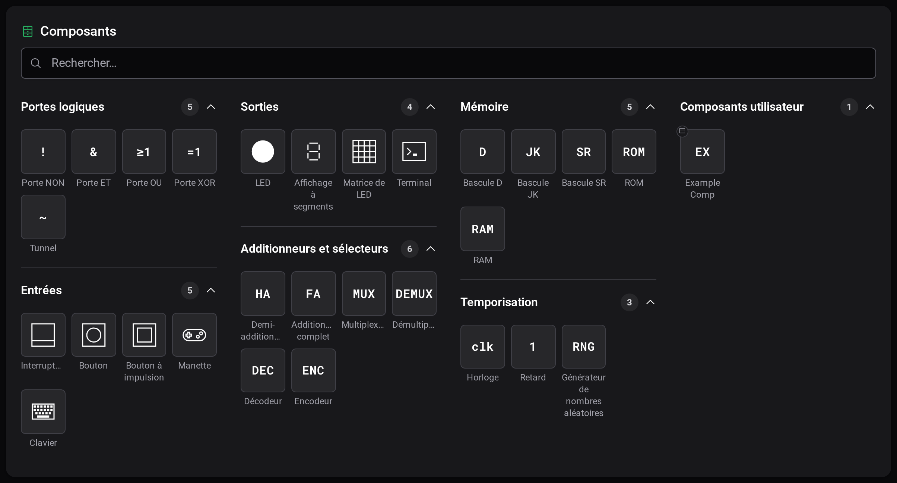
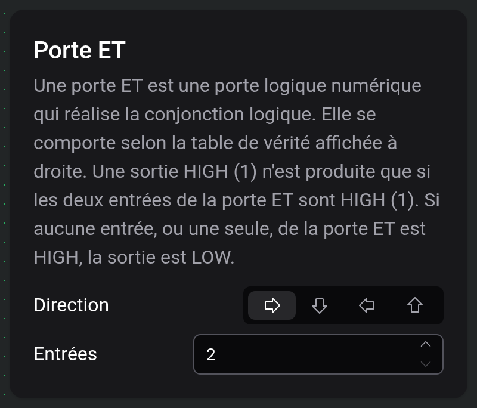

# Composants et options

Les composants sont les pièces dont un circuit est fait : portes, mémoires, entrées et affichages. Vous les choisissez dans la palette à gauche et réglez leurs options dans la carte de paramètres. Cette page liste chaque composant intégré et renvoie à sa description.

## La palette {#the-palette}

Le champ de recherche en haut filtre la palette par nom. Les catégories sont Portes logiques, Entrées, Sorties, Additionneurs et sélecteurs, Mémoire et Temporisation, plus Composants utilisateur dès que vous avez construit un [composant personnalisé](docs:custom-components). Un clic sur l'en-tête d'une catégorie la replie ; la palette retient celles que vous avez repliées. Le placement est décrit dans [Plan de travail et outils](docs:board-and-tools#placing-components).

Chaque composant met un tick à transmettre un changement à sa sortie. Les tableaux ci-dessous suivent l'ordre de la palette.

### Portes logiques {#logic-gates}

| Composant                                    | Rôle                                                                |
| -------------------------------------------- | ------------------------------------------------------------------- |
| [Porte NON](docs:logic-gates#not-gate)       | Inverse son entrée.                                                 |
| [Porte ET](docs:logic-gates#and-gate)        | Donne 1 quand toutes les entrées sont à 1.                          |
| [Porte OU](docs:logic-gates#or-gate)         | Donne 1 quand au moins une entrée est à 1.                          |
| [Porte XOR](docs:logic-gates#xor-gate)       | Donne 1 quand un nombre impair d'entrées est à 1.                   |
| [Tunnel](docs:wires-and-connections#tunnels) | Relié sans fil à tous les autres tunnels portant la même étiquette. |

### Additionneurs et sélecteurs {#adders-and-selectors}

| Composant                                                    | Rôle                                                                          |
| ------------------------------------------------------------ | ----------------------------------------------------------------------------- |
| [Demi-additionneur](docs:adders-and-selectors#half-adder)    | Additionne deux bits.                                                         |
| [Additionneur complet](docs:adders-and-selectors#full-adder) | Additionne deux bits et une retenue entrante.                                 |
| [Multiplexeur](docs:adders-and-selectors#multiplexer)        | Transmet à sa sortie l'entrée de données choisie par les lignes de sélection. |
| [Démultiplexeur](docs:adders-and-selectors#demultiplexer)    | Transmet son entrée à la sortie choisie par les lignes de sélection.          |
| [Décodeur](docs:adders-and-selectors#decoder)                | Active la seule sortie dont le numéro est présent sur les entrées.            |
| [Encodeur](docs:adders-and-selectors#encoder)                | Donne le numéro de l'entrée la plus haute qui est à 1.                        |

### Mémoire {#memory}

| Composant                              | Rôle                                                                             |
| -------------------------------------- | -------------------------------------------------------------------------------- |
| [Bascule D](docs:memory#d-flip-flop)   | Mémorise D sur le front montant de CLK.                                          |
| [Bascule JK](docs:memory#jk-flip-flop) | Met un bit à 1, le remet à 0 ou l'inverse sur le front montant de CLK.           |
| [Bascule SR](docs:memory#sr-flip-flop) | Met un bit à 1 ou le remet à 0 sur le front montant de CLK.                      |
| [ROM](docs:memory#rom)                 | Donne le mot stocké à l'adresse présente sur ses entrées.                        |
| [RAM](docs:memory#ram)                 | Stocke les mots que le circuit écrit et donne celui qui se trouve à une adresse. |

### Temporisation {#timing}

| Composant                                                                         | Rôle                                                                               |
| --------------------------------------------------------------------------------- | ---------------------------------------------------------------------------------- |
| [Horloge](docs:clock-and-timing#clock)                                            | Passe d'elle-même de 0 à 1 et inversement, en signal carré ou en impulsion.        |
| [Retard](docs:clock-and-timing#delay)                                             | Transmet son entrée telle quelle, un tick plus tard.                               |
| [Générateur de nombres aléatoires](docs:clock-and-timing#random-number-generator) | Place une nouvelle valeur aléatoire sur ses sorties à chaque front montant de CLK. |

### Entrées {#inputs}

| Composant                                      | Rôle                                                                                 |
| ---------------------------------------------- | ------------------------------------------------------------------------------------ |
| [Interrupteur](docs:inputs#switch)             | Bascule entre 0 et 1 à chaque clic pendant une simulation.                           |
| [Bouton](docs:inputs#button)                   | Donne 1 tant que vous le maintenez enfoncé.                                          |
| [Bouton à impulsion](docs:inputs#pulse-button) | Donne une impulsion d'un tick par clic.                                              |
| [Manette](docs:inputs#gamepad)                 | Une sortie par bouton d'une manette avec laquelle vous jouez pendant une simulation. |
| [Clavier](docs:inputs#keyboard)                | Place sur ses sorties le code de chaque touche que vous tapez.                       |

### Sorties {#outputs}

| Composant                                            | Rôle                                                                                |
| ---------------------------------------------------- | ----------------------------------------------------------------------------------- |
| [LED](docs:outputs#led)                              | S'allume tant que son entrée est à 1.                                               |
| [Affichage à segments](docs:outputs#segment-display) | Affiche le nombre binaire présent sur ses entrées en décimal, hexadécimal ou octal. |
| [Matrice de LED](docs:outputs#led-matrix)            | Une grille carrée de LED, écrite une ligne à la fois.                               |
| [Terminal](docs:outputs#terminal)                    | Un écran de texte qui affiche un caractère à chaque front montant de CLK.           |

## La carte de paramètres {#the-settings-card}

Quand vous sélectionnez un seul composant, ou en choisissez un à placer, sa carte de paramètres apparaît à côté du plan de travail : le nom, une description et les options. Pendant une simulation, la carte est masquée.

- Direction, que tous les composants possèdent, a quatre boutons fléchés qui tournent le composant. Une direction choisie pendant le placement est conservée pour le composant suivant du même type.
- Modifier Entrées, Sorties ou une option de taille change immédiatement le nombre de ports.
- Les autres options sont décrites avec chaque composant, comme le contenu d'une [ROM](docs:memory#rom), les noms des boutons d'une [manette](docs:inputs#gamepad) et la taille de l'écran d'un [terminal](docs:outputs#terminal).

## Inverser un port {#negating-a-port}

Avec l'outil fil, appuyez sur un port d'entrée ou de sortie pour y ajouter une bulle d'inversion. Le signal qui traverse ce port est alors inversé, sans retard supplémentaire. Appuyez de nouveau sur la bulle pour la retirer. Au survol d'un port, l'outil fil montre l'effet qu'aurait un appui. Une bulle sur l'entrée CLK d'une [bascule](docs:memory) la fait réagir au front descendant.

Les tunnels, les fiches Entrée et Sortie et les ports d'un composant personnalisé placé ne peuvent pas être inversés.

## Étiquettes de texte {#text-labels}

Le texte ne figure pas dans la palette. Avec l'outil Texte (`T`), cliquez sur le plan de travail pour poser une étiquette « [insert text] ». « Modifier le texte » dans sa carte de paramètres ouvre une fenêtre pour le texte, qui peut tenir sur plusieurs lignes, et Taille de police va de 2 à 128. Les fils traversent les étiquettes sans s'y connecter. Un clic sur un fil passant sous une étiquette sélectionne le fil.

## Voir aussi {#see-also}

- [Portes logiques](docs:logic-gates) : la première des pages de composants
- [Entrées](docs:inputs) : interrupteurs, boutons, la manette et le clavier
- [Fils et connexions](docs:wires-and-connections) : relier des ports
- [Composants personnalisés](docs:custom-components) : construire vos propres pièces
- [Plan de travail et outils](docs:board-and-tools) : placer, déplacer et tourner
