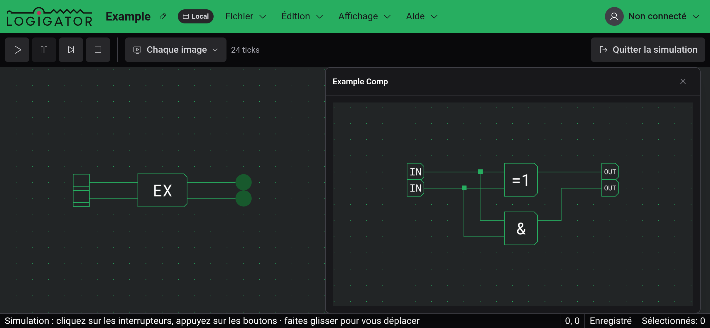
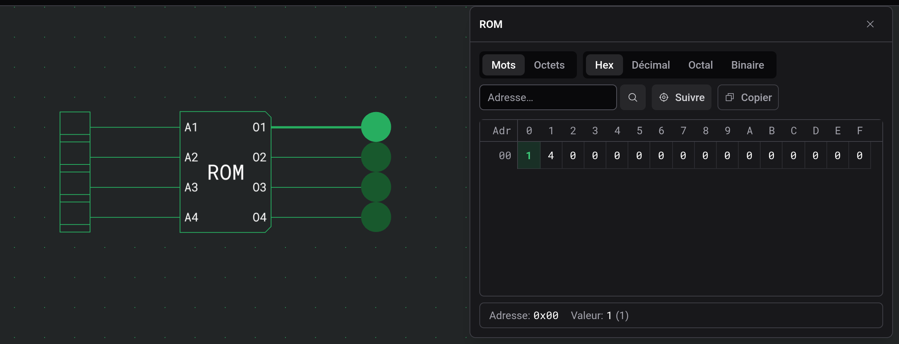

# Inspection et surveillances

Pendant une [simulation](docs:simulation), en cours ou en pause, quatre sortes de composants peuvent être ouverts pour voir à l'intérieur. Un clic sur une ROM affiche son contenu, avec le mot en cours de lecture en surbrillance, un clic sur une RAM montre ce qu'elle contient à mesure que le circuit y écrit, et un clic sur un terminal montre tout ce qu'il a affiché. Un clic sur un composant personnalisé ouvre une surveillance, une vue en direct de son circuit interne.

Sur ordinateur, chaque vue s'ouvre dans une fenêtre que vous pouvez déplacer et redimensionner. Un nouveau clic sur le composant ramène sa fenêtre au premier plan. En [disposition tactile](docs:phones-and-tablets), les vues de ROM, de RAM et de terminal partagent un panneau en bas de l'écran, et une surveillance occupe tout l'écran. Quitter la simulation les ferme toutes.

## Contenu d'une ROM

La vue est en lecture seule ; le contenu se modifie pendant l'édition, dans les [paramètres de la ROM](docs:memory#rom). Le mot à l'adresse actuelle est en surbrillance, et avec « Suivre » (activé par défaut) le tableau défile quand l'adresse change. La ligne du bas affiche l'adresse et la valeur de la cellule en surbrillance. Un clic sur une autre cellule affiche celle-ci jusqu'au prochain changement d'adresse.

Les boutons au-dessus du tableau choisissent Mots ou Octets et la base : Hex, Décimal, Octal ou Binaire. Pour aller à une adresse, tapez-la en hexadécimal dans le champ « Adresse… ». « Copier » place tout le tableau dans le presse-papiers sous forme de texte, dans la vue et la base choisies.

## Contenu d'une RAM

La vue d'une RAM a le même tableau, les mêmes boutons et le même « Suivre » que celle d'une ROM, avec le mot à l'adresse présente sur ses entrées en surbrillance. Elle montre ce que le circuit a stocké et change à mesure qu'il écrit, en marche ou pas à pas. Elle aussi est en lecture seule : seul le circuit écrit dans une RAM. Chaque mot vaut 0 au démarrage de la simulation, et « Arrêter » les remet tous à 0.

Une grande RAM n'est lue qu'autour des lignes affichées. Une ligne qui défile à l'écran montre des points jusqu'à ce qu'elle soit lue, ce qui prend un instant, et la ligne du bas indique « Non chargée » pour une cellule affichée ainsi. « Copier » place le tableau dans le presse-papiers tel que vous le voyez, points compris.

## Sortie d'un terminal

La fenêtre d'un terminal montre l'historique, la ligne la plus ancienne en premier, et en dessous l'écran, sur une bande teintée, avec le curseur. Le texte apparaît à mesure que le circuit l'affiche, en marche ou pas à pas. L'effet de chaque code est décrit sous [Terminal](docs:outputs#terminal).

Les lignes sont coupées aux colonnes du terminal, comme sur son écran : une fenêtre plus étroite ou plus large ne les coupe pas autrement. Le texte rapetisse quand la fenêtre se rétrécit, jusqu'à une taille minimale, puis la fenêtre défile horizontalement. « Tout copier » place l'historique et l'écran dans le presse-papiers sous forme de texte.

Un terminal placé sur le plan de travail est lu dès le début de la simulation : sa fenêtre montre donc tout le texte, même si vous l'ouvrez tard. « Arrêter » vide la fenêtre en même temps que l'écran du terminal.

La simulation conserve les 65 536 derniers caractères envoyés à chaque terminal. Quand un circuit en envoie davantage entre deux rafraîchissements de l'écran, en mode Aussi vite que possible par exemple :

- les plus anciens n'atteignent jamais le terminal,
- une ligne de l'historique indique combien de caractères ont été perdus,
- l'écran continue avec les caractères arrivés ensuite.

## Surveillances

Une surveillance dessine le circuit interne du composant avec les mêmes fils allumés que le plan de travail. Vous pouvez y déplacer la vue, zoomer et utiliser les interrupteurs et boutons qu'il contient. Ils pilotent la vraie simulation, donc le reste du circuit réagit.

Un clic sur un composant à l'intérieur d'une surveillance ouvre :

| Composant                       | Ce qui s'ouvre                                                                                                                       |
| ------------------------------- | ------------------------------------------------------------------------------------------------------------------------------------ |
| Un composant personnalisé       | Son circuit, dans la même fenêtre. Le titre montre le chemin, par exemple Outer › Inner. Cliquez sur un nom précédent pour remonter. |
| Une ROM, une RAM ou un terminal | Sa propre vue.                                                                                                                       |
| Une manette ou un clavier       | Sa fenêtre, dont le titre montre le chemin, par exemple Outer › Inner › Manette.                                                     |

Un terminal à l'intérieur d'une surveillance y montre aussi son écran : quand vous ouvrez son niveau, il rejoue les caractères que la simulation conserve encore pour lui, et montre ainsi ce qui a été affiché avant que vous ne regardiez.

La fenêtre d'une manette ou d'un clavier fonctionne comme sur le plan de travail (voir [Manette](docs:inputs#manette) et [Clavier](docs:inputs#clavier)), et ce que vous y faites atteint le composant dans la surveillance. Remonter au-dessus de son niveau ou fermer la surveillance ferme aussi cette fenêtre.

Si la surveillance signale que le circuit interne ne correspond pas à la simulation compilée, le composant a été modifié après le démarrage de la simulation. Quittez la simulation et relancez-la.

## Voir aussi

- [Simulation](docs:simulation) : faire fonctionner un circuit
- [Composants personnalisés](docs:custom-components) : construire les composants que vous surveillez
- [Mémoire](docs:memory) : options des ROM et des RAM, modification du contenu d'une ROM
- [Sorties](docs:outputs) : les options du terminal et ce qu'il fait de chaque code
