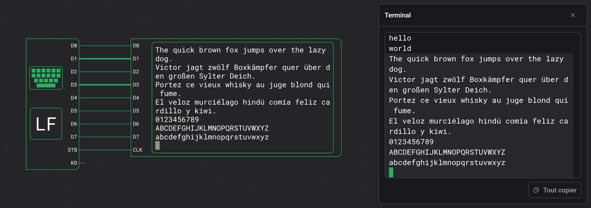

# Sorties

Les sorties montrent ce que fait un circuit : une LED pour un seul signal, un affichage à segments pour un nombre, une matrice de LED pour une image et un terminal pour du texte. Elles n'ont que des entrées et changent au fil de la simulation.

## LED

Une LED s'allume tant que son entrée est à 1.

| Port   | Sens   | Rôle            |
| ------ | ------ | --------------- |
| Entrée | entrée | 1 allume la LED |

Elle n'a pas d'autre option que Direction.

## Affichage à segments

Un affichage à segments affiche le nombre binaire présent sur ses entrées sous forme de nombre décimal, hexadécimal ou octal.

| Port       | Sens   | Rôle                                                        |
| ---------- | ------ | ----------------------------------------------------------- |
| 0, 1, 2, … | entrée | Les bits du nombre, l'entrée 0 étant le bit de poids faible |

| Option  | Valeurs       | Par défaut |
| ------- | ------------- | ---------- |
| Entrées | 1 à 16        | 2          |
| Base    | DEC, HEX, OCT | DEC        |

Le nombre est complété par des zéros jusqu'au nombre de chiffres qu'exige la plus grande valeur possible sur les entrées. Un petit 10, 16 ou 8 à côté indique la base.

| Entrées | DEC       | HEX     | OCT       |
| ------- | --------- | ------- | --------- |
| 4       | 00 à 15   | 0 à f   | 00 à 17   |
| 8       | 000 à 255 | 00 à ff | 000 à 377 |

## Matrice de LED

Une matrice de LED est une grille carrée de LED. Sur le front montant de CLK, les entrées de données sont écrites dans la ligne choisie par les entrées d'adresse. Chaque ligne garde ce qui y a été écrit jusqu'à l'écriture suivante.

| Port      | Sens   | Rôle                                   |
| --------- | ------ | -------------------------------------- |
| A0, A1, … | entrée | L'adresse de la ligne à écrire         |
| D0, D1, … | entrée | Les LED à allumer dans cette ligne     |
| CLK       | entrée | Un front montant écrit D dans la ligne |

| Option          | Valeurs  | Par défaut |
| --------------- | -------- | ---------- |
| Largeur/Hauteur | 4, 8, 16 | 4          |

La taille fixe le nombre d'entrées d'adresse et de données :

| Largeur/Hauteur | Entrées d'adresse | Entrées de données | Une adresse couvre |
| --------------- | ----------------- | ------------------ | ------------------ |
| 4               | A0 à A1           | D0 à D3            | une ligne          |
| 8               | A0 à A2           | D0 à D7            | une ligne          |
| 16              | A0 à A4           | D0 à D7            | une demi-ligne     |

En 16 × 16, l'adresse 0 est la moitié gauche de la ligne 0, l'adresse 1 sa moitié droite, l'adresse 2 la moitié gauche de la ligne 1, et ainsi de suite. D0 est la LED la plus à gauche de la ligne ou de la demi-ligne. La ligne 0 est en haut, et quand vous tournez la matrice, la grille reste droite et seuls les ports changent de place.

Avec une [bulle d'inversion](docs:components-and-options#inverser-un-port) sur CLK, la matrice écrit au front descendant.

## Terminal

Un terminal est un écran de texte. Il affiche un caractère chaque fois que son entrée CLK monte : celui dont le code est sur D0 à D7 à ce tick. Le saut de ligne, le retour arrière et les autres codes de contrôle déplacent le curseur à la place.

| Port    | Sens   | Rôle                                                                   |
| ------- | ------ | ---------------------------------------------------------------------- |
| D0 à D7 | entrée | Le code Latin-1 sur 8 bits à afficher, D0 étant le bit de poids faible |
| CLK     | entrée | Un front montant affiche le code présent sur D0 à D7                   |

| Option          | Valeurs        | Par défaut |
| --------------- | -------------- | ---------- |
| Colonnes        | 8 à 80         | 40         |
| Lignes          | 1 à 24         | 12         |
| Taille du texte | Petite, Grande | Petite     |

L'écran fait Colonnes caractères de large et Lignes lignes de haut, et le composant grandit avec lui. Grande dessine chaque caractère une fois et demie plus grand que Petite. Quand vous tournez un terminal, son écran reste droit et seuls les ports changent de place.

Le caractère suivant s'écrit à la place du curseur en bloc, que l'écran ne montre que pendant une simulation. Avec une [bulle d'inversion](docs:components-and-options#inverser-un-port) sur CLK, le terminal affiche au front descendant.

Pour voir ce que vous tapez, reliez D0 à D7 d'un [clavier](docs:inputs#clavier) à D0 à D7 du terminal, et sa sortie STB à CLK. `Enter` commence alors une nouvelle ligne, `Backspace` efface le caractère avant le curseur, et les flèches et `Home` déplacent le curseur.

Pendant une simulation, un clic sur un terminal ouvre une fenêtre avec tout ce qu'il a affiché. Cette fenêtre est décrite dans [Inspection et surveillances](docs:inspection#sortie-d-un-terminal).

### Caractères affichés

Les codes sont en Latin-1, comme sur le clavier. Les codes de l'espace à `~` et de `0xA0` à ÿ s'affichent comme leur caractère : `0x41` affiche A et `0xE9` affiche é. L'espace insécable s'affiche comme une espace et le trait d'union conditionnel comme un trait d'union.

### Codes de contrôle

Ces codes déplacent le curseur ou effacent :

| Code   | Nom | Effet                                                                                                       |
| ------ | --- | ----------------------------------------------------------------------------------------------------------- |
| `0x08` | BS  | Recule d'une colonne et efface le caractère qui s'y trouve. Sans effet dans la première colonne.            |
| `0x09` | TAB | Avance jusqu'au taquet de tabulation suivant, un toutes les 8 colonnes, ou jusqu'à la dernière colonne.     |
| `0x0A` | LF  | Passe au début de la ligne suivante. Sur la dernière ligne, l'écran défile plutôt d'une ligne vers le haut. |
| `0x0B` | HOM | Va au coin supérieur gauche.                                                                                |
| `0x0C` | FF  | Efface l'écran et va au coin supérieur gauche. Les lignes effacées ne vont pas dans l'historique.           |
| `0x0D` | CR  | Revient au début de la ligne.                                                                               |
| `0x1C` | RT  | Avance d'une colonne vers la droite.                                                                        |
| `0x1D` | LT  | Recule d'une colonne vers la gauche.                                                                        |
| `0x1E` | UP  | Monte d'une ligne.                                                                                          |
| `0x1F` | DN  | Descend d'une ligne.                                                                                        |
| `0x7F` | DEL | Efface le caractère sous le curseur. Le curseur ne bouge pas.                                               |

RT, LT, UP et DN s'arrêtent aux bords de l'écran ; seul LF fait défiler. Tout autre code, dont ESC et `0x80` à `0x9F`, est ignoré.

### Retour à la ligne

- Un caractère affiché dans la dernière colonne y laisse le curseur.
- Le caractère suivant va au début de la ligne suivante, l'écran défilant si le curseur était sur la dernière ligne.
- Une ligne pleine suivie de LF ne laisse donc pas de ligne vide.
- Un code qui déplace le curseur annule ce retour à la ligne : un BS juste après la dernière colonne efface le caractère qui y est affiché.

### Historique

Une ligne qui sort de l'écran par le haut va dans l'historique telle qu'elle était, et les codes de déplacement ne peuvent plus la modifier. L'historique garde les 10 000 dernières lignes et s'affiche dans la [fenêtre](docs:inspection#sortie-d-un-terminal) du terminal.

| Action                | Écran    | Historique |
| --------------------- | -------- | ---------- |
| Pause                 | conservé | conservé   |
| Arrêter               | effacé   | effacé     |
| Quitter la simulation | effacé   | effacé     |

## Voir aussi

- [Entrées](docs:inputs) : les interrupteurs, les boutons et le clavier qui pilotent ces sorties
- [Inspection et surveillances](docs:inspection) : la fenêtre du terminal et les surveillances
- [Simulation](docs:simulation) : lancer, mettre en pause et arrêter un circuit
- [Composants et options](docs:components-and-options) : la palette et la carte de paramètres
