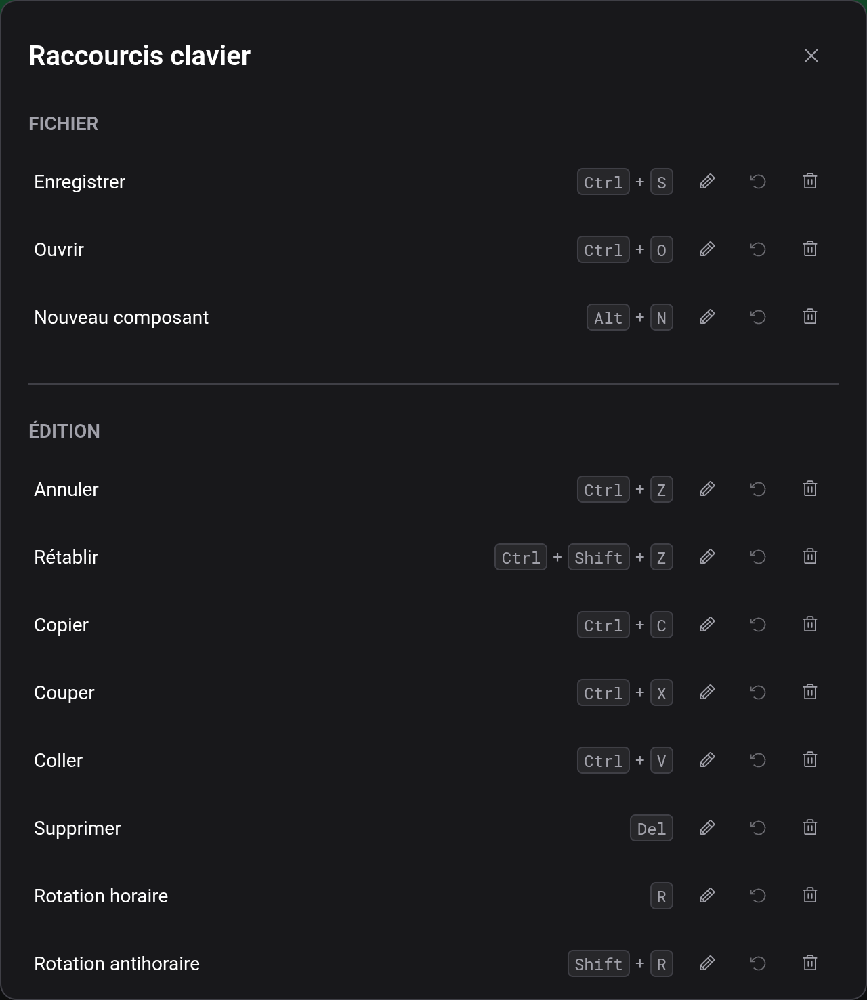

# Raccourcis clavier

Voici les raccourcis par défaut, dans l'ordre où Édition → Raccourcis clavier les liste. Sur Mac, `⌘` fonctionne partout où le tableau indique `Ctrl`, et `Ctrl` fonctionne aussi.

## Raccourcis par défaut {#default-bindings}

| Action                                                     | Par défaut     |
| ---------------------------------------------------------- | -------------- |
| Enregistrer                                                | `Ctrl+S`       |
| Ouvrir                                                     | `Ctrl+O`       |
| Nouveau composant                                          | `Alt+N`        |
| Annuler                                                    | `Ctrl+Z`       |
| Rétablir                                                   | `Ctrl+Shift+Z` |
| Copier                                                     | `Ctrl+C`       |
| Couper                                                     | `Ctrl+X`       |
| Coller                                                     | `Ctrl+V`       |
| Supprimer                                                  | `Delete`       |
| Rotation horaire                                           | `R`            |
| Rotation antihoraire                                       | `Shift+R`      |
| Déplacer la sélection vers le haut / bas / gauche / droite | flèches        |
| Zoom avant                                                 | `Ctrl++`       |
| Zoom arrière                                               | `Ctrl+-`       |
| Zoom 100 %                                                 | `Ctrl+0`       |
| Déplacement                                                | `P`            |
| Outil fil                                                  | `W`            |
| Sélectionner                                               | `S`            |
| Effacer                                                    | `E`            |
| Placer du texte                                            | `T`            |
| Couper les fils au bord de la sélection (maintenir)        | `Alt`          |
| Ajouter à la sélection ou l'en retirer (maintenir)         | `Ctrl`         |
| Déplacer la vue en faisant glisser (maintenir)             | `Space`        |
| Démarrer/Arrêter la simulation                             | `Enter`        |
| Annuler                                                    | `Escape`       |

Pendant la saisie dans un champ de texte, seul `Escape` réagit. Pendant une simulation, les raccourcis d'édition sont désactivés, et `Escape` quitte la simulation.

## Touches maintenues {#held-keys}

Les trois actions marquées « maintenir » agissent tant que la touche est enfoncée, au lieu de se déclencher une fois. Maintenez `Alt` en relâchant un cadre de sélection pour couper les fils à son bord (voir [Plan de travail et outils](docs:board-and-tools#cutting-wires-at-the-selection-edge)). Maintenez `Ctrl` en cliquant ou en traçant un cadre pour ajouter à la sélection ou en retirer. Cela fonctionne avec Sélectionner et l'outil fil. Maintenez `Space` et faites glisser avec le bouton gauche pour déplacer le plan, quel que soit l'outil ; le pointeur devient une main tant que vous la maintenez.

## Modifier un raccourci {#changing-a-binding}

Édition → Raccourcis clavier liste chaque action. Cliquez sur le crayon à côté et appuyez sur la nouvelle combinaison. `Escape` annule l'enregistrement, et ne peut donc pas être attribué à autre chose. Une touche de modification seule, comme `Alt`, ne peut être attribuée qu'aux actions maintenues.

Si la combinaison appartient déjà à une autre action, celle-ci la perd et un message indique laquelle. « Réinitialiser » rétablit le raccourci par défaut d'une action, « Désassigner » la laisse sans raccourci, et « Tout réinitialiser » rétablit tous les raccourcis par défaut.

Vos raccourcis sont enregistrés dans ce navigateur. Effacer les données du site les réinitialise.

## Touches de la manette {#gamepad-keys}

Une [manette](docs:inputs#gamepad) a ses propres touches, distinctes des raccourcis ci-dessus. Elles agissent tant que sa fenêtre a le clavier, et y passent avant les raccourcis : `Enter` appuie sur Start.

| Bouton                       | Touche par défaut |
| ---------------------------- | ----------------- |
| Haut / Bas / Gauche / Droite | flèches           |
| A                            | `X`               |
| B                            | `W`               |
| X                            | `S`               |
| Y                            | `Q`               |
| L                            | `A`               |
| R                            | `Z`               |
| Select                       | `Shift` droite    |
| Start                        | `Enter`           |

Une touche compte par sa position sur le clavier. Le tableau la nomme telle qu'elle est inscrite sur un clavier AZERTY ; sur un clavier QWERTY, B est par exemple la touche Z. Chrome et Edge affichent dans la fenêtre les touches telles que votre clavier les inscrit, les autres navigateurs celles d'un clavier QWERTY américain.

Pour modifier les touches :

1. Cliquez sur « Attribuer les touches » en bas d'une fenêtre de manette.
2. Cliquez sur un bouton, puis appuyez sur la touche qu'il doit recevoir. Si un autre bouton avait déjà cette touche, les deux échangent leurs touches et l'autre bouton s'allume brièvement.
3. Cliquez sur « Terminé » pour revenir au jeu.

Pendant l'attribution, `Escape` annule, et `Backspace` ou `Delete` laisse le bouton sans touche. `Escape` et `Tab` ne peuvent pas être attribuées. « Rétablir les valeurs par défaut » remet le tableau ci-dessus.

Les touches sont communes à toutes les manettes de tous les projets et enregistrées dans ce navigateur, comme les raccourcis. Une modification apparaît aussitôt dans chaque fenêtre de manette ouverte, y compris dans d'autres onglets.

## Touches dans la fenêtre d'un clavier {#keys-in-a-keyboard-window}

Tant que le champ de saisie de la [fenêtre d'un clavier](docs:inputs#keyboard) a le focus, les touches vont au circuit et les raccourcis ci-dessus ne font rien. Ces touches y agissent autrement :

| Touche      | Dans le champ de saisie                   |
| ----------- | ----------------------------------------- |
| `Enter`     | Envoie LF. La simulation continue.        |
| `Escape`    | Envoie ESC. La fenêtre reste ouverte.     |
| `Tab`       | Envoie TAB. Le focus reste dans le champ. |
| `Shift+Tab` | Fait sortir le focus du champ.            |
| flèches     | Envoient RT, LT, UP et DN.                |

Les combinaisons avec `Ctrl`, `Alt` ou `⌘` vont au navigateur, si bien que `Ctrl+V` colle du texte dans le clavier. `AltGr` n'en fait pas partie : un caractère tapé avec cette touche est envoyé. Une touche envoie le caractère que lui donne la disposition de votre clavier ; ces touches ne se réattribuent donc pas comme celles d'une manette.

## Voir aussi {#see-also}

- [Plan de travail et outils](docs:board-and-tools) : les outils et actions derrière ces touches
- [Simulation](docs:simulation) : ce que font Enter et Escape pendant la simulation
