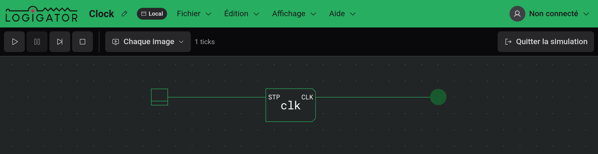
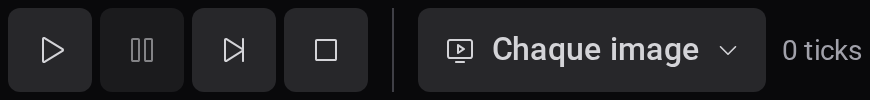
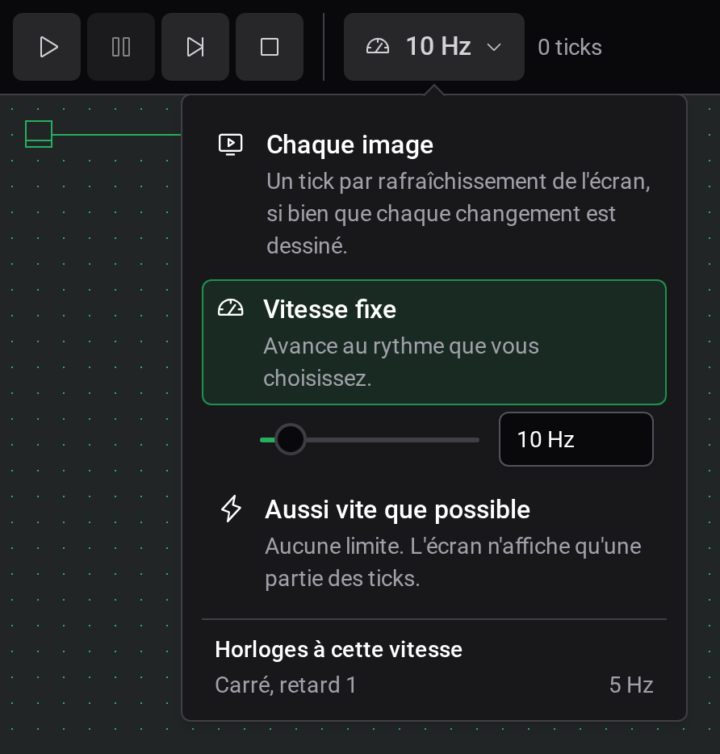
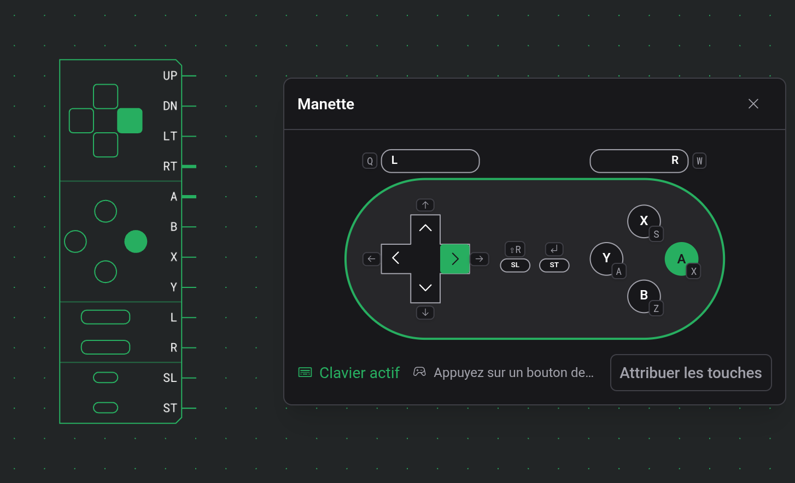
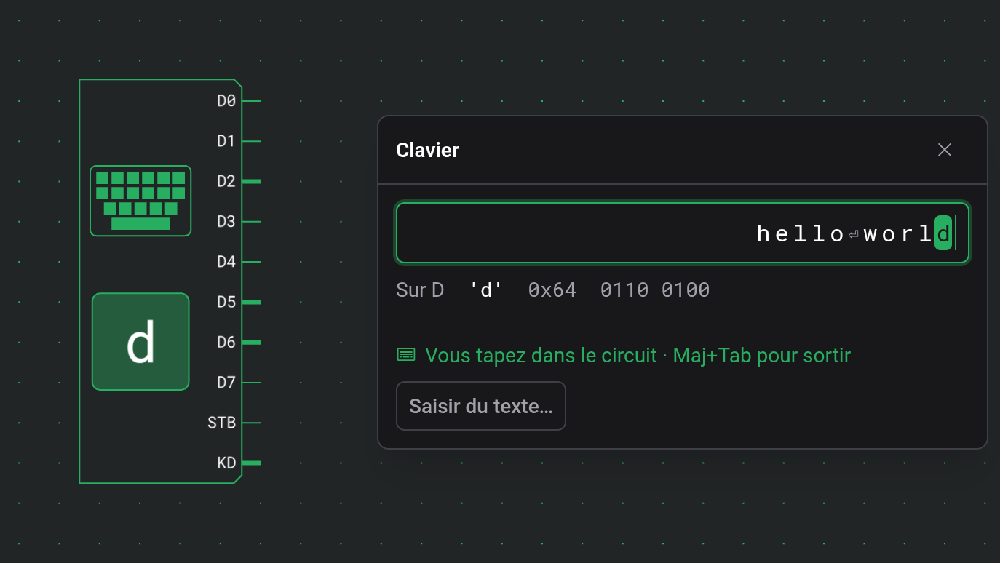

# Simulation

« Démarrer la simulation », à l'extrémité droite de la barre d'outils, met le circuit sous tension : les fils alimentés s'allument, les LED et les affichages montrent leur état, et interrupteurs et boutons répondent aux clics. `Enter` fait de même.

## Entrer et sortir

La simulation exécute toujours le projet principal. Si l'onglet d'un composant personnalisé est ouvert, l'éditeur revient d'abord au projet principal.

Pendant qu'elle tourne, le plan de travail est verrouillé. Vous pouvez déplacer la vue et zoomer, utiliser les entrées et [inspecter](docs:inspection) les ROM, les RAM, les terminaux et les composants personnalisés, mais pas placer, déplacer, câbler ou supprimer quoi que ce soit. « Quitter la simulation », `Enter` ou `Escape` ramène à l'édition avec l'outil Déplacement.

Avec « Démarrage automatique de la simulation » activé (par défaut), le circuit démarre dès que vous entrez. Désactivé, la simulation attend en pause au tick 0 pour que vous avanciez pas à pas depuis le début.

## Commandes

Pendant une simulation, la barre d'outils est remplacée par quatre boutons, le bouton de vitesse et un compteur.

| Bouton    | Effet                                                                                                      |
| --------- | ---------------------------------------------------------------------------------------------------------- |
| Exécuter  | Démarre ou reprend la simulation.                                                                          |
| Pause     | S'arrête au tick actuel et conserve l'état.                                                                |
| Pas à pas | Avance d'un tick. Disponible seulement en pause.                                                           |
| Arrêter   | Remet le circuit au tick 0, éteint tous les interrupteurs et met en pause. Vous restez dans la simulation. |

Le compteur affiche les ticks depuis le départ et, pendant l'exécution, la vitesse réellement atteinte.

## Vitesse

Le bouton de vitesse affiche le réglage actuel. Un clic ouvre un panneau avec trois modes, entre lesquels vous pouvez passer pendant l'exécution :

- Chaque image, par défaut, avance d'un tick par rafraîchissement de l'écran ; la vitesse suit donc la fréquence de votre écran.
- Vitesse fixe avance au rythme que vous choisissez, 1 kHz au départ. Le curseur va de 1 Hz à 10 MHz. Dans le champ à côté, vous pouvez taper n'importe quel rythme à partir de 0,1 Hz, par exemple `20`, `2,5k` ou `1M`. Un champ rouge signifie que la saisie n'est pas un rythme, et le dernier valide reste appliqué. Si le circuit n'arrive pas à suivre, un signe d'avertissement apparaît à côté du compteur.
- Aussi vite que possible tourne sans limite. L'écran n'affiche alors qu'une partie des ticks.

Sous les modes, « Horloges à cette vitesse » liste la fréquence de chaque sorte d'horloge du circuit. Un signal carré est inactif pendant Retard ticks puis actif aussi longtemps, donc un cycle dure 2 × Retard ticks. Une impulsion est active pendant un tick après Retard ticks d'inactivité, donc un cycle dure Retard + 1 ticks. À 10 Hz, un signal carré de retard 1 tourne à 5 Hz et un de retard 5 à 1 Hz, et une impulsion de retard 4 tourne à 2 Hz. En vitesse fixe, la liste est là tout de suite. Dans les deux autres modes, le rythme doit d'abord être mesuré, et la liste apparaît environ une seconde après le démarrage du circuit.

## Utiliser les entrées

- Un interrupteur bascule à chaque clic et reste dans la position où vous le laissez.
- Un bouton est actif tant que vous le maintenez enfoncé. Il transmet ce qui est enfoncé maintenant : si vous cliquez bien plus vite qu'une simulation lente ou en pause n'avance, il saute les appuis les plus anciens, mais votre dernier clic arrive toujours.
- Un bouton à impulsion envoie une impulsion d'un tick par clic, quelle que soit la durée de l'appui. C'est lui qui ne saute jamais de clic, quelle que soit votre avance sur la simulation.
- Une manette ouvre sa fenêtre de jeu, décrite dans la section suivante.
- Un clavier ouvre une fenêtre de saisie, décrite après la manette.

Un glisser n'importe où ailleurs sur le plan de travail déplace la vue.

## Jouer avec une manette

Un clic sur une manette ouvre une fenêtre où la manette est dessinée. Un bouton maintenu enfoncé dans cette fenêtre met sa sortie à 1 jusqu'à ce que vous le relâchiez, et s'allume aussi sur le plan de travail. Comme un bouton, la manette transmet ce qui est enfoncé maintenant et peut sauter les appuis les plus anciens quand vous avez une grande avance sur une simulation lente ou en pause, tandis que des boutons enfoncés ensemble arrivent au même tick.

La fenêtre prend le clavier à son ouverture, et la ligne du bas indique « Clavier actif ». Après un clic sur le plan de travail ou dans une autre fenêtre, elle indique « Cliquez ici pour utiliser le clavier », et les touches n'atteignent plus la manette. La touche de chaque bouton est affichée sous celui-ci. Tant que la fenêtre a le clavier, les touches de la manette passent avant les raccourcis : `Enter` appuie sur Start au lieu de quitter la simulation. `Escape` ferme toujours la fenêtre, et les raccourcis avec `Ctrl` ou `Alt` fonctionnent toujours. Les touches par défaut et la façon de les modifier sont décrites dans [Raccourcis clavier](docs:shortcuts#touches-de-la-manette).

À la souris ou au doigt, un bouton reste enfoncé tant que vous appuyez dessus, et sur un écran tactile chaque doigt tient son propre bouton. La croix directionnelle a huit directions : appuyer entre deux branches enfonce les deux, et faire glisser le pouce passe d'une direction à la suivante sans le lever. Le centre de la croix n'enfonce aucune direction.

Une manette physique branchée à votre ordinateur peut aussi jouer. Le navigateur ne signale une manette qu'après l'appui sur l'un de ses boutons pendant que l'éditeur est ouvert. Faites-le avec une fenêtre de manette ouverte : la manette physique est reliée à cette fenêtre et apparaît dans le menu Manette en bas. Une manette physique continue de jouer quand une autre fenêtre a le clavier ; deux manettes physiques peuvent donc jouer sur deux manettes à la fois, chacune choisie dans sa propre fenêtre. Les boutons sont associés par position, quelle que soit leur inscription : le bouton d'action de droite est A, celui du bas B, celui du haut X et celui de gauche Y. La croix et le stick gauche commandent tous deux la croix, LB et LT sont L, RB et RT sont R, Back ou Share est Select, et Start est Start. Les manettes que le navigateur ne signale pas avec la disposition standard figurent dans la liste mais ne peuvent pas être choisies.

Fermer la fenêtre ou quitter la simulation relâche tous les boutons. Une manette placée dans un composant personnalisé se joue depuis une [surveillance](docs:inspection#surveillances). En disposition tactile, la manette s'ouvre dans le panneau en bas de l'écran ; les touches s'y affichent dès que vous appuyez sur une touche d'un clavier, et le menu Manette dès qu'une manette physique est connectée.

## Taper sur un clavier

Un clic sur un clavier ouvre une fenêtre avec un champ de saisie en haut. Tant que ce champ a le focus, les touches sur lesquelles vous appuyez vont au circuit. Une touche enfoncée met son code sur D0 à D7, envoie une impulsion d'un tick sur STB et met KD à 1. KD reste à 1 tant que vous maintenez la touche et repasse à 0 quand vous la relâchez ; D garde le caractère jusqu'à ce que la touche suivante le remplace. Sur le plan de travail, la case du clavier affiche le caractère présent sur D et s'allume tant que KD est à 1.

Le champ montre les 64 derniers caractères envoyés, le plus récent à droite, et met en évidence celui qui est sur D tant qu'une touche est maintenue. En dessous, « Sur D » donne le code que le circuit reçoit à cet instant : le caractère, sa valeur hexadécimale et ses 8 bits. La ligne suivante indique « Vous tapez dans le circuit · Maj+Tab pour sortir » tant que le champ a le focus. Après un clic ailleurs, elle indique « Cliquez ici pour taper », et les touches n'atteignent plus le clavier jusqu'à ce que vous cliquiez de nouveau dans la fenêtre.

Une touche maintenue ne se répète pas : STB envoie une impulsion par appui. KD indique au circuit si une touche est maintenue : un circuit qui doit répéter une touche maintenue peut faire tourner une horloge tant que KD est à 1, et un circuit qui compte les appuis peut compter les impulsions sur KD. Appuyer sur une deuxième touche avant de relâcher la première met le code de la deuxième sur D, avec une nouvelle impulsion sur STB, et KD reste à 1 jusqu'à ce que vous ayez relâché les deux.

Le code est le Latin-1 : l'ASCII plus les lettres accentuées et les symboles des langues d'Europe occidentale. Les caractères imprimables, de l'espace à `~` et de `0xA0` à ÿ, sont envoyés tels quels : é arrive donc comme `0xE9`. L'espace insécable (`0xA0`) et le trait d'union conditionnel (`0xAD`) sont affichés NBS et SHY, car ils ne se voient pas. Ces touches envoient des codes de contrôle, affichés par leur nom sur le plan de travail et à côté de « Sur D » :

| Touche      | Code   | Affiché |
| ----------- | ------ | ------- |
| `Enter`     | `0x0A` | LF      |
| `Backspace` | `0x08` | BS      |
| `Tab`       | `0x09` | TAB     |
| `Escape`    | `0x1B` | ESC     |
| `Delete`    | `0x7F` | DEL     |
| `→`         | `0x1C` | RT      |
| `←`         | `0x1D` | LT      |
| `↑`         | `0x1E` | UP      |
| `↓`         | `0x1F` | DN      |
| `Home`      | `0x0B` | HOM     |

Un [terminal](#afficher-sur-un-terminal) comprend tous ces codes sauf ESC : relié à un clavier, il affiche donc ce que vous tapez.

Les touches de fonction, `End`, `Page Up`, `Page Down` et `Insert` n'envoient rien, pas plus que les flèches et `Home` quand vous maintenez `Shift`. Les guillemets typographiques et les tirets longs sont envoyés comme `'`, `"` et `-`, et … comme trois points. Tout autre caractère hors Latin-1, comme € ou un emoji, est ignoré, et la ligne du bas le signale pendant quelques secondes. Les caractères tapés avec `AltGr`, comme @ sur un clavier AZERTY, sont envoyés. Les combinaisons avec `Ctrl`, `Alt` ou `⌘` restent au navigateur. Les touches qui vont au circuit plutôt qu'à l'éditeur sont décrites dans [Raccourcis clavier](docs:shortcuts#touches-dans-la-fenêtre-d-un-clavier).

Un collage envoie le texte collé caractère par caractère. « Saisir du texte… », en bas de la fenêtre, ouvre une boîte de dialogue où vous pouvez écrire ou coller un texte plus long, un programme par exemple. Elle indique avant l'envoi combien de caractères seront ignorés. Les sauts de ligne sont envoyés comme LF et les tabulations comme TAB, les autres caractères de contrôle sont omis, et un collage ou un envoi depuis la boîte de dialogue prend jusqu'à 10 000 caractères. Chaque caractère arrive comme une touche enfoncée puis relâchée : KD est à 1 pendant trois ticks, et STB monte un tick après l'arrivée du code et redescend un tick avant que KD ne repasse à 0. Un circuit qui mémorise D quand STB monte lit donc chaque caractère, même avec une porte de plus sur le chemin de D que sur celui de STB, ou l'inverse. KD est à 0 pendant un tick après chaque caractère, si bien qu'une lettre double arrive comme deux impulsions sur KD. Tant que des caractères attendent, la fenêtre affiche « Envoi : » suivi du nombre restant, et un ✕ qui abandonne le reste. Un caractère dont l'impulsion sur STB a déjà commencé arrive quand même, et KD repasse à 0. Cela arrive aussi quand vous tapez plus vite que la simulation n'avance, à une vitesse fixe basse par exemple. Au plus 21 845 caractères peuvent attendre à la fois, et un collage ou un envoi qui ne tient pas derrière eux n'est pas envoyé du tout, pas même en partie : la fenêtre ou la boîte de dialogue vous demande plutôt de les attendre.

En pause, les touches attendent « Pas à pas ». Une touche enfoncée puis relâchée est sur D, avec KD à 1, après le pas suivant ; STB est à 1 après le deuxième et de nouveau à 0 après le troisième, et KD repasse à 0 après le quatrième, le caractère restant sur D. Le caractère suivant arrive après le cinquième ; un texte collé demande donc quatre pas par caractère.

Fermer la fenêtre, cliquer en dehors ou passer à un autre onglet relâche toutes les touches maintenues. « Arrêter » efface les caractères du champ. Pour un clavier placé dans un composant personnalisé, tapez depuis une [surveillance](docs:inspection#surveillances). Sur un téléphone ou une tablette, la fenêtre s'ouvre dans le panneau en bas de l'écran (voir [Téléphones et tablettes](docs:phones-and-tablets#simulation-et-inspection)).

## Afficher sur un terminal

Un terminal affiche un caractère chaque fois que son entrée CLK monte : celui dont le code est sur D0 à D7 à ce tick. Avec une bulle d'inversion sur CLK, il affiche sur le front descendant. Le caractère suivant s'écrit à la place du curseur en bloc, que l'écran ne montre que pendant une simulation.

Pour voir ce que vous tapez, reliez D0 à D7 d'un clavier à D0 à D7 du terminal, et sa sortie STB à CLK. `Enter` commence alors une nouvelle ligne, `Backspace` efface le caractère avant le curseur, et les flèches et `Home` déplacent le curseur.

Les codes sont en Latin-1, comme sur le clavier. Les codes de l'espace à `~` et de `0xA0` à ÿ s'affichent comme leur caractère : `0x41` affiche A et `0xE9` affiche é. L'espace insécable s'affiche comme une espace et le trait d'union conditionnel comme un trait d'union. Ces codes de contrôle déplacent le curseur ou effacent :

| Code   | Nom | Effet                                                                                                       |
| ------ | --- | ----------------------------------------------------------------------------------------------------------- |
| `0x08` | BS  | Recule d'une colonne et efface le caractère qui s'y trouve. Sans effet dans la première colonne.            |
| `0x09` | TAB | Avance jusqu'au taquet de tabulation suivant, un toutes les 8 colonnes, ou jusqu'à la dernière colonne.     |
| `0x0A` | LF  | Passe au début de la ligne suivante. Sur la dernière ligne, l'écran défile plutôt d'une ligne vers le haut. |
| `0x0B` | HOM | Va au coin supérieur gauche.                                                                                |
| `0x0C` | FF  | Efface l'écran et va au coin supérieur gauche. Les lignes effacées ne vont pas dans l'historique.           |
| `0x0D` | CR  | Revient au début de la ligne.                                                                               |
| `0x1C` | RT  | Avance d'une colonne vers la droite.                                                                        |
| `0x1D` | LT  | Recule d'une colonne vers la gauche.                                                                        |
| `0x1E` | UP  | Monte d'une ligne.                                                                                          |
| `0x1F` | DN  | Descend d'une ligne.                                                                                        |
| `0x7F` | DEL | Efface le caractère sous le curseur. Le curseur ne bouge pas.                                               |

RT, LT, UP et DN s'arrêtent aux bords de l'écran ; seul LF fait défiler. Tout autre code, dont ESC et `0x80` à `0x9F`, est ignoré.

Un caractère affiché dans la dernière colonne y laisse le curseur, et le caractère suivant va au début de la ligne suivante, l'écran défilant si le curseur était sur la dernière ligne. Une ligne pleine suivie de LF ne laisse donc pas de ligne vide. Un code qui déplace le curseur annule ce retour à la ligne : un BS juste après la dernière colonne efface le caractère qui y est affiché.

Une ligne qui sort de l'écran par le haut va dans l'historique telle qu'elle était, et les codes de déplacement ne peuvent plus la modifier. L'historique garde les 10 000 dernières lignes et s'affiche dans la [fenêtre](docs:inspection#sortie-d-un-terminal) du terminal. « Pause » garde le texte à l'écran et dans l'historique. « Arrêter » efface les deux, tout comme quitter la simulation.

## Signaux en conflit

Un fil dessiné en orange signale un conflit. Il y a deux causes :

- Deux sorties ou plus pilotent le même fil, et à ce moment l'une est à 1 et une autre à 0. Des sorties qui donnent la même valeur ne sont pas marquées, si bien que l'orange peut apparaître et disparaître quand les valeurs changent.
- Une bascule SR a reçu un front d'horloge avec S et R tous deux à 1. Q passe à 1 et !Q à 0, et les deux restent en orange jusqu'à un front d'horloge où seul S ou seul R est à 1.

La simulation continue sans changement : un fil relié à plusieurs sorties est à 1 dès que l'une d'elles est à 1. L'orange est une indication sur votre circuit. Sur du matériel réel, le premier cas serait un court-circuit, et le second est une combinaison d'entrées qu'une bascule SR n'admet pas.

Pour le premier cas, ne reliez qu'une seule sortie à chaque fil. Pour combiner plusieurs sources, faites-les passer par une porte OU, et pour en choisir une, utilisez un multiplexeur. Pour une bascule SR, ne mettez pas S et R à 1 en même temps, ou utilisez plutôt une bascule D ou JK.

Un conflit à l'intérieur d'un composant personnalisé n'apparaît pas sur le plan de travail. Cliquez sur le composant pour ouvrir une [surveillance](docs:inspection#surveillances), où ses fils le montrent.

Le paramètre « Mettre en évidence les conflits », activé par défaut, désactive ce marquage en orange. Voir [Paramètres](docs:settings).

## Quand la simulation ne démarre pas

L'éditeur refuse de démarrer et affiche un message nommant le composant quand :

- un composant personnalisé se contient lui-même, directement ou via un autre,
- un composant personnalisé ne contient aucun circuit,
- les ports d'un composant personnalisé ne correspondent plus aux fiches Entrée et Sortie de son circuit.

Corrigez le composant nommé et relancez. Si le message indique que le moteur de simulation n'a pas pu démarrer, votre navigateur ne prend pas en charge WebAssembly.

## Voir aussi

- [Inspection et surveillances](docs:inspection) : contenu des ROM et des RAM, sortie des terminaux, et surveillances
- [Composants et options](docs:components-and-options) : ce que fait chaque entrée et affichage
- [Paramètres](docs:settings) : le démarrage automatique de la simulation et la mise en évidence des conflits
- [Téléphones et tablettes](docs:phones-and-tablets) : les commandes en disposition tactile
